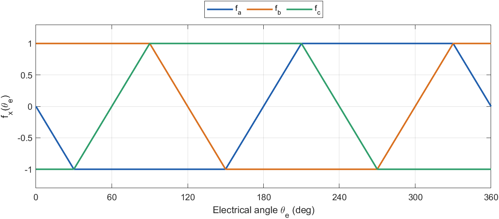

# Mô hình toán học động cơ BLDC có sức phản điện động hình thang

**Tài liệu 01** trong bộ tài liệu lý thuyết của đề tài *Điều khiển định hướng từ trường cho động cơ BLDC có sức phản điện động hình thang*.

| Tài liệu | Nội dung |
|---|---|
| **01 – Mô hình toán học động cơ BLDC** (tài liệu này) | Chương 2 |
| [02 – Mô hình BLDC trên hệ tọa độ quay](02_dq_model.md) | Chương 3 |
| [03 – Thiết kế FOC và FOC thông thường](03_FOC_conventional.md) | Chương 4, 5 và mô hình Simulink FOC thông thường |
| [04 – FOC bù back-EMF hình thang](04_FOC_compensated.md) | Chương 6 và mô hình Simulink FOC bù |
| [05 – Mô phỏng và so sánh](05_simulation_results.md) | Chương 7 |
| [06 – Điều khiển six-step và so sánh ba bộ điều khiển](06_six_step.md) | Chương 8 và mô hình Simulink six-step |
| [07 – Điều khiển giả vector (PVC)](07_pseudo_vector_control.md) | Chương 9 và mô hình Simulink PVC |

---

## Tóm tắt

Tài liệu xây dựng mô hình toán học của động cơ một chiều không chổi than (BLDC) ba pha trong hệ tọa độ pha $abc$: phương trình điện áp, sức phản điện động (back-EMF) dạng hình thang với đỉnh phẳng 120°, khai triển Fourier của back-EMF và từ thông thành phần cơ bản, biểu thức mô-men điện từ và phương trình chuyển động cơ. Phần cuối đối chiếu mô hình với khối Permanent Magnet Synchronous Machine (back-EMF hình thang) của Simscape Electrical được dùng trong các mô hình Simulink của đề tài. Mô hình này là cơ sở cho việc chuyển sang hệ tọa độ quay ở Tài liệu 02.

**Từ khóa:** động cơ BLDC; back-EMF hình thang; khai triển Fourier; mô-men điện từ; Simscape Electrical.

---

## Mục lục

- [Danh mục ký hiệu](#danh-mục-ký-hiệu)
- [2. Mô hình toán học động cơ BLDC](#2-mô-hình-toán-học-động-cơ-bldc)
  - [2.1. Phương trình điện áp](#21-phương-trình-điện-áp)
  - [2.2. Sức phản điện động hình thang](#22-sức-phản-điện-động-hình-thang)
  - [2.3. Mô-men điện từ và phương trình cơ](#23-mô-men-điện-từ-và-phương-trình-cơ)
  - [2.4. Tương ứng với khối PMSM trong Simulink](#24-tương-ứng-với-khối-pmsm-trong-simulink)
- [Tài liệu tham khảo](#tài-liệu-tham-khảo)

---

## Danh mục ký hiệu

| Ký hiệu | Ý nghĩa | Đơn vị |
|---|---|---|
| $v_x,\ i_x,\ e_x$ | điện áp, dòng điện, back-EMF pha $x\in\{a,b,c\}$ | V, A, V |
| $v_n$ | điện áp điểm trung tính | V |
| $R$ | điện trở một pha | Ω |
| $L_s,\ M,\ L$ | điện cảm riêng, hỗ cảm, điện cảm đồng bộ $L = L_s - M$ | H |
| $\lambda$ | biên độ từ thông nam châm (ứng với đỉnh phẳng back-EMF) | Wb |
| $\lambda_1$ | từ thông thành phần cơ bản, $\lambda_1 = b_1\lambda$ | Wb |
| $p$ | số đôi cực | – |
| $\omega_m,\ \omega_e = p\,\omega_m$ | tốc độ cơ, tốc độ điện | rad/s |
| $\theta_m,\ \theta_e = p\,\theta_m$ | góc cơ, góc điện của rotor | rad |
| $F(\theta)$ | hàm hình thang chuẩn hóa (biên độ 1, đỉnh phẳng 120°) | – |
| $f_x(\theta_e)$ | dạng back-EMF chuẩn hóa của pha $x$ | – |
| $b_n$ | hệ số Fourier bậc $n$ của $F$ | – |
| $T_e,\ T_L$ | mô-men điện từ, mô-men tải | N·m |
| $J,\ B$ | mô-men quán tính, hệ số ma sát nhớt | kg·m², N·m·s/rad |

---

## 2. Mô hình toán học động cơ BLDC

### 2.1. Phương trình điện áp

Xét động cơ BLDC ba pha nối sao, stator đối xứng, rotor nam châm bề mặt (điện cảm không phụ thuộc góc) [1]–[3]. Với mỗi pha $x\in\{a,b,c\}$:

$$
v_x = R\,i_x + L\,\frac{di_x}{dt} + e_x + v_n, \qquad i_a+i_b+i_c = 0, \tag{2.1}
$$

trong đó $v_x$ là điện áp từ đầu pha tới cực âm nguồn DC, $v_n$ là điện áp điểm trung tính, và $L = L_s - M$ là điện cảm đồng bộ (điện cảm riêng trừ hỗ cảm). Điều kiện $i_a+i_b+i_c=0$ (nối sao, không dây trung tính) cho phép gộp hỗ cảm vào $L$.

### 2.2. Sức phản điện động hình thang

Back-EMF tỉ lệ với tốc độ và có dạng phụ thuộc góc rotor:

$$
e_x = \omega_e\,\lambda\, f_x(\theta_e), \qquad
f_a = -F(\theta_e),\quad f_b = -F\!\left(\theta_e - \tfrac{2\pi}{3}\right),\quad f_c = -F\!\left(\theta_e + \tfrac{2\pi}{3}\right). \tag{2.2}
$$

Với BLDC lý tưởng, $F$ là hình thang có **đỉnh phẳng 120°** và **sườn tuyến tính 60°**, biên độ 1; gốc góc của $F$ chọn tại điểm giữa sườn lên, nên $F(\theta) \approx b_1\sin\theta$. Góc điện $\theta_e$ được đo từ trục pha $a$ tới hướng từ thông nam châm (trục $d$ ở Tài liệu 02). Tại $\theta_e = 0$, từ thông móc vòng pha $a$ cực đại nên $e_a = d\psi_a/dt$ đi qua 0 theo chiều giảm; đó là lý do có dấu trừ trong (2.2), giống động cơ sin với $\psi_a = \lambda\cos\theta_e$ và $e_a = -\omega_e\lambda\sin\theta_e$.

Khi chỉ hai pha dẫn (chế độ 6 bước), dòng chạy qua đúng hai pha đang ở đỉnh phẳng nên mô-men không đổi; đó là lý do BLDC được thiết kế với back-EMF hình thang.



*Hình 2.1. Back-EMF chuẩn hóa của ba pha theo (2.2): đỉnh phẳng 120°, sườn 60°, lệch nhau 120°. Trong mô hình, $e_x = \omega_e\lambda f_x$.*

Hàm $F$ được hiện thực trong `bldc_trap.m` (thư mục `03_Simulation/Common`, dùng chung cho mọi bộ điều khiển):

```matlab
function y = bldc_trap(x)
x = mod(x, 2*pi); a = pi/6;
y = zeros(size(x));
k = x < a;                        y(k) = x(k)/a;          % sườn lên
k = x >= a & x <= pi - a;         y(k) = 1;               % đỉnh phẳng dương
k = x > pi - a & x < pi + a;      y(k) = (pi - x(k))/a;   % sườn xuống
k = x >= pi + a & x <= 2*pi - a;  y(k) = -1;              % đỉnh phẳng âm
k = x > 2*pi - a;                 y(k) = (x(k) - 2*pi)/a; % sườn lên
end
```

**Thành phần cơ bản.** Khai triển Fourier hình thang có đỉnh phẳng 120° (nửa sườn $a=\pi/6$) chỉ chứa các bậc lẻ:

$$
F(\theta) = \sum_{n=1,5,7,11,\dots} b_n \sin(n\theta),\qquad
b_n = \frac{4}{\pi}\,\frac{\sin(n a)}{n^2 a},\qquad
b_1 = \frac{4}{\pi}\cdot\frac{\sin(\pi/6)}{\pi/6} = \frac{12}{\pi^2} \approx 1{,}2158. \tag{2.3}
$$

Bậc 3 và bội của 3 triệt tiêu giữa các dây (nối sao), nên các bậc còn lại là $5, 7, 11, 13,\dots$ Trên hệ tọa độ quay, các bậc $6k \pm 1$ này tạo ra dao động bậc 6 (Tài liệu 02, mục 3.4). Từ thông **cơ bản** được định nghĩa:

$$
\lambda_1 = b_1\,\lambda = 1{,}2158 \times 0{,}171 = 0{,}2079\ \text{Wb}. \tag{2.4}
$$

Thành phần cơ bản lớn hơn biên độ đỉnh phẳng 21,6 %; cần lưu ý điểm này khi sử dụng mô hình sin cho BLDC (FOC thông thường dùng $\lambda_1$, Tài liệu 03).

### 2.3. Mô-men điện từ và phương trình cơ

Công suất điện chuyển thành cơ là $\sum e_x i_x$, nên

$$
T_e = \frac{e_a i_a + e_b i_b + e_c i_c}{\omega_m} = p\,\lambda\,\big(f_a i_a + f_b i_b + f_c i_c\big), \tag{2.5}
$$

$$
J\,\frac{d\omega_m}{dt} = T_e - T_L - B\,\omega_m, \qquad \frac{d\theta_m}{dt} = \omega_m, \qquad \theta_e = p\,\theta_m . \tag{2.6}
$$

> **Ghi chú – Mô-men ở chế độ 6 bước.**
> Ở chế độ 6 bước, tại mỗi thời điểm có hai pha dẫn dòng $\pm I$ và cả hai đang ở đỉnh phẳng $f = \pm 1$. Theo (2.5), $T_e = p\lambda(1\cdot I + 1\cdot I) = 2p\lambda\, I$, không phụ thuộc góc. Gợn mô-men thực tế của phương pháp 6 bước đến từ quá trình chuyển dòng giữa các pha [4]. Với FOC, dòng ba pha liên tục nên mô-men phụ thuộc vào toàn bộ dạng $f_x$, kể cả các sườn; đây là nguồn gốc của gợn mô-men được phân tích ở Tài liệu 03.

### 2.4. Tương ứng với khối PMSM trong Simulink

Trong các mô hình `Conventional_FOC.slx` và `Compensated_FOC.slx`, động cơ được mô phỏng bằng khối *Permanent Magnet Synchronous Machine* (Simscape Electrical – Specialized Power Systems) với back-EMF hình thang. Khối này hiện thực đúng mô hình (2.1)–(2.6).

*Bảng 2.1. Thông số động cơ và cách khai báo trong khối PMSM.*

| Thông số | Ký hiệu | Giá trị | Khai báo trong khối |
|---|---|---|---|
| Dạng back-EMF | – | hình thang | Back EMF waveform = Trapezoidal |
| Độ rộng đỉnh phẳng | – | 120° | Flat area of the back EMF waveform = 120 |
| Kiểu rotor | – | rotor tròn (nam châm bề mặt) | Rotor type = Round |
| Điện trở pha | $R$ | 0,4578 Ω | `P.R` |
| Điện cảm đồng bộ | $L$ | 3,33 mH | `P.L` |
| Từ thông nam châm | $\lambda$ | 0,171 Wb | Flux linkage established by magnets = `P.lam` |
| Mô-men quán tính, ma sát, số đôi cực | $J$, $B$, $p$ | 1,469·10⁻³ kg·m², 3,035·10⁻⁴ N·m·s/rad, 8 | `[P.J P.B P.p 0]` |
| Đầu vào cơ | $T_L$ | – | Mechanical input = Torque Tm |

Hai hằng số mà khối tự tính từ các thông số trên khớp với mô hình:

- **Hằng số điện áp** (đỉnh dây, mỗi 1000 vòng/phút) bằng 286,5 V. Theo (2.2), đỉnh phẳng back-EMF pha là $\omega_e\lambda$, và điện áp dây đỉnh bằng hai lần giá trị đó khi hai pha ở hai đỉnh ngược dấu: $2\,p\,\lambda\,\omega_m = 2\times 8\times 0{,}171\times(1000\cdot 2\pi/60) = 286{,}5$ V.
- **Hằng số mô-men** bằng 2,736 N·m/A, đúng bằng $2p\lambda = 2\times 8\times 0{,}171$ của chế độ 6 bước (ghi chú mục 2.3).

Khối PMSM đo góc rotor theo quy ước riêng (*rotor flux position when θ = 0: 90° behind phase A axis*). Vì vậy góc điện dùng trong bộ điều khiển phải cộng thêm độ lệch `THETA_OFF` $= -\pi/2$; xem Tài liệu 02, mục 3.5 và Tài liệu 03, mục 5.3.4.

---

## Tài liệu tham khảo

1. P. Pillay and R. Krishnan, "Modeling, simulation, and analysis of permanent-magnet motor drives, Part II: The brushless DC motor drive," *IEEE Trans. Ind. Appl.*, vol. 25, no. 2, pp. 274–279, 1989.
2. C.-M. Ong, *Dynamic Simulation of Electric Machinery Using MATLAB/SIMULINK*. Upper Saddle River, NJ, USA: Prentice Hall, 1997.
3. R. Krishnan, *Permanent Magnet Synchronous and Brushless DC Motor Drives*. Boca Raton, FL, USA: CRC Press, 2010.
4. R. Carlson, M. Lajoie-Mazenc, and J. C. dos S. Fagundes, "Analysis of torque ripple due to phase commutation in brushless DC machines," *IEEE Trans. Ind. Appl.*, vol. 28, no. 3, pp. 632–638, 1992.
