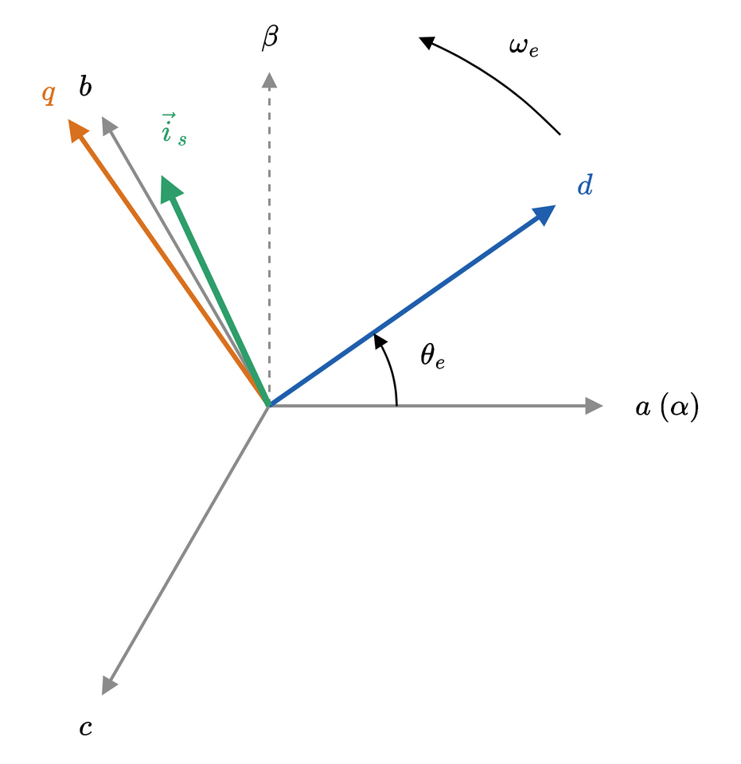
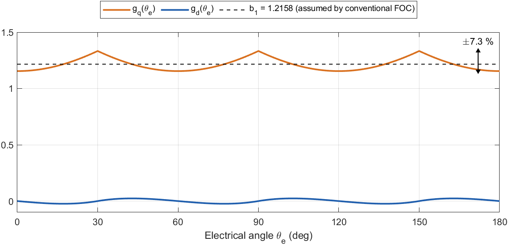

# Mô hình động cơ BLDC trên hệ tọa độ quay

**Tài liệu 02** trong bộ tài liệu lý thuyết của đề tài *Điều khiển định hướng từ trường cho động cơ BLDC có sức phản điện động hình thang*.

| Tài liệu | Nội dung |
|---|---|
| [01 – Mô hình toán học động cơ BLDC](01_BLDC_model.md) | Chương 2 |
| **02 – Mô hình BLDC trên hệ tọa độ quay** (tài liệu này) | Chương 3 |
| [03 – Thiết kế FOC và FOC thông thường](03_FOC_conventional.md) | Chương 4, 5 và mô hình Simulink FOC thông thường |
| [04 – FOC bù back-EMF hình thang](04_FOC_compensated.md) | Chương 6 và mô hình Simulink FOC bù |
| [05 – Mô phỏng và so sánh](05_simulation_results.md) | Chương 7 |
| [06 – Điều khiển six-step và so sánh ba bộ điều khiển](06_six_step.md) | Chương 8 và mô hình Simulink six-step |

---

## Tóm tắt

Điều khiển định hướng từ trường (FOC) điều khiển dòng điện trong một hệ trục quay cùng rotor. Tài liệu trình bày biến đổi Clarke ($abc\to\alpha\beta$) và Park ($\alpha\beta\to dq$), từ đó viết lại mô hình BLDC của Tài liệu 01 trên hệ $dq$. Khác với động cơ có back-EMF hình sin, back-EMF hình thang khi chiếu lên hệ $dq$ không còn là hằng số mà được mô tả bằng hai hàm $g_d(\theta_e)$, $g_q(\theta_e)$ dao động bậc 6 quanh giá trị trung bình. Khoảng dao động của $g_q$ (±7,3 %) là nguồn gốc của gợn mô-men khi áp dụng FOC thông thường cho BLDC. Phần cuối đối chiếu các phép biến đổi với các khối trong mô hình Simulink.

**Từ khóa:** biến đổi Clarke; biến đổi Park; hệ tọa độ quay; back-EMF hình thang; dao động bậc 6.

---

## Mục lục

- [Danh mục ký hiệu](#danh-mục-ký-hiệu)
- [Nhắc lại các kết quả từ Tài liệu 01](#nhắc-lại-các-kết-quả-từ-tài-liệu-01)
- [3. Mô hình động cơ BLDC trên hệ tọa độ quay](#3-mô-hình-động-cơ-bldc-trên-hệ-tọa-độ-quay)
  - [3.1. Biến đổi Clarke ($abc\to\alpha\beta$)](#31-biến-đổi-clarke-abcto-alphabeta)
  - [3.2. Biến đổi Park ($\alpha\beta\to dq$)](#32-biến-đổi-park-alphabetato-dq)
  - [3.3. Mô hình BLDC trong hệ $dq$](#33-mô-hình-bldc-trong-hệ-dq)
  - [3.4. So sánh với động cơ có back-EMF hình sin](#34-so-sánh-với-động-cơ-có-back-emf-hình-sin)
  - [3.5. Tương ứng trong mô hình Simulink](#35-tương-ứng-trong-mô-hình-simulink)
- [Tài liệu tham khảo](#tài-liệu-tham-khảo)

---

## Danh mục ký hiệu

| Ký hiệu | Ý nghĩa | Đơn vị |
|---|---|---|
| $x_a, x_b, x_c$ | đại lượng pha (điện áp, dòng điện, back-EMF, …) | – |
| $x_\alpha, x_\beta$ | đại lượng trên hệ trục tĩnh $\alpha\beta$ | – |
| $x_d, x_q$ | đại lượng trên hệ trục quay $dq$ gắn với rotor | – |
| $\theta_e,\ \omega_e$ | góc điện và tốc độ điện của rotor | rad, rad/s |
| $\vec i_s$ | vector không gian dòng stator | A |
| $f_\alpha, f_\beta$ | back-EMF chuẩn hóa trên hệ $\alpha\beta$ | – |
| $g_d(\theta_e),\ g_q(\theta_e)$ | back-EMF chuẩn hóa trên hệ $dq$ (hình chiếu của $f_{abc}$) | – |
| $b_1$ | hệ số Fourier bậc 1 của back-EMF hình thang, $12/\pi^2$ | – |
| $f_e,\ f_6$ | tần số điện, tần số dao động bậc 6 ($f_6 = 6 f_e$) | Hz |

Các ký hiệu khác ($R$, $L$, $\lambda$, $\lambda_1$, $p$, …) giống Tài liệu 01.

---

## Nhắc lại các kết quả từ Tài liệu 01

- Phương trình điện áp pha (2.1): $\ v_x = R\,i_x + L\,\dfrac{di_x}{dt} + e_x + v_n,\quad i_a+i_b+i_c = 0.$
- Back-EMF hình thang (2.2): $\ e_x = \omega_e\lambda f_x(\theta_e)$ với $f_a = -F(\theta_e)$, $f_b = -F(\theta_e - 2\pi/3)$, $f_c = -F(\theta_e + 2\pi/3)$; $F$ là hình thang đỉnh phẳng 120°, biên độ 1.
- Hệ số Fourier bậc 1 và từ thông cơ bản (2.3), (2.4): $\ b_1 = 12/\pi^2 \approx 1{,}2158$, $\ \lambda_1 = b_1\lambda$.
- Mô-men điện từ (2.5): $\ T_e = p\,\lambda\,(f_a i_a + f_b i_b + f_c i_c).$

---

## 3. Mô hình động cơ BLDC trên hệ tọa độ quay

FOC điều khiển dòng điện trong một hệ trục **quay cùng rotor**. Trong hệ trục này, với động cơ sin, các đại lượng xoay chiều trở thành một chiều, và bộ PI có thể điều khiển chúng không sai lệch tĩnh [1].

*Hình 3.1. Hệ trục pha $abc$, hệ trục tĩnh $\alpha\beta$ và hệ trục quay $dq$ gắn với rotor. Trục $d$ trùng hướng từ thông nam châm, trục $q$ vượt trước 90°; FOC đặt $\vec i_s$ gần như trùng trục $q$ ($i_d = 0$).*

### 3.1. Biến đổi Clarke ($abc\to\alpha\beta$)

Sử dụng dạng bất biến biên độ (hệ số $2/3$) [1]:

$$
\begin{bmatrix} x_\alpha \\ x_\beta \end{bmatrix}
= \frac{2}{3}\begin{bmatrix} 1 & -\tfrac12 & -\tfrac12 \\ 0 & \tfrac{\sqrt3}{2} & -\tfrac{\sqrt3}{2} \end{bmatrix}
\begin{bmatrix} x_a \\ x_b \\ x_c \end{bmatrix},
\qquad
\begin{bmatrix} x_a \\ x_b \\ x_c \end{bmatrix}
= \begin{bmatrix} 1 & 0 \\ -\tfrac12 & \tfrac{\sqrt3}{2} \\ -\tfrac12 & -\tfrac{\sqrt3}{2} \end{bmatrix}
\begin{bmatrix} x_\alpha \\ x_\beta \end{bmatrix}. \tag{3.1}
$$

Với hệ số $2/3$, biên độ vector $\alpha\beta$ bằng biên độ đại lượng pha; đổi lại công suất có hệ số $3/2$: $P = \tfrac32 (v_\alpha i_\alpha + v_\beta i_\beta)$. Phép biến đổi ngược ở (3.1) đúng khi thành phần thứ tự không bằng 0, điều luôn thỏa với dòng điện do $i_a+i_b+i_c=0$.

### 3.2. Biến đổi Park ($\alpha\beta\to dq$)

$$
\begin{bmatrix} x_d \\ x_q \end{bmatrix}
= \begin{bmatrix} \cos\theta_e & \sin\theta_e \\ -\sin\theta_e & \cos\theta_e \end{bmatrix}
\begin{bmatrix} x_\alpha \\ x_\beta \end{bmatrix},
\qquad
\begin{bmatrix} x_\alpha \\ x_\beta \end{bmatrix}
= \begin{bmatrix} \cos\theta_e & -\sin\theta_e \\ \sin\theta_e & \cos\theta_e \end{bmatrix}
\begin{bmatrix} x_d \\ x_q \end{bmatrix}. \tag{3.2}
$$

Ma trận Park là ma trận quay trực chuẩn, nên tích vô hướng được bảo toàn: $x_\alpha y_\alpha + x_\beta y_\beta = x_d y_d + x_q y_q$.

### 3.3. Mô hình BLDC trong hệ $dq$

Áp dụng (3.1)–(3.2) cho (2.1) (thành phần $v_n$ là thứ tự không nên biến mất), và dùng $\frac{d}{dt}\mathbf{P}(\theta_e) = \omega_e\,\frac{d\mathbf{P}}{d\theta_e}$, ta được [3], [4]:

$$
v_d = R\,i_d + L\frac{di_d}{dt} - \omega_e L\, i_q + e_d, \tag{3.3}
$$

$$
v_q = R\,i_q + L\frac{di_q}{dt} + \omega_e L\, i_d + e_q. \tag{3.4}
$$

Các số hạng $\mp\omega_e L\, i_{q,d}$ là **ghép chéo** giữa hai trục. Back-EMF trên hệ $dq$ là hình chiếu của (2.2):

$$
e_d = \omega_e\lambda\, g_d(\theta_e), \qquad e_q = \omega_e\lambda\, g_q(\theta_e), \tag{3.5}
$$

$$
\boxed{\;
\begin{aligned}
f_\alpha &= \tfrac23\big(f_a - \tfrac12 f_b - \tfrac12 f_c\big), &\quad f_\beta &= \tfrac{1}{\sqrt3}\big(f_b - f_c\big),\\
g_d(\theta_e) &= \cos\theta_e\, f_\alpha + \sin\theta_e\, f_\beta, &\quad g_q(\theta_e) &= -\sin\theta_e\, f_\alpha + \cos\theta_e\, f_\beta .
\end{aligned}\;} \tag{3.6}
$$

Mô-men (2.5) viết lại trên hệ $dq$ (hệ số $3/2$ do Clarke bất biến biên độ, và Park bảo toàn tích vô hướng):

$$
T_e = \frac32\,p\,\lambda\,\big(g_d(\theta_e)\, i_d + g_q(\theta_e)\, i_q\big). \tag{3.7}
$$

### 3.4. So sánh với động cơ có back-EMF hình sin

- **Động cơ sin (PMSM):** $f_x$ là sin, khi đó $g_d \equiv 0$ và $g_q \equiv 1$ (với $\lambda$ là biên độ sin). Back-EMF trên hệ $dq$ là hằng số và $T_e = \tfrac32 p\lambda i_q$, tức mô-men tỉ lệ thẳng với $i_q$.
- **Động cơ hình thang (BLDC):** $g_d$, $g_q$ **dao động theo góc** với chu kỳ $\pi/3$ (60° điện, tức bậc 6), Hình 3.2. Giá trị trung bình $\overline{g_q} = b_1 = 1{,}2158$, $\overline{g_d}=0$, nhưng:

$$
g_q(\theta_e) \in \Big[\tfrac{2}{\sqrt3},\ \tfrac43\Big] = [1{,}1547;\ 1{,}3333], \qquad g_d(\theta_e)\in[-0{,}0237;\ 0{,}0237]. \tag{3.8}
$$

Biên độ dao động của $g_q$ là $\tfrac12\big(\tfrac43 - \tfrac{2}{\sqrt3}\big)/b_1 \approx 7{,}3\,\%$ so với giá trị trung bình. Nguyên nhân: các bậc điều hòa $6k\pm1$ của back-EMF (bậc 5, 7, 11, 13, … ở (2.3)) quay với tốc độ $(6k\pm1)\omega_e$ trong hệ tĩnh, nên khi nhìn từ hệ quay với tốc độ $\omega_e$ chúng trở thành dao động tần số $6k\,\omega_e$ [2].

*Hình 3.2. Hình chiếu của back-EMF hình thang lên hệ $dq$ (tính theo (3.6)). $g_q$ dao động quanh $b_1$ với chu kỳ 60° điện, $g_d$ rất nhỏ.*

> **Ghi chú – Tần số của dao động bậc 6.**
> Ở tốc độ cơ $n$ (vòng/phút), tần số điện $f_e = p\,n/60$ và dao động trên hệ $dq$ có tần số $f_6 = 6 f_e$. Với động cơ này ($p=8$) tại 100 vòng/phút: $f_e = 13{,}3$ Hz, $f_6 = 80$ Hz, $\omega_e = 83{,}8$ rad/s.

Hệ quả cho điều khiển: nếu bộ điều khiển giả thiết $g_q$ là hằng số $b_1$ (như động cơ sin), phần dao động $g_q - b_1$ vừa tác động như một nhiễu điện áp bậc 6 lên vòng dòng, vừa làm mô-men dao động theo (3.7) ngay cả khi $i_q$ phẳng. Hai cơ chế này được phân tích định lượng ở Tài liệu 03, mục 5.2, và được khắc phục bằng FOC bù ở Tài liệu 04.

### 3.5. Tương ứng trong mô hình Simulink

*Bảng 3.1. Các phép biến đổi của chương này trong mô hình Simulink.*

| Công thức | Vị trí trong mô hình | Hiện thực |
|---|---|---|
| Clarke thuận (3.1) | khối `abc_to_dq` | Gain với ma trận `P.Kc` = $\tfrac23\begin{bmatrix}1 & -\frac12 & -\frac12\\ 0 & \frac{\sqrt3}{2} & -\frac{\sqrt3}{2}\end{bmatrix}$ |
| Park thuận (3.2) | khối `abc_to_dq` | 4 phép nhân với $\cos\theta_e$, $\sin\theta_e$ và 2 bộ cộng |
| Park ngược (3.2) | khối `SVPWM` | 4 phép nhân và 2 bộ cộng, cho $u_\alpha$, $u_\beta$ |
| Clarke ngược (3.1) | khối `SVPWM` | Gain với ma trận `P.Kic` |
| $g_d$, $g_q$ theo (3.6) | `comp_foc_init.m` (chỉ FOC bù) | Tính sẵn trên một chu kỳ $[0, \pi/3)$, lưu vào bảng tra `TAB.gd`, `TAB.gq` |
| Góc điện $\theta_e$ | tầng ngoài cùng: `p_th`, `theta_off`, `theta_e` | $\theta_e = p\,\theta_m + \texttt{THETA\_OFF}$ |

Ảnh các khối `abc_to_dq` và `SVPWM` xem Tài liệu 03, Hình 5.5 và 5.6.

**Quy ước góc và `THETA_OFF`.** Các công thức trong bộ tài liệu dùng $\theta_e$ đo từ trục pha $a$ tới trục $d$ (hướng từ thông nam châm), như Hình 3.1. Khối PMSM của Simscape lại báo góc rotor theo quy ước *"rotor flux position when θ = 0: 90° behind phase A axis"*, tức lệch $\pi/2$ so với quy ước trên. Vì vậy mô hình cộng thêm `THETA_OFF` $= -\pi/2$ vào $p\,\theta_m$ trước khi dùng cho Park, Park ngược và bảng tra. Giá trị này đã được kiểm chứng bằng mô phỏng: với `THETA_OFF` $= -\pi/2$, $i_d$ dao động quanh 0, mô-men trung bình bằng mô-men tải, và khi quét thêm độ lệch bảng tra `TAB_SHIFT` trong ±15°, giá trị tối ưu là 0° (Tài liệu 04, mục 6.7.4).

---

## Tài liệu tham khảo

1. B. K. Bose, *Modern Power Electronics and AC Drives*. Upper Saddle River, NJ, USA: Prentice Hall, 2002.
2. T. M. Jahns and W. L. Soong, "Pulsating torque minimization techniques for permanent magnet AC motor drives — A review," *IEEE Trans. Ind. Electron.*, vol. 43, no. 2, pp. 321–330, 1996.
3. C.-M. Ong, *Dynamic Simulation of Electric Machinery Using MATLAB/SIMULINK*. Upper Saddle River, NJ, USA: Prentice Hall, 1997.
4. R. Krishnan, *Permanent Magnet Synchronous and Brushless DC Motor Drives*. Boca Raton, FL, USA: CRC Press, 2010.
