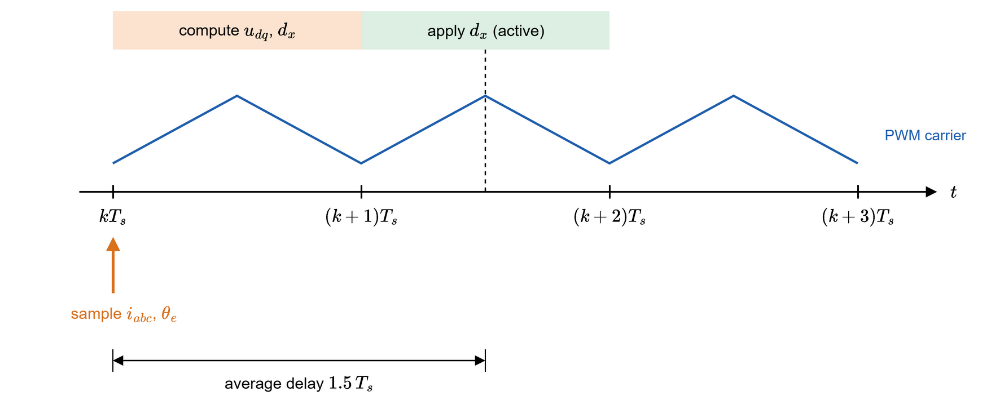
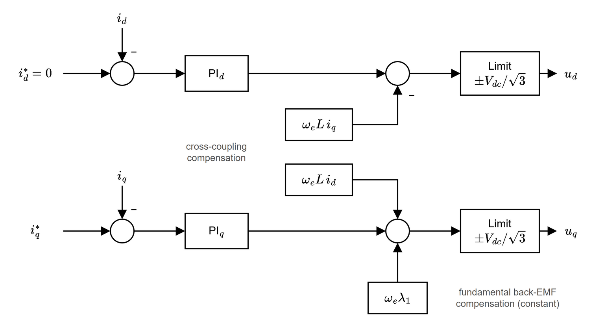
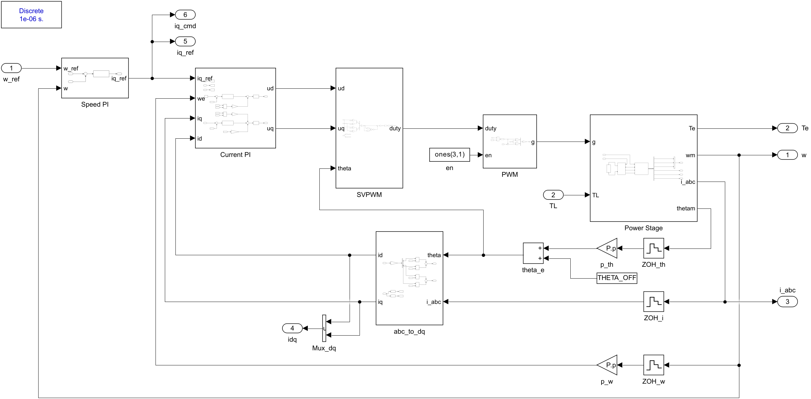
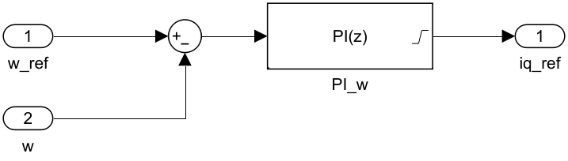
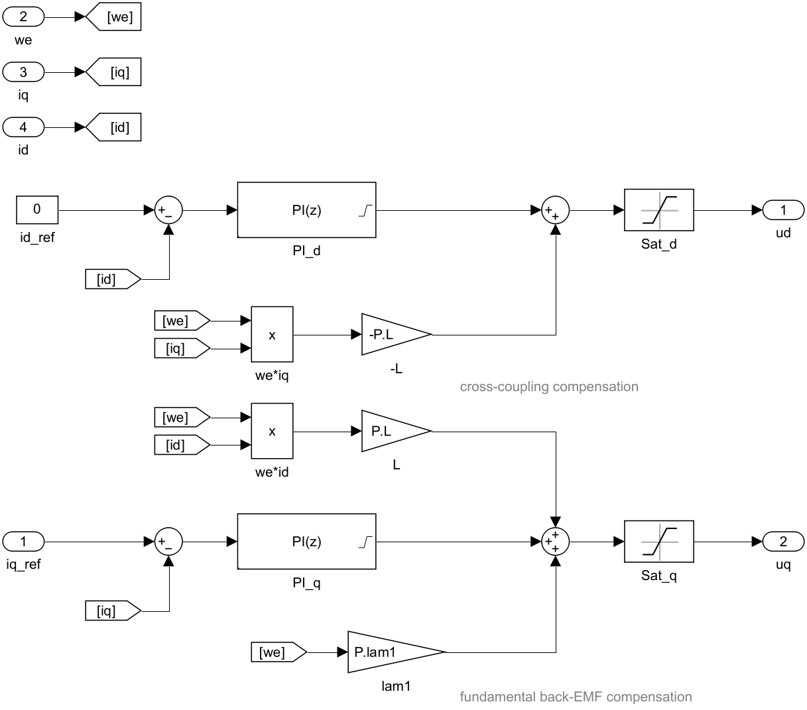
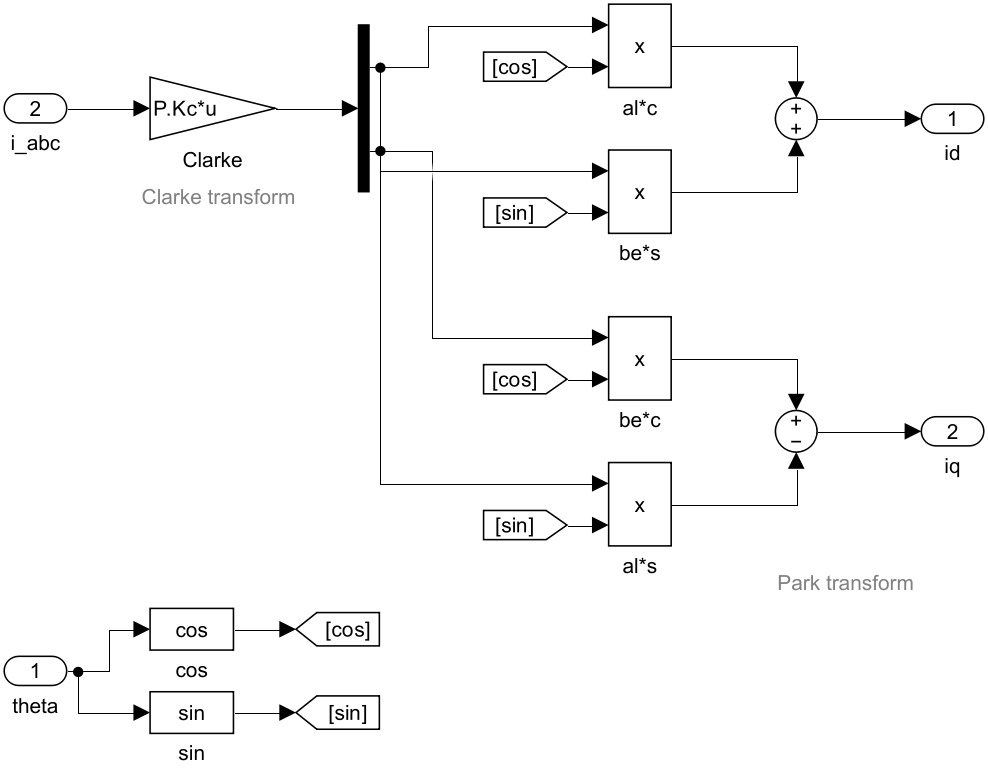
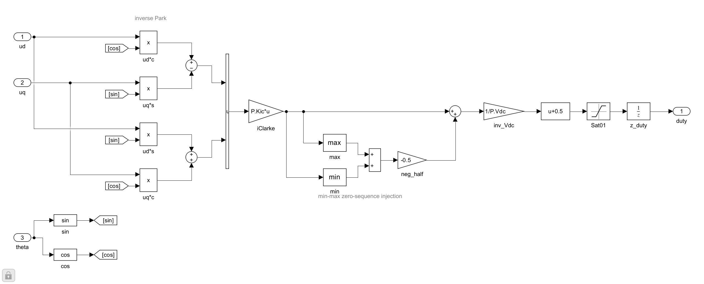
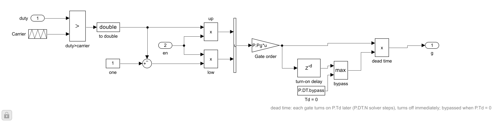
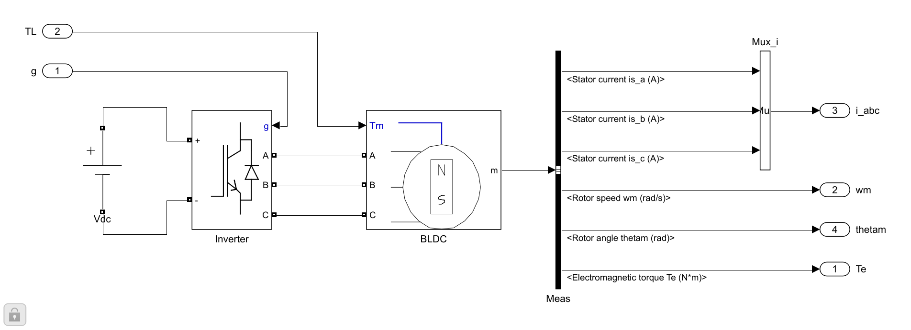
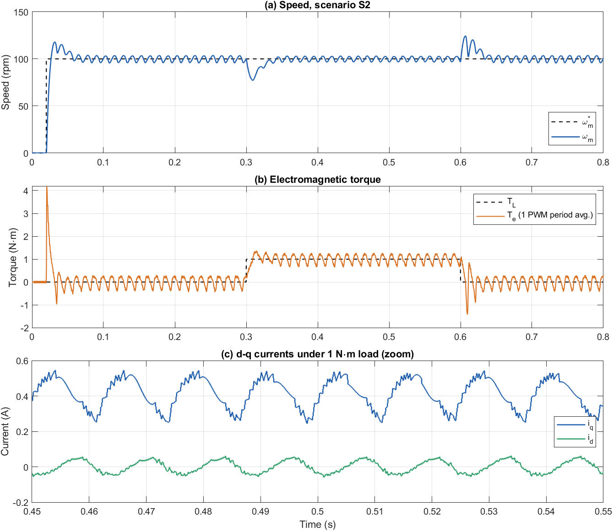

# Thiết kế hệ thống điều khiển FOC và FOC thông thường cho động cơ BLDC có back-EMF hình thang

**Tài liệu 03** trong bộ tài liệu lý thuyết của đề tài *Điều khiển định hướng từ trường cho động cơ BLDC có sức phản điện động hình thang*.

| Tài liệu | Nội dung |
|---|---|
| [01 – Mô hình toán học động cơ BLDC](01_BLDC_model.md) | Chương 2 |
| [02 – Mô hình BLDC trên hệ tọa độ quay](02_dq_model.md) | Chương 3 |
| **03 – Thiết kế FOC và FOC thông thường** (tài liệu này) | Chương 4, 5 và mô hình Simulink |
| [04 – FOC bù back-EMF hình thang](04_FOC_compensated.md) | Chương 6 |

---

## Tóm tắt

Tài liệu trình bày cấu trúc tổng thể của hệ điều khiển định hướng từ trường (FOC) cho động cơ BLDC, cách thiết kế các bộ điều khiển PI dòng điện (phương pháp mô hình nội – IMC) và PI tốc độ (phương pháp đặt cực), cơ chế chống bão hòa tích phân, điều chế vector không gian kiểu min–max và ảnh hưởng của trễ trong điều khiển số. Trên cơ sở đó, luật điều khiển của FOC thông thường được xây dựng với giả thiết back-EMF hình sin, và hai cơ chế sinh gợn mô-men khi áp dụng luật này cho động cơ có back-EMF hình thang được phân tích định lượng. Phần cuối mô tả chi tiết mô hình Simulink `Conventional_FOC.slx` hiện thực FOC thông thường, đối chiếu từng khối với các công thức, và kiểm chứng phân tích gợn mô-men bằng kết quả mô phỏng kịch bản S2.

**Từ khóa:** động cơ BLDC; điều khiển định hướng từ trường; IMC; SVPWM; gợn mô-men; Simulink.

---

## Mục lục

- [Danh mục ký hiệu](#danh-mục-ký-hiệu)
- [Nhắc lại các kết quả từ Tài liệu 01, 02](#nhắc-lại-các-kết-quả-từ-tài-liệu-01-02)
- [4. Thiết kế hệ thống điều khiển FOC](#4-thiết-kế-hệ-thống-điều-khiển-foc)
  - [4.1. Sơ đồ tổng thể](#41-sơ-đồ-tổng-thể)
  - [4.2. Thiết kế bộ PI dòng điện (phương pháp IMC)](#42-thiết-kế-bộ-pi-dòng-điện-phương-pháp-imc)
  - [4.3. Thiết kế bộ PI tốc độ (phương pháp đặt cực)](#43-thiết-kế-bộ-pi-tốc-độ-phương-pháp-đặt-cực)
  - [4.4. Chống bão hòa tích phân (anti-windup)](#44-chống-bão-hòa-tích-phân-anti-windup)
  - [4.5. Điều chế vector không gian (SVPWM) kiểu min–max](#45-điều-chế-vector-không-gian-svpwm-kiểu-minmax)
  - [4.6. Trễ trong điều khiển số](#46-trễ-trong-điều-khiển-số)
- [5. FOC thông thường và nguồn gốc gợn mô-men](#5-foc-thông-thường-và-nguồn-gốc-gợn-mô-men)
  - [5.1. Luật điều khiển](#51-luật-điều-khiển)
  - [5.2. Phân tích gợn mô-men](#52-phân-tích-gợn-mô-men)
  - [5.3. Triển khai mô hình Simulink](#53-triển-khai-mô-hình-simulink)
- [Tài liệu tham khảo](#tài-liệu-tham-khảo)

---

## Danh mục ký hiệu

| Ký hiệu | Ý nghĩa | Đơn vị |
|---|---|---|
| $v_x,\ i_x,\ e_x$ | điện áp, dòng điện, back-EMF pha $x\in\{a,b,c\}$ | V, A, V |
| $R,\ L$ | điện trở và điện cảm đồng bộ một pha | Ω, H |
| $\lambda$ | biên độ từ thông nam châm (ứng với đỉnh phẳng back-EMF) | Wb |
| $\lambda_1$ | từ thông thành phần cơ bản, $\lambda_1 = b_1\lambda$ | Wb |
| $p$ | số đôi cực | – |
| $\omega_m,\ \omega_e = p\,\omega_m$ | tốc độ cơ, tốc độ điện | rad/s |
| $\theta_m,\ \theta_e = p\,\theta_m$ | góc cơ, góc điện của rotor | rad |
| $g_d(\theta_e),\ g_q(\theta_e)$ | hình chiếu của back-EMF chuẩn hóa lên trục $d$, $q$ | – |
| $u_d,\ u_q$ | điện áp đặt trên hệ $dq$ (đầu ra bộ điều khiển dòng) | V |
| $T_e,\ T_L$ | mô-men điện từ, mô-men tải | N·m |
| $J,\ B$ | mô-men quán tính, hệ số ma sát nhớt | kg·m², N·m·s/rad |
| $K_t$ | hằng số mô-men dùng cho thiết kế, $K_t = \tfrac32 p\lambda_1$ | N·m/A |
| $T_s,\ f_{pwm}$ | chu kỳ lấy mẫu vòng dòng, tần số PWM ($T_s = 1/f_{pwm}$) | s, Hz |
| $T_\omega$ | chu kỳ lấy mẫu vòng tốc độ | s |
| $\tau_c$ | hằng số thời gian mong muốn của vòng dòng | s |
| $d_x$ | độ rộng xung (duty) pha $x$ | – |
| $x^*$ | giá trị đặt (tham chiếu) của $x$ | – |

---

## Nhắc lại các kết quả từ Tài liệu 01, 02

Đánh số phương trình trong bộ tài liệu theo chương. Các phương trình của chương 2, 3 được dùng lại trong tài liệu này là:

- Hệ số Fourier bậc 1 của back-EMF hình thang (đỉnh phẳng 120°) và từ thông cơ bản (2.3), (2.4):

$$
b_1 = \frac{12}{\pi^2} \approx 1{,}2158, \qquad \lambda_1 = b_1\lambda = 0{,}2079\ \text{Wb}.
$$

- Phương trình điện áp trên hệ $dq$ (3.3), (3.4):

$$
v_d = R\,i_d + L\frac{di_d}{dt} - \omega_e L\, i_q + e_d, \qquad
v_q = R\,i_q + L\frac{di_q}{dt} + \omega_e L\, i_d + e_q .
$$

- Back-EMF và mô-men trên hệ $dq$ (3.5), (3.7):

$$
e_d = \omega_e\lambda\, g_d(\theta_e), \qquad e_q = \omega_e\lambda\, g_q(\theta_e), \qquad
T_e = \frac32\,p\,\lambda\,\big(g_d(\theta_e)\, i_d + g_q(\theta_e)\, i_q\big).
$$

- Khoảng dao động của $g_q$, $g_d$ với back-EMF hình thang, chu kỳ $\pi/3$ (60° điện, bậc 6) (3.8):

$$
g_q(\theta_e) \in \Big[\tfrac{2}{\sqrt3},\ \tfrac43\Big] = [1{,}1547;\ 1{,}3333], \qquad g_d(\theta_e)\in[-0{,}0237;\ 0{,}0237].
$$

---

## 4. Thiết kế hệ thống điều khiển FOC

### 4.1. Sơ đồ tổng thể

FOC gồm hai vòng lồng nhau: **vòng tốc độ** (chậm, 1 kHz) tạo dòng đặt $i_q^*$, và **vòng dòng điện** (nhanh, 10 kHz) điều khiển $i_d$, $i_q$ bằng hai bộ PI. Điện áp đặt $u_d$, $u_q$ được đổi về hệ $\alpha\beta$, điều chế SVPWM và đưa tới nghịch lưu.


*Hình 4.1. Sơ đồ khối FOC. Hai cấu trúc trong bộ tài liệu (FOC thông thường – chương 5, FOC bù – chương 6) **chỉ khác nhau ở khối "d–q current controller"**; mọi khối còn lại giữ nguyên.*

### 4.2. Thiết kế bộ PI dòng điện (phương pháp IMC)

Bộ điều khiển dòng được thiết kế theo phương pháp mô hình nội [1]. Giả sử khâu bù (mục 5.1) đã khử được ghép chéo và back-EMF. Từ (3.3)–(3.4), đối tượng của mỗi trục chỉ còn là một khâu quán tính:

$$
G_i(s) = \frac{I(s)}{U'(s)} = \frac{1}{L s + R}. \tag{4.1}
$$

Chọn bộ PI $C_i(s) = K_{p,i} + \dfrac{K_{i,i}}{s}$ với

$$
K_{p,i} = \frac{L}{\tau_c},\qquad K_{i,i} = \frac{R}{\tau_c}
\quad\Longrightarrow\quad
C_i(s)\,G_i(s) = \frac{1}{\tau_c s},\qquad
\frac{I(s)}{I^*(s)} = \frac{1}{\tau_c s + 1}. \tag{4.2}
$$

Zero của PI ($s=-R/L$) triệt tiêu cực của đối tượng, nên vòng kín là khâu quán tính bậc 1 với hằng số thời gian $\tau_c$ tự chọn.

**Chọn $\tau_c$.** Điều khiển số gây trễ khoảng $1{,}5T_s$ (mục 4.6). Với hàm truyền vòng hở $\frac{1}{\tau_c s}e^{-1{,}5T_s s}$, tần số cắt $\omega_c = 1/\tau_c$ và độ dự trữ pha

$$
\varphi_m = 90^\circ - \omega_c\cdot 1{,}5T_s\cdot\frac{180^\circ}{\pi}. \tag{4.3}
$$

Chọn băng thông bằng $f_{pwm}/20 = 500$ Hz: $\tau_c = \dfrac{1}{2\pi\cdot 500} = 0{,}318$ ms, $\varphi_m = 90^\circ - 27^\circ = 63^\circ$.
Khi đó $K_{p,i} = 3{,}33\cdot10^{-3}/3{,}18\cdot10^{-4} = 10{,}46$ V/A và $K_{i,i} = 0{,}4578/3{,}18\cdot10^{-4} = 1438$ V/(A·s).

### 4.3. Thiết kế bộ PI tốc độ (phương pháp đặt cực)

Vòng dòng nhanh hơn nhiều so với vòng tốc độ, nên coi $i_q \approx i_q^*$ và $T_e = K_t\, i_q^*$ với $K_t = \tfrac32 p\lambda_1 = 2{,}495$ N·m/A. Đối tượng cơ là $G_\omega(s) = \dfrac{K_t}{J s + B}$. Với $C_\omega = K_{p,\omega} + K_{i,\omega}/s$, phương trình đặc trưng vòng kín

$$
J s^2 + (B + K_t K_{p,\omega})\,s + K_t K_{i,\omega} = 0 \tag{4.4}
$$

được đồng nhất với $s^2 + 2\zeta\omega_n s + \omega_n^2$:

$$
K_{p,\omega} = \frac{2\zeta\omega_n J - B}{K_t},\qquad K_{i,\omega} = \frac{J\omega_n^2}{K_t}. \tag{4.5}
$$

Với $\omega_n = 2\pi\cdot 20$ rad/s, $\zeta = 1$: $K_{p,\omega} = 0{,}148$ A·s/rad, $K_{i,\omega} = 9{,}30$ A/rad. Đầu ra được giới hạn $|i_q^*|\le 3$ A.

> **Ghi chú – Vì sao vẫn có vọt lố khi chọn $\zeta=1$?**
> Bộ PI có zero tại $s = -K_{i,\omega}/K_{p,\omega}$ nằm gần các cực, làm đáp ứng bước có vọt lố khoảng 17–18 % dù hai cực là cực kép thực. Có thể giảm vọt lố bằng PI hai bậc tự do (trọng số điểm đặt) hoặc tham chiếu dạng dốc.

### 4.4. Chống bão hòa tích phân (anti-windup)

Mỗi bộ PI rời rạc (Forward Euler) có giới hạn đầu ra và chống bão hòa kiểu *back-calculation*:

$$
u_k = K_p e_k + x_k,\qquad \bar u_k = \mathrm{sat}(u_k),\qquad
x_{k+1} = x_k + T\big[K_i e_k + K_b(\bar u_k - u_k)\big],\quad K_b = \frac{K_i}{K_p}. \tag{4.6}
$$

Khi đầu ra không bão hòa, $\bar u_k = u_k$ và đây là PI thường; khi bão hòa, số hạng $K_b(\bar u - u)$ kéo tích phân về, tránh vọt lố lớn khi thoát bão hòa.

### 4.5. Điều chế vector không gian (SVPWM) kiểu min–max

Sau Park ngược và Clarke ngược ta có điện áp pha mong muốn $u_a, u_b, u_c$. Cộng thêm thành phần thứ tự không

$$
u_0 = -\tfrac12\big(\max(u_a,u_b,u_c) + \min(u_a,u_b,u_c)\big),\qquad
d_x = \tfrac12 + \frac{u_x + u_0}{V_{dc}} \in [0,1], \tag{4.7}
$$

cho kết quả tương đương SVPWM cổ điển [2]. Vùng tuyến tính là $\sqrt{u_d^2 + u_q^2} \le V_{dc}/\sqrt3 = 20{,}78$ V. Độ rộng xung $d_x$ được so sánh với sóng mang tam giác 10 kHz để tạo 6 xung cho nghịch lưu.

### 4.6. Trễ trong điều khiển số



*Hình 4.2. Dòng và góc được lấy mẫu tại $kT_s$; độ rộng xung tính xong được áp ở chu kỳ kế tiếp; điện áp trung bình của chu kỳ đó ứng với thời điểm $(k+1{,}5)T_s$. Trong khoảng trễ này rotor quay thêm $1{,}5\,T_s\,\omega_e$ rad điện.*

Trễ trung bình $1{,}5\,T_s$ này được dùng để chọn $\tau_c$ ở mục 4.2. Với FOC thông thường, trễ chỉ ảnh hưởng tới độ dự trữ pha; với FOC bù (Tài liệu 04), trễ còn làm lệch pha khâu bù theo góc và phải được bù trực tiếp.

---

## 5. FOC thông thường và nguồn gốc gợn mô-men

### 5.1. Luật điều khiển

FOC thông thường được thiết kế như cho động cơ sin [3]: coi $e_d = 0$ và $e_q = \omega_e\lambda_1$ là hằng số. Từ (3.3)–(3.4):

$$
u_d = \underbrace{K_{p,i}(0 - i_d) + K_{i,i}\!\int(0 - i_d)\,dt}_{\text{PI}_d} \;-\; \underbrace{\omega_e L\, i_q}_{\text{bù ghép chéo}}, \tag{5.1}
$$

$$
u_q = \underbrace{K_{p,i}(i_q^* - i_q) + K_{i,i}\!\int(i_q^* - i_q)\,dt}_{\text{PI}_q} \;+\; \underbrace{\omega_e L\, i_d}_{\text{bù ghép chéo}} \;+\; \underbrace{\omega_e\lambda_1}_{\text{bù back-EMF cơ bản}}. \tag{5.2}
$$

Dòng đặt: $i_d^* = 0$ (không làm yếu từ thông), $i_q^*$ là đầu ra PI tốc độ.



*Hình 5.1. Bộ điều khiển dòng của FOC thông thường: hai PI, bù ghép chéo và bù back-EMF cơ bản hằng số $\omega_e\lambda_1$ trên trục $q$.*

### 5.2. Phân tích gợn mô-men

So sánh (5.2) với (3.4), phần back-EMF **không** được bù là

$$
\Delta e_d = \omega_e\lambda\, g_d(\theta_e), \qquad \Delta e_q = \omega_e\lambda\big(g_q(\theta_e) - b_1\big). \tag{5.3}
$$

Đây là nguồn gốc của gợn mô-men khi áp dụng FOC cho động cơ có back-EMF không sin [4]. Gợn mô-men sinh ra theo **hai cơ chế** chồng lên nhau.

**Cơ chế 1: nhiễu điện áp lên vòng dòng.** $\Delta e_q$ là một nhiễu điện áp bậc 6. Với PI theo (4.2), hàm truyền từ nhiễu điện áp tới dòng là

$$
\frac{I_q(s)}{-\Delta E_q(s)} = \frac{G_i}{1 + C_i G_i} = \frac{1}{Ls+R}\cdot\frac{\tau_c s}{\tau_c s + 1}. \tag{5.4}
$$

Ví dụ số tại 100 vòng/phút ($\omega_6 = 6\omega_e = 503$ rad/s): biên độ đỉnh–đỉnh của nhiễu $\Delta e_q$ là $\omega_e\lambda\big(\tfrac43 - \tfrac{2}{\sqrt3}\big) = 83{,}8\times0{,}171\times0{,}179 = 2{,}56$ V; độ lợi (5.4) tại $\omega_6$ bằng $0{,}091$ A/V; suy ra dao động $i_q \approx 0{,}23$ A đỉnh–đỉnh.

**Cơ chế 2: mô-men gợn ngay cả khi $i_q$ phẳng.** Theo (3.7) với $i_d = 0$:

$$
T_e = \tfrac32\,p\,\lambda\, g_q(\theta_e)\, i_q . \tag{5.5}
$$

Nếu $i_q$ là hằng số tuyệt đối thì $T_e$ vẫn dao động theo $g_q(\theta_e)$, tức gợn nội tại

$$
\frac{\Delta T_{e,pp}}{T_{e,avg}} = \frac{4/3 - 2/\sqrt3}{b_1} = 14{,}7\ \%. \tag{5.6}
$$

> **Ghi chú – Hệ quả**
> Tăng băng thông vòng dòng chỉ giảm được cơ chế 1, **không** giảm được cơ chế 2. Muốn mô-men phẳng phải (a) bù đầy đủ back-EMF để triệt nhiễu, và (b) cố ý điều chế $i_q$ theo góc để bù cho $g_q(\theta_e)$. Đó chính là hai thành phần của FOC bù (Tài liệu 04).

Mục 5.3.7 kiểm chứng các ước lượng này trên mô hình Simulink.

### 5.3. Triển khai mô hình Simulink

Mục này mô tả mô hình `Conventional_FOC.slx` hiện thực FOC thông thường của mục 5.1 trên một động cơ BLDC back-EMF hình thang, ở mức chuyển mạch từng van của nghịch lưu.

#### 5.3.1. Tổ chức file và cách chạy

Các file nằm trong `03_Simulation/Conventional_FOC/`:

| File | Vai trò |
|---|---|
| `Conventional_FOC.slx` | Mô hình Simulink (Simscape Electrical – Specialized Power Systems) |
| `conv_foc_init.m` | Tạo `P` (`bldc_params`) và kịch bản `SC` (`bldc_scenario`), đặt góc lệch `THETA_OFF` và hệ số ghi dữ liệu `DECIM`. Được gọi tự động khi mở mô hình (`PreLoadFcn`) |
| `run_conv_foc.m` | Chạy lần lượt S1–S4 (qua `bldc_run_scenario`), lưu kết quả vào `04_Results/Raw/<SCEN>_conv.mat` |

Phần dùng chung cho mọi bộ điều khiển nằm trong `03_Simulation/Common/`:

| File | Vai trò |
|---|---|
| `bldc_params.m` | Hàm trả về struct `P`: thông số động cơ, nghịch lưu, tần số lấy mẫu, hệ số PI của FOC và các ma trận dùng trong khối Gain |
| `bldc_scenario.m` | Hàm trả về kịch bản `SC` (S1–S4 và `CAL`) |
| `bldc_run_scenario.m` | Hàm chạy một kịch bản cho một mô hình bất kỳ có cùng giao diện (Inport `w_ref`, `TL`; Outport `w`, `Te`, `i_abc`, `idq`, `iq_ref`, `iq_cmd`) và trả về struct kết quả `R` |
| `bldc_trap.m` | Hàm dạng back-EMF hình thang chuẩn hóa $F(\theta)$ |
| `bldc_plant_lib.slx` | Thư viện Simulink chứa các khối `Power Stage`, `PWM`, `SVPWM`, `abc_to_dq`. Trong mô hình, các khối này là liên kết thư viện (library link): sửa một lần trong thư viện là cập nhật cho mọi mô hình |

`PreLoadFcn` của mô hình tự thêm thư mục của mô hình và `Common/` vào đường dẫn MATLAB, rồi gọi `conv_foc_init`; vì vậy có thể mở mô hình từ bất kỳ thư mục làm việc nào.

```matlab
% Chạy cả 4 kịch bản
run_conv_foc

% Chỉ chạy một kịch bản
SCEN_LIST = {'S2'}; run_conv_foc

% Mở mô hình với một kịch bản để chạy bằng nút Run
SCEN = 'S3'; conv_foc_init; open_system('Conventional_FOC')
```

Mỗi file kết quả chứa struct `R` gồm các chuỗi thời gian `t, w_ref, TL, w, Te, i_abc, id, iq, iq_ref, iq_cmd` (bước 10 µs), cùng `P`, `SC`, `THETA_OFF` và `meta` (ngày chạy, phiên bản MATLAB, thời gian mô phỏng).

#### 5.3.2. Cấu hình mô phỏng và các tần số lấy mẫu

Mô hình là hệ nhiều tốc độ lấy mẫu, mô phỏng với solver bước cố định:

| Thành phần | Bước / chu kỳ | Biến |
|---|---|---|
| Solver (`FixedStepDiscrete`) và `powergui` (Discrete) – mạch công suất, động cơ | 1 µs | `P.dt` |
| Lấy mẫu dòng, góc, tốc độ (ZOH); PI dòng; SVPWM; sóng mang PWM | 100 µs (10 kHz) | `P.Ts` |
| PI tốc độ | 1 ms | `P.Tsw` |
| Ghi dữ liệu các đầu ra `w`, `Te`, `i_abc` | 10 µs | `DECIM*P.dt` |

Thời gian mô phỏng lấy theo kịch bản (`StopTime = SC.T`). Tham chiếu tốc độ `w_ref` và mô-men tải `TL` là hai Inport ở tầng ngoài cùng, được `run_conv_foc.m` cấp dưới dạng tín hiệu bậc thang (`Interpolate = off`).

#### 5.3.3. Sơ đồ tầng ngoài cùng



*Hình 5.2. Tầng ngoài cùng của `Conventional_FOC.slx`. Hàng trên là đường thuận từ tham chiếu tốc độ tới động cơ; ba hàng dưới là phản hồi góc, dòng và tốc độ, sắp xếp giống Hình 4.1.*

Bảng 5.1 đối chiếu các khối trên Hình 4.1 với mô hình:

*Bảng 5.1. Đối chiếu sơ đồ khối FOC (Hình 4.1) với các khối Simulink.*

| Hình 4.1 | Khối Simulink | Ghi chú |
|---|---|---|
| Speed PI | `Speed PI` | PI rời rạc, $T_\omega$ = 1 ms |
| d–q current controller | `Current PI` | Luật (5.1)–(5.2) |
| Inverse Park + SVPWM + $z^{-1}$ | `SVPWM` | Gộp Park ngược, Clarke ngược, min–max và trễ một chu kỳ |
| (tạo xung) | `PWM` | So sánh duty với sóng mang 10 kHz |
| Three-phase inverter + BLDC | `Power Stage` | Nghịch lưu IGBT, khối PMSM back-EMF hình thang |
| Clarke + Park | `abc_to_dq` | (3.1), (3.2) |
| Encoder | `ZOH_th`, `ZOH_w` | Lấy mẫu góc và tốc độ cơ tại $T_s$ (encoder lý tưởng) |
| $\times p$ | `p_th`, `p_w` | $\theta_e = p\theta_m$, $\omega_e = p\omega_m$ |
| – | `theta_off`, `theta_e` | $\theta_e = p\theta_m + \texttt{THETA\_OFF}$ (xem mục 5.3.4) |
| – | `ZOH_i` | Lấy mẫu dòng pha tại $T_s$ |

Các Outport `w`, `Te`, `i_abc`, `idq`, `iq_ref`, `iq_cmd` chỉ dùng để ghi dữ liệu.

#### 5.3.4. Các khối con

**a) Speed PI.** Sai lệch $e_\omega = \omega_m^* - \omega_m$ đưa vào bộ PID rời rạc (dạng PI, Forward Euler, $T_\omega$ = 1 ms) với $K_p$ = `P.Kp_w_foc`, $K_i$ = `P.Ki_w_foc` theo (4.5). Đầu ra giới hạn ±`P.Imax` = ±3 A, chống bão hòa back-calculation với $K_b = K_i/K_p$ theo (4.6).



*Hình 5.3. Khối `Speed PI`.*

**b) Current PI.** Hiện thực trực tiếp (5.1)–(5.2), bố cục giống Hình 5.1. Tín hiệu $\omega_e$, $i_d$, $i_q$ được phân phối bằng các nhãn Goto/From (`[we]`, `[id]`, `[iq]`) để tránh dây cắt nhau.



*Hình 5.4. Khối `Current PI`.*

*Bảng 5.2. Đối chiếu luật điều khiển (5.1)–(5.2) với khối `Current PI`.*

| Thành phần | Khối | Tham số |
|---|---|---|
| $i_d^* = 0$ | `id_ref` (Constant) | 0 |
| Sai lệch $e_d$, $e_q$ | `e_d`, `e_q` (Sum) | – |
| PI$_d$, PI$_q$ (4.2) | `PI_d`, `PI_q` (PID Controller, rời rạc, $T_s$) | `P.Kp_i`, `P.Ki_i`; giới hạn ±`P.Vm`; $K_b$ = `P.Ki_i/P.Kp_i` |
| $-\omega_e L i_q$ | `we*iq` (Product) → `-L` (Gain) | `-P.L` |
| $+\omega_e L i_d$ | `we*id` (Product) → `L` (Gain) | `P.L` |
| $+\omega_e\lambda_1$ | `lam1` (Gain) | `P.lam1` |
| Tổng $u_d$, $u_q$ | `Sum_ud`, `Sum_uq` | – |
| Giới hạn $\pm V_{dc}/\sqrt3$ | `Sat_d`, `Sat_q` (Saturation) | ±`P.Vm` = ±20,78 V |

> **Ghi chú – Bão hòa hai lần.** Mỗi PI tự giới hạn đầu ra ±`P.Vm`, sau đó phần bù mới được cộng vào và tổng lại bị giới hạn bởi `Sat_d`, `Sat_q`. Cơ chế chống bão hòa (4.6) chỉ "thấy" giới hạn bên trong PI, không thấy giới hạn của tổng. Ở 100 vòng/phút điện áp còn xa giới hạn nên không ảnh hưởng; ở tốc độ cao (khi $\omega_e\lambda_1$ lớn) cần đưa giới hạn tổng vào vòng back-calculation.

**c) abc_to_dq.** Clarke bất biến biên độ (3.1) bằng khối Gain với ma trận `P.Kc`, sau đó Park (3.2):
$i_d = i_\alpha\cos\theta_e + i_\beta\sin\theta_e$, $i_q = -i_\alpha\sin\theta_e + i_\beta\cos\theta_e$.



*Hình 5.5. Khối `abc_to_dq`.*

**d) SVPWM.** Gồm bốn bước:

1. Park ngược: $u_\alpha = u_d\cos\theta_e - u_q\sin\theta_e$, $u_\beta = u_d\sin\theta_e + u_q\cos\theta_e$.
2. Clarke ngược bằng khối Gain `iClarke` với ma trận `P.Kic`, cho $u_a, u_b, u_c$.
3. Bơm thành phần thứ tự không min–max và chuẩn hóa theo (4.7): `max`, `min`, `Sum_mm`, `neg_half` (×−0,5), `v_inj`, `inv_Vdc` (×1/`P.Vdc`), `Bias` (+0,5), `Sat01` (giới hạn [0, 1]).
4. Trễ một chu kỳ `z_duty` (Unit Delay, $T_s$): duty tính tại $kT_s$ được áp ở chu kỳ sau, đúng như Hình 4.2.



*Hình 5.6. Khối `SVPWM`.*

**e) PWM.** Duty $d_x$ được so sánh với sóng mang tam giác `Carrier` (Repeating Sequence, chu kỳ `P.Ts`, biên độ 0–1). Xung van trên là $s_x = (d_x > \text{carrier})$, xung van dưới là $1 - s_x$ (không có thời gian chết). Đầu vào `en` (hằng `ones(3,1)`) cho phép khóa xung. Gain `Gate order` với ma trận hoán vị `P.Pg` sắp xếp 6 xung theo thứ tự mà khối Universal Bridge yêu cầu.



*Hình 5.7. Khối `PWM`.*

**f) Power Stage.** Nguồn DC `Vdc` (`P.Vdc` = 36 V) cấp cho nghịch lưu ba pha `Inverter` (Universal Bridge, IGBT/diode, $R_{on}$ = 1 mΩ, snubber 100 kΩ), nối với khối `BLDC` (Permanent Magnet Synchronous Machine). Khối `Meas` (Bus Selector) tách dòng ba pha, tốc độ, góc và mô-men từ bus đo của động cơ.



*Hình 5.8. Khối `Power Stage`.*

Cấu hình khối `BLDC`:

| Thông số khối | Giá trị |
|---|---|
| Back EMF waveform (`FluxDistribution`) | Trapezoidal |
| Flat area of the back EMF waveform | 120° |
| Rotor type | Round (điện cảm không phụ thuộc góc) |
| Resistance / Inductance | `P.R` / `P.L` |
| Flux linkage established by magnets | `P.lam` (biên độ đỉnh phẳng $\lambda$) |
| Inertia, friction, pole pairs | `[P.J P.B P.p 0]` |
| Mechanical input | Torque Tm (= mô-men tải $T_L$) |
| Rotor flux position when θ = 0 | 90° behind phase A axis (modified Park) |

Do quy ước góc của khối PMSM ("90° behind phase A axis"), trục $d$ của bộ điều khiển phải lệch $-\pi/2$ so với góc đo của khối. Vì vậy góc điện dùng trong bộ điều khiển là $\theta_e = p\,\theta_m + \texttt{THETA\_OFF}$ với `THETA_OFF` $= -\pi/2$. Giá trị này đã được hiệu chỉnh trong mô phỏng tham chiếu (quét bốn giá trị $0, \pm\pi/2, \pi$ và chọn giá trị cho sai số tốc độ nhỏ nhất).

#### 5.3.5. Thông số

Toàn bộ thông số nằm trong struct `P` do `conv_foc_init.m` tạo ra.

*Bảng 5.3. Thông số động cơ và bộ điều khiển.*

| Thông số | Ký hiệu | Giá trị | Biến |
|---|---|---|---|
| Số đôi cực | $p$ | 8 | `P.p` |
| Điện trở pha | $R$ | 0,4578 Ω | `P.R` |
| Điện cảm đồng bộ | $L$ | 3,33 mH | `P.L` |
| Từ thông nam châm (đỉnh phẳng) | $\lambda$ | 0,171 Wb | `P.lam` |
| Từ thông cơ bản | $\lambda_1 = 12\lambda/\pi^2$ | 0,2079 Wb | `P.lam1` |
| Mô-men quán tính | $J$ | 1,469·10⁻³ kg·m² | `P.J` |
| Ma sát nhớt | $B$ | 3,035·10⁻⁴ N·m·s/rad | `P.B` |
| Điện áp DC | $V_{dc}$ | 36 V | `P.Vdc` |
| Tần số PWM / chu kỳ vòng dòng | $f_{pwm}$ / $T_s$ | 10 kHz / 0,1 ms | `P.fpwm` / `P.Ts` |
| Chu kỳ vòng tốc độ | $T_\omega$ | 1 ms | `P.Tsw` |
| Hằng số thời gian vòng dòng | $\tau_c$ | 0,318 ms | `P.tau_c` |
| PI dòng | $K_{p,i}$ / $K_{i,i}$ | 10,46 V/A / 1438 V/(A·s) | `P.Kp_i` / `P.Ki_i` |
| Hằng số mô-men FOC | $K_t = 1{,}5p\lambda_1$ | 2,495 N·m/A | `P.Kt_foc` |
| PI tốc độ | $K_{p,\omega}$ / $K_{i,\omega}$ | 0,148 / 9,30 | `P.Kp_w_foc` / `P.Ki_w_foc` |
| Giới hạn dòng / điện áp pha | $I_{max}$ / $V_{dc}/\sqrt3$ | 3 A / 20,78 V | `P.Imax` / `P.Vm` |
| Ma trận Clarke / Clarke ngược | – | (3.1) | `P.Kc` / `P.Kic` |
| Ma trận thứ tự xung | – | hoán vị 6×6 | `P.Pg` |

#### 5.3.6. Kịch bản mô phỏng

*Bảng 5.4. Bốn kịch bản vận hành (dùng chung cho FOC thông thường và FOC bù).*

| Kịch bản | Mô tả | Thời gian |
|---|---|---|
| S1 | Khởi động không tải, tham chiếu 0 → 100 vòng/phút tại 0,02 s | 0,4 s |
| S2 | 100 vòng/phút, đóng tải 1 N·m tại 0,3 s, cắt tải tại 0,6 s | 0,8 s |
| S3 | Đảo chiều +100 → −100 vòng/phút tại 0,3 s, không tải | 0,7 s |
| S4 | Tham chiếu bậc thang 30 → 60 → 100 → 60 → 30 vòng/phút (mỗi 0,25 s), tải 0,5 N·m | 1,25 s |

#### 5.3.7. Kết quả kiểm chứng (kịch bản S2)



*Hình 5.9. Kết quả FOC thông thường ở kịch bản S2: (a) tốc độ; (b) mô-men điện từ (trung bình trượt một chu kỳ PWM); (c) dòng $i_d$, $i_q$ trong đoạn có tải 1 N·m.*

*Bảng 5.5. Chỉ tiêu ở đoạn xác lập có tải (0,45–0,58 s) của kịch bản S2.*

| Chỉ tiêu | Giá trị |
|---|---|
| Tốc độ trung bình | 99,96 vòng/phút |
| Độ sụt tốc khi đóng tải | 22,9 vòng/phút |
| Mô-men trung bình | 1,009 N·m |
| Gợn mô-men đỉnh–đỉnh (trung bình 1 chu kỳ PWM) | 0,642 N·m (≈ 64 %) |
| Gợn mô-men RMS | 0,176 N·m |
| Gợn tốc độ đỉnh–đỉnh | 6,90 vòng/phút |
| Dao động $i_q$ đỉnh–đỉnh | ≈ 0,30 A |

Nhận xét:

- Mô hình bám tốc độ đặt và mô-men trung bình bằng mô-men tải, $i_d$ dao động quanh 0: góc lệch `THETA_OFF` và chiều các phép biến đổi là đúng.
- $i_q$ dao động với chu kỳ 12,5 ms, tức 80 Hz $= 6 f_e$ tại 100 vòng/phút, đúng bậc 6 do $\Delta e_q$ gây ra (cơ chế 1). Biên độ ≈ 0,30 A đỉnh–đỉnh (kể cả gợn PWM do lấy mẫu) cùng bậc với ước lượng 0,23 A ở mục 5.2.
- Gợn mô-men đỉnh–đỉnh ≈ 64 %, lớn hơn nhiều so với gợn nội tại 14,7 % của cơ chế 2. Tại điểm làm việc này, dao động $i_q$ (± khoảng 0,15 A quanh 0,41 A) chiếm phần lớn, tức cơ chế 1 chiếm ưu thế. Muốn mô-men phẳng phải xử lý cả hai cơ chế, đó là nội dung của FOC bù (Tài liệu 04).
- Các chỉ tiêu trong Bảng 5.5 trùng với kết quả FOC thông thường của mô phỏng tham chiếu ban đầu (`FOC_Controller/bldc_foc_comp_blocks.slx`), xác nhận mô hình tách riêng cho kết quả như cũ.

---

## Tài liệu tham khảo

1. L. Harnefors and H.-P. Nee, "Model-based current control of AC machines using the internal model control method," *IEEE Trans. Ind. Appl.*, vol. 34, no. 1, pp. 133–141, 1998.
2. D. G. Holmes and T. A. Lipo, *Pulse Width Modulation for Power Converters: Principles and Practice*. Piscataway, NJ, USA: IEEE Press / Wiley, 2003.
3. B. K. Bose, *Modern Power Electronics and AC Drives*. Upper Saddle River, NJ, USA: Prentice Hall, 2002.
4. T. M. Jahns and W. L. Soong, "Pulsating torque minimization techniques for permanent magnet AC motor drives — A review," *IEEE Trans. Ind. Electron.*, vol. 43, no. 2, pp. 321–330, 1996.
