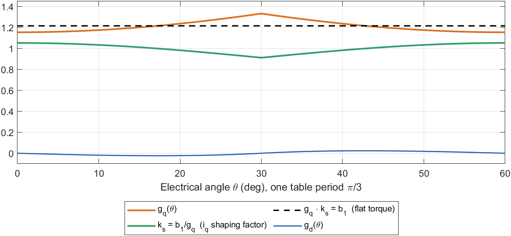
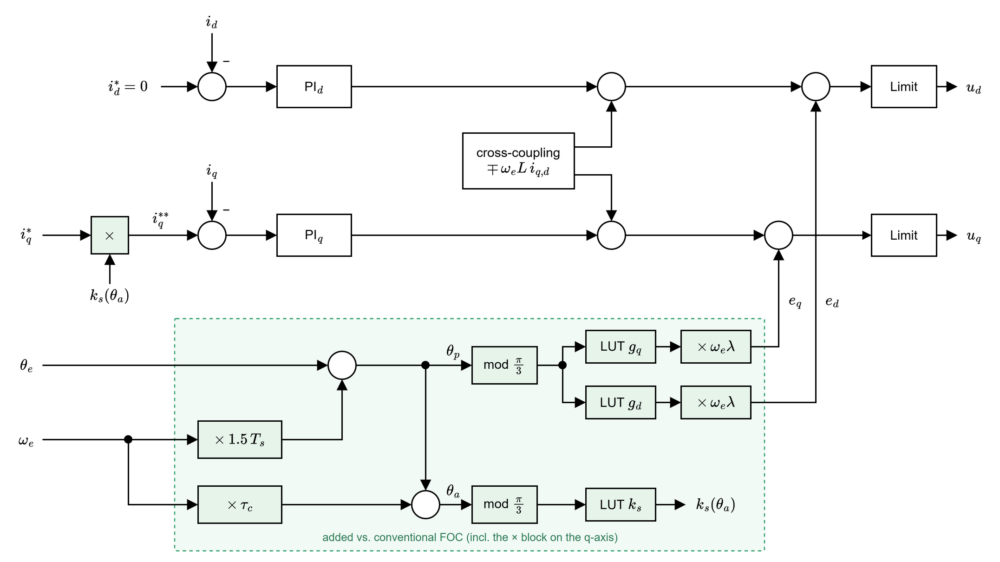
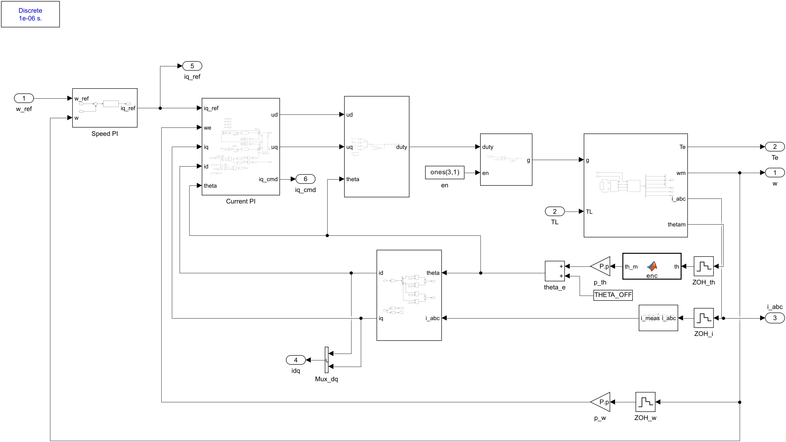
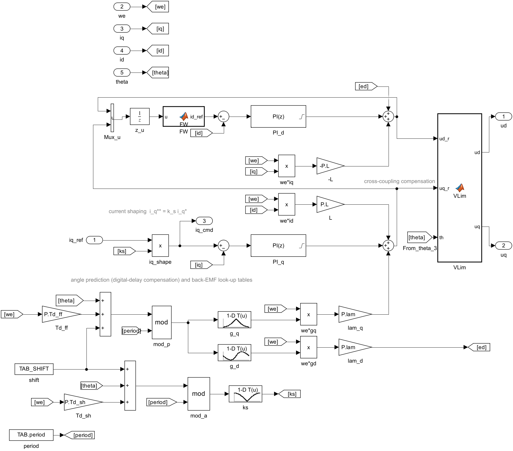

# Phương pháp FOC bù back-EMF hình thang kết hợp định dạng dòng điện

**Tài liệu 04** trong bộ tài liệu lý thuyết của đề tài *Điều khiển định hướng từ trường cho động cơ BLDC có sức phản điện động hình thang*.

| Tài liệu | Nội dung |
|---|---|
| [01 – Mô hình toán học động cơ BLDC](01_BLDC_model.md) | Chương 2 |
| [02 – Mô hình BLDC trên hệ tọa độ quay](02_dq_model.md) | Chương 3 |
| [03 – Thiết kế FOC và FOC thông thường](03_FOC_conventional.md) | Chương 4, 5 và mô hình Simulink FOC thông thường |
| **04 – FOC bù back-EMF hình thang** (tài liệu này) | Chương 6 và mô hình Simulink FOC bù |
| [05 – Mô phỏng và so sánh](05_simulation_results.md) | Chương 7 |
| [06 – Điều khiển six-step và so sánh ba bộ điều khiển](06_six_step.md) | Chương 8 và mô hình Simulink six-step |
| [07 – Điều khiển giả vector (PVC)](07_pseudo_vector_control.md) | Chương 9 và mô hình Simulink PVC |

---

## Tóm tắt

FOC thông thường coi back-EMF trên hệ $d$–$q$ là hằng số, nên với động cơ BLDC còn để lại một nhiễu điện áp bậc 6 và một gợn mô-men nội tại (Tài liệu 03, mục 5.2). Tài liệu này trình bày phương pháp FOC bù gồm ba thành phần: (i) bù back-EMF hình thang theo góc rotor bằng bảng tra, (ii) bù trễ của điều khiển số trong góc tra, và (iii) định dạng dòng $i_q^*$ để mô-men không phụ thuộc góc. Hai bộ PI, bù ghép chéo, SVPWM và vòng tốc độ được giữ nguyên như FOC thông thường. Phần cuối mô tả mô hình Simulink `Compensated_FOC.slx`, đối chiếu từng khối với công thức, quy trình hiệu chỉnh bảng tra và kết quả kiểm chứng ở kịch bản S2.

**Từ khóa:** động cơ BLDC; FOC; back-EMF hình thang; bù tiến (feedforward); bù trễ số; định dạng dòng điện; bảng tra; Simulink.

---

## Mục lục

- [Danh mục ký hiệu](#danh-mục-ký-hiệu)
- [Nhắc lại các kết quả từ Tài liệu 02, 03](#nhắc-lại-các-kết-quả-từ-tài-liệu-02-03)
- [6. Phương pháp FOC bù back-EMF hình thang](#6-phương-pháp-foc-bù-back-emf-hình-thang)
  - [6.1. Thành phần 1: bù back-EMF hình thang theo góc](#61-thành-phần-1-bù-back-emf-hình-thang-theo-góc)
  - [6.2. Thành phần 2: bù trễ số](#62-thành-phần-2-bù-trễ-số)
  - [6.3. Thành phần 3: định dạng dòng $i_q^*$](#63-thành-phần-3-định-dạng-dòng-i_q)
  - [6.4. Bảng tra theo góc](#64-bảng-tra-theo-góc)
  - [6.5. Sơ đồ bộ điều khiển dòng của FOC bù](#65-sơ-đồ-bộ-điều-khiển-dòng-của-foc-bù)
  - [6.6. Thuật toán trong một chu kỳ $T_s$](#66-thuật-toán-trong-một-chu-kỳ-t_s)
  - [6.7. Triển khai mô hình Simulink](#67-triển-khai-mô-hình-simulink)
- [Tài liệu tham khảo](#tài-liệu-tham-khảo)

---

## Danh mục ký hiệu

Các ký hiệu chung ($R$, $L$, $\lambda$, $\lambda_1$, $p$, $\omega_e$, $\theta_e$, $T_s$, $\tau_c$, …) giống Tài liệu 03. Ký hiệu riêng của tài liệu này:

| Ký hiệu | Ý nghĩa | Đơn vị |
|---|---|---|
| $g_d(\theta),\ g_q(\theta)$ | hình chiếu của back-EMF chuẩn hóa lên trục $d$, $q$ (tuần hoàn $\pi/3$) | – |
| $b_1$ | hệ số Fourier bậc 1 của back-EMF hình thang, $b_1 = 12/\pi^2 \approx 1{,}2158$ | – |
| $\theta_p$ | góc dự báo dùng để tra bảng back-EMF | rad |
| $\theta_a$ | góc dự báo dùng để tra hệ số định dạng dòng | rad |
| $k_s(\theta)$ | hệ số định dạng dòng, $k_s = b_1/g_q$ | – |
| $i_q^*$ | dòng đặt trục $q$ (đầu ra PI tốc độ) | A |
| $i_q^{**}$ | dòng đặt trục $q$ sau định dạng, $i_q^{**} = k_s\, i_q^*$ | A |
| $e_d,\ e_q$ | back-EMF trên hệ $dq$ được bù | V |
| $\mathrm{LUT}(\cdot)$ | bảng tra một chiều, nội suy tuyến tính | – |

---

## Nhắc lại các kết quả từ Tài liệu 02, 03

- Back-EMF và mô-men trên hệ $dq$ (3.5), (3.7):

$$
e_d = \omega_e\lambda\, g_d(\theta_e), \qquad e_q = \omega_e\lambda\, g_q(\theta_e), \qquad
T_e = \frac32\,p\,\lambda\,\big(g_d(\theta_e)\, i_d + g_q(\theta_e)\, i_q\big).
$$

- Hình chiếu của back-EMF chuẩn hóa $f_{abc}$ lên hệ $dq$ (3.6):

$$
f_\alpha = \tfrac23\big(f_a - \tfrac12 f_b - \tfrac12 f_c\big),\quad f_\beta = \tfrac{1}{\sqrt3}\big(f_b - f_c\big),\quad
g_d = \cos\theta_e\, f_\alpha + \sin\theta_e\, f_\beta,\quad g_q = -\sin\theta_e\, f_\alpha + \cos\theta_e\, f_\beta .
$$

- Phần back-EMF mà FOC thông thường **không** bù được (5.3):

$$
\Delta e_d = \omega_e\lambda\, g_d(\theta_e), \qquad \Delta e_q = \omega_e\lambda\big(g_q(\theta_e) - b_1\big).
$$

- Trễ trung bình của điều khiển số là $1{,}5\,T_s$ (Tài liệu 03, mục 4.6, Hình 4.2); vòng dòng kín có dạng $1/(\tau_c s + 1)$ (4.2).

---

## 6. Phương pháp FOC bù back-EMF hình thang

Các kỹ thuật giảm gợn mô-men cho máy nam châm vĩnh cửu có back-EMF không sin gồm định dạng dòng tối ưu [1] và bù gợn theo vị trí rotor bằng bảng tra [2], [3]. FOC bù áp dụng các ý tưởng đó: giữ nguyên hai bộ PI, bù ghép chéo, SVPWM và vòng tốc độ, và thay đổi ba chỗ: (1) bù back-EMF đầy đủ trên cả hai trục bằng bảng tra; (2) bù trễ số trong góc tra; (3) định dạng dòng $i_q^*$.

### 6.1. Thành phần 1: bù back-EMF hình thang theo góc

Thay số hạng hằng $\omega_e\lambda_1$ bằng hình chiếu chính xác (3.5):

$$
u_d = \text{PI}_d(0 - i_d) - \omega_e L\, i_q + \omega_e\lambda\, g_d(\theta_p), \tag{6.1}
$$

$$
u_q = \text{PI}_q(i_q^{**} - i_q) + \omega_e L\, i_d + \omega_e\lambda\, g_q(\theta_p). \tag{6.2}
$$

Khi $\theta_p$ trùng góc thật tại thời điểm điện áp được áp, nhiễu (5.3) bị khử hoàn toàn, và đối tượng mỗi trục thật sự còn là $1/(Ls+R)$ như giả thiết trong thiết kế IMC (4.1) [4]. Thành phần này triệt **cơ chế 1** của gợn mô-men (Tài liệu 03, mục 5.2).

### 6.2. Thành phần 2: bù trễ số

Theo Hình 4.2, điện áp tính tại $kT_s$ có tác dụng trung bình tại $(k+1{,}5)T_s$. Góc dùng để tra bảng back-EMF là góc dự báo:

$$
\theta_p = \theta_e + 1{,}5\,T_s\,\omega_e . \tag{6.3}
$$

Ở 100 vòng/phút, $1{,}5\,T_s\,\omega_e = 0{,}0126$ rad $= 0{,}72^\circ$, nhỏ; nhưng ở tốc độ cao (ví dụ 2000 vòng/phút) sai góc lên tới $14^\circ$, và khâu bù không có (6.3) sẽ mất tác dụng.

### 6.3. Thành phần 3: định dạng dòng $i_q^*$

Ý tưởng định dạng dòng để mô-men không đổi với back-EMF không sin được đề xuất trong [1]. Mục tiêu: $T_e$ không phụ thuộc góc và bằng $K_t\, i_q^*$ với cùng $K_t = \tfrac32 p\lambda_1$ của FOC thông thường, để giữ nguyên thiết kế vòng tốc độ (4.5). Từ (3.7) với $i_d = 0$:

$$
\tfrac32\,p\,\lambda\, g_q(\theta_e)\, i_q = \tfrac32\,p\,\lambda_1\, i_q^*
\quad\Longrightarrow\quad
\boxed{\; i_q^{**} = i_q^*\,\frac{\lambda_1/\lambda}{g_q(\theta_a)} = i_q^*\, k_s(\theta_a),\qquad k_s(\theta)=\frac{b_1}{g_q(\theta)} \;} \tag{6.4}
$$

$k_s$ nằm trong khoảng $[0{,}912;\ 1{,}053]$: dòng $i_q^{**}$ được **cố ý** điều chế khoảng ±7 % ngược pha với $g_q$ (Hình 6.1). Thành phần này triệt **cơ chế 2** (gợn mô-men nội tại 14,7 % khi $i_q$ phẳng).

Vì vòng dòng có trễ xấp xỉ $\tau_c$ (vòng kín $1/(\tau_c s+1)$) cộng trễ số $1{,}5\,T_s$, góc dùng để tính $k_s$ được dự báo xa hơn:

$$
\theta_a = \theta_e + (1{,}5\,T_s + \tau_c)\,\omega_e . \tag{6.5}
$$



*Hình 6.1. Nguyên lý định dạng dòng trên một chu kỳ $\pi/3$: nhân $i_q^*$ với $k_s(\theta)$ ngược pha với $g_q(\theta)$ làm tích $g_q\,k_s$, tức mô-men, không đổi theo góc. $g_d$ rất nhỏ (|g_d| ≤ 0,024).*

### 6.4. Bảng tra theo góc

$g_d$, $g_q$ và $k_s$ chỉ phụ thuộc góc và tuần hoàn $\pi/3$. Vì vậy chỉ cần lưu **một chu kỳ** $[0, \pi/3)$ và quy góc về chu kỳ đó bằng phép mod:

$$
g(\theta) = \mathrm{LUT}\big(\theta \bmod \tfrac{\pi}{3}\big). \tag{6.6}
$$

Phép mod phải cho kết quả trong $[0,\pi/3)$ cả khi $\theta<0$ (lúc quay ngược), như hàm `mod` của MATLAB. Trong mô phỏng, bảng có 361 điểm (bước 0,17°), nội suy tuyến tính. Đoạn mã tạo bảng (trích `comp_foc_init.m`):

```matlab
TAB.th = linspace(0, pi/3, 361);
fa = -bldc_trap(TAB.th); fb = -bldc_trap(TAB.th - 2*pi/3); fc = -bldc_trap(TAB.th + 2*pi/3);
fal = 2/3*(fa - fb/2 - fc/2);   fbe = (fb - fc)/sqrt(3);       % Clarke
TAB.gd =  cos(TAB.th).*fal + sin(TAB.th).*fbe;                 % Park
TAB.gq = -sin(TAB.th).*fal + cos(TAB.th).*fbe;
TAB.ks = (P.lam1/P.lam)./TAB.gq;                               % current shaping
```

> **Ghi chú – Hiệu chỉnh gốc góc.**
> Bảng tra chỉ đúng khi trục $q$ của bộ điều khiển trùng hướng thành phần cơ bản của back-EMF. Với khối PMSM của Simscape, gốc góc lệch $-\pi/2$ (`THETA_OFF`, xem Tài liệu 03, mục 5.3.4). Ngoài ra, script mô phỏng có thể quét thêm độ lệch `TAB_SHIFT` của bảng tra trong ±15° và chọn giá trị cho gợn mô-men nhỏ nhất (mục 6.7.4); kết quả hiệu chỉnh là 0°, tức bảng tra khớp đúng mô hình.

### 6.5. Sơ đồ bộ điều khiển dòng của FOC bù



*Hình 6.2. Bộ điều khiển dòng của FOC bù. Vùng nền xanh lá là phần thêm vào so với FOC thông thường: góc dự báo $\theta_p$, $\theta_a$; bảng tra $g_d$, $g_q$, $k_s$; bù back-EMF $e_d$, $e_q$ theo góc; và định dạng $i_q^{**} = k_s\, i_q^*$ (khối × trên trục $q$). Bù hằng $\omega_e\lambda_1$ của FOC thông thường bị bỏ. Trong hình, $\theta_a$ được vẽ dưới dạng $\theta_p + \tau_c\,\omega_e$, tương đương với (6.5).*

### 6.6. Thuật toán trong một chu kỳ $T_s$

1. Lấy mẫu $i_a, i_b, i_c$, góc $\theta_e$ và tốc độ $\omega_e$.
2. Clarke (3.1), Park (3.2) để có $i_d$, $i_q$.
3. Tính $\theta_p$ theo (6.3) và $\theta_a$ theo (6.5); quy về $[0,\pi/3)$; tra $g_d(\theta_p)$, $g_q(\theta_p)$, $k_s(\theta_a)$.
4. Định dạng dòng: $i_q^{**} = k_s\, i_q^*$ (6.4).
5. Hai PI dòng, cộng bù ghép chéo và bù back-EMF theo (6.1)–(6.2); giới hạn điện áp; chống bão hòa.
6. Park ngược, Clarke ngược, SVPWM (4.7); nạp độ rộng xung cho chu kỳ kế tiếp.

FOC thông thường là trường hợp riêng của thuật toán trên: bỏ bước 3–4 (đặt $g_d = 0$, $g_q = b_1$, $k_s = 1$).

### 6.7. Triển khai mô hình Simulink

Mô hình `Compensated_FOC.slx` dùng chung động cơ, nghịch lưu, PI dòng, PI tốc độ, SVPWM, PWM và kịch bản với `Conventional_FOC.slx` (Tài liệu 03, mục 5.3). Chỉ khối `Current PI` khác. Mục này chỉ mô tả phần khác biệt.

#### 6.7.1. So sánh cấu trúc với FOC thông thường

*Bảng 6.1. So sánh cấu trúc hai bộ điều khiển. PI dòng, PI tốc độ, giới hạn và SVPWM giống hệt nhau.*

| | FOC thông thường | FOC bù |
|---|---|---|
| Giả thiết back-EMF | sin: $e_d = 0$, $e_q = \omega_e\lambda_1$ | hình thang: $e_{d,q} = \omega_e\lambda\, g_{d,q}(\theta_e)$ |
| Bù trục $d$ | $-\omega_e L i_q$ | $-\omega_e L i_q + \omega_e\lambda g_d(\theta_p)$ |
| Bù trục $q$ | $\omega_e L i_d + \omega_e\lambda_1$ | $\omega_e L i_d + \omega_e\lambda g_q(\theta_p)$ |
| Dòng đặt $i_q$ | $i_q^*$ (hằng ở xác lập) | $k_s(\theta_a)\, i_q^*$ (dao động ±7 %) |
| Bù trễ số | không | $\theta_p = \theta_e + 1{,}5T_s\omega_e$, $\theta_a = \theta_e + (1{,}5T_s+\tau_c)\omega_e$ |
| Khối thêm (Simulink) | – | 3 bảng tra 1-D, 2 khối mod, 2 khối cộng góc, 6 Gain/Product |
| Yêu cầu cảm biến | góc liên tục (encoder) | góc liên tục, chính xác hơn |
| Thông tin cần biết | $R, L, \lambda_1$ | $R, L, \lambda$ và dạng back-EMF |

#### 6.7.2. Tổ chức file và cách chạy

Các file nằm trong `03_Simulation/Compensated_FOC/`:

| File | Vai trò |
|---|---|
| `Compensated_FOC.slx` | Mô hình Simulink (Simscape Electrical – Specialized Power Systems) |
| `comp_foc_init.m` | Tạo `P` (`bldc_params`, thêm `P.Td_ff`, `P.Td_sh`), bảng tra `TAB` (dùng `bldc_trap`), kịch bản `SC` (`bldc_scenario`, S1–S4 và `CAL`), `THETA_OFF`, `TAB_SHIFT`, `DECIM`; biến tùy chọn `VLIM` ghi đè `P.vlim` (`VLIM = 0` tái lập số liệu chương 7–9). Được gọi tự động khi mở mô hình (`PreLoadFcn`) |
| `comp_foc_calib.mat` | Giá trị đã hiệu chỉnh `THETA_OFF`, `TAB_SHIFT` |
| `run_comp_foc.m` | Chạy S1–S4, lưu kết quả vào `04_Results/Raw/<SCEN>_comp.mat`; tùy chọn hiệu chỉnh `TAB_SHIFT` trước |

```matlab
% Chạy cả 4 kịch bản
run_comp_foc

% Chỉ chạy một kịch bản
SCEN_LIST = {'S2'}; run_comp_foc

% Hiệu chỉnh lại TAB_SHIFT (7 lần chạy ngắn), rồi chạy S1-S4
DO_CALIB = true; run_comp_foc
```

Cấu trúc file kết quả giống FOC thông thường (struct `R`, bước 10 µs), với hai khác biệt: `R.iq_cmd` là dòng đặt đã định dạng $i_q^{**}$ (lấy mẫu tại $T_s$), còn `R.iq_ref` là đầu ra PI tốc độ $i_q^*$. File còn lưu thêm `TAB` và `TAB_SHIFT`.

#### 6.7.3. Sơ đồ tầng ngoài cùng



*Hình 6.3. Tầng ngoài cùng của `Compensated_FOC.slx`. Bố cục giống Hình 5.2 của Tài liệu 03; khác biệt là `Current PI` nhận thêm góc $\theta_e$ (cổng `theta`) và có thêm đầu ra `iq_cmd` = $i_q^{**}$. Các khối Current Sensor (sau `ZOH_i`) và Position Sensor (sau `ZOH_th`) được thêm ở chương 9–10 để mô phỏng sai số đo dòng và encoder; mặc định chúng lý tưởng.*

Các khối `Speed PI`, `abc_to_dq`, `SVPWM`, `PWM`, `Power Stage`, các khâu lấy mẫu ZOH và cấu hình solver giống hệt FOC thông thường (bốn khối `abc_to_dq`, `SVPWM`, `PWM`, `Power Stage` là liên kết tới cùng thư viện `Common/bldc_plant_lib.slx`); xem Tài liệu 03, mục 5.3.2–5.3.4 (Hình 5.3, 5.5–5.8).

#### 6.7.4. Khối Current PI của FOC bù



*Hình 6.4. Khối `Current PI` của FOC bù, gồm ba vùng: trục $d$ (trên), trục $q$ với định dạng dòng (giữa), và dự báo góc kèm bảng tra back-EMF (dưới). Tín hiệu được phân phối bằng nhãn Goto/From: `[we]`, `[iq]`, `[id]`, `[theta]`, `[ed]` (back-EMF trục $d$), `[ks]` (hệ số định dạng) và `[period]` (chu kỳ bảng tra). Bản hiện tại có thêm khối `VLim` (bộ giới hạn điện áp, thay hai khối `Sat_d`, `Sat_q` ban đầu) và khối `FW` (suy yếu từ thông, mặc định tắt), xem Tài liệu 07, mục 9.8 và 9.10.*

*Bảng 6.2. Đối chiếu công thức với các khối trong `Compensated_FOC/Current PI`.*

| Công thức | Khối | Tham số |
|---|---|---|
| (6.3) $\theta_p = \theta_e + 1{,}5T_s\omega_e$ | `Td_ff` (Gain), `th_p` (Sum) | `P.Td_ff` = $1{,}5T_s$ = 0,15 ms |
| (6.5) $\theta_a = \theta_e + (1{,}5T_s+\tau_c)\omega_e$ | `Td_sh` (Gain), `th_a` (Sum) | `P.Td_sh` = $1{,}5T_s + \tau_c$ = 0,468 ms |
| Độ lệch hiệu chỉnh bảng tra | `shift` (Constant), cộng vào `th_p` và `th_a` | `TAB_SHIFT` (= 0) |
| (6.6) $\theta \bmod \pi/3$ | `mod_p`, `mod_a` (Math Function, `mod`), `period` (Constant) | `TAB.period` = $\pi/3$ |
| $g_d(\theta_p)$, $g_q(\theta_p)$, $k_s(\theta_a)$ | `g_d`, `g_q`, `ks` (1-D Lookup Table, nội suy tuyến tính, Clip) | `TAB.th`, `TAB.gd`, `TAB.gq`, `TAB.ks` |
| $e_d = \omega_e\lambda g_d$, $e_q = \omega_e\lambda g_q$ | `we*gd`, `we*gq` (Product), `lam_d`, `lam_q` (Gain) | `P.lam` |
| (6.4) $i_q^{**} = k_s\, i_q^*$ | `iq_shape` (Product) | – |
| PI dòng (4.2), giới hạn điện áp | `PI_d`, `PI_q`, `VLim` (MATLAB Function, gọi `Common/bldc_vlim.m`) | `P.Kp_i`, `P.Ki_i`, `P.Vm`, `P.vlim` (mặc định 3: lục giác nghịch lưu; 0: kẹp riêng $u_d$, $u_q$ như bản gốc, mục 9.8) |
| Suy yếu từ thông (9.18), tùy chọn | `Mux_u`, `z_u` (Unit Delay), `FW` (MATLAB Function) thay cho hằng `id_ref` = 0 | `P.FW` (mặc định tắt, $i_d^* = 0$) |
| Bù ghép chéo | `we*iq` → `-L`, `we*id` → `L` | `P.L` |
| Tổng (6.1), (6.2) | `Sum_ud` ($e_d$ từ trên, PI$_d$ từ trái, $-\omega_e L i_q$ từ dưới), `Sum_uq` ($\omega_e L i_d$ từ trên, PI$_q$ từ trái, $e_q$ từ dưới) | – |

**Hiệu chỉnh `TAB_SHIFT`.** Với `DO_CALIB = true`, `run_comp_foc.m` chạy kịch bản `CAL` (100 vòng/phút, tải 1 N·m từ 0,1 s, dài 0,26 s) với 7 giá trị `TAB_SHIFT` = −15°, −10°, …, +15°. Mỗi lần chạy đo gợn mô-men đỉnh–đỉnh (trung bình một chu kỳ PWM) trong đoạn $t \ge 0{,}18$ s, rồi giữ giá trị cho gợn nhỏ nhất và lưu vào `comp_foc_calib.mat`. Nếu giá trị tối ưu nằm ở biên dải quét, script cảnh báo: khi đó quy ước góc của khối PMSM có thể khác giả thiết và cần kiểm tra lại `THETA_OFF`. Kết quả hiệu chỉnh hiện tại là `TAB_SHIFT` = 0°.

*Bảng 6.3. Thông số bổ sung so với FOC thông thường (các thông số khác xem Bảng 5.3, Tài liệu 03).*

| Thông số | Ký hiệu | Giá trị | Biến |
|---|---|---|---|
| Trễ dự báo cho bù back-EMF | $1{,}5\,T_s$ | 0,15 ms | `P.Td_ff` |
| Trễ dự báo cho định dạng dòng | $1{,}5\,T_s + \tau_c$ | 0,468 ms | `P.Td_sh` |
| Số điểm bảng tra / chu kỳ bảng | – | 361 / $\pi/3$ (bước 0,17°) | `TAB.N` / `TAB.period` |
| Khoảng giá trị $g_q$ | – | [1,1547; 1,3333] | `TAB.gq` |
| Khoảng giá trị $k_s$ | – | [0,912; 1,053] | `TAB.ks` |
| Góc lệch khối PMSM | – | $-\pi/2$ | `THETA_OFF` |
| Độ lệch hiệu chỉnh bảng tra | – | 0 | `TAB_SHIFT` |

#### 6.7.5. Kết quả kiểm chứng (kịch bản S2)


*Hình 6.5. Kết quả kịch bản S2, FOC bù so với FOC thông thường: (a) tốc độ; (b) mô-men điện từ (trung bình một chu kỳ PWM) trong đoạn có tải; (c) dòng $i_q$ và dòng đặt đã định dạng $i_q^{**}$ của FOC bù.*

*Bảng 6.4. Chỉ tiêu ở đoạn xác lập có tải (0,45–0,58 s) của kịch bản S2.*

| Chỉ tiêu | FOC thông thường | FOC bù | Thay đổi |
|---|---|---|---|
| Tốc độ trung bình (vòng/phút) | 99,96 | 100,00 | |
| Độ sụt tốc khi đóng tải (vòng/phút) | 22,9 | 21,1 | −8 % |
| Mô-men trung bình (N·m) | 1,009 | 1,004 | |
| Gợn mô-men đỉnh–đỉnh (N·m) | 0,642 | 0,153 | **−76 %** |
| Gợn mô-men RMS (N·m) | 0,176 | 0,030 | **−83 %** |
| Gợn tốc độ đỉnh–đỉnh (vòng/phút) | 6,90 | 0,87 | **−87 %** |
| Dao động $i_q$ đỉnh–đỉnh (A) | ≈ 0,30 | ≈ 0,10 | |

Nhận xét:

- Bù back-EMF theo góc (thành phần 1) loại bỏ gần hết dao động $i_q$ ngoài ý muốn do nhiễu bậc 6: $i_q$ giờ bám sát $i_q^{**}$. Dao động nhỏ còn lại của $i_q$ là **có chủ đích**, do định dạng dòng (thành phần 3) yêu cầu, với biên độ $i_q^{**}$ khoảng 0,055 A đỉnh–đỉnh (≈ ±7 % quanh 0,41 A).
- Nhờ hai thành phần cùng tác dụng, gợn mô-men giảm khoảng 76 % (đỉnh–đỉnh) và 83 % (RMS), gợn tốc độ giảm 87 %.
- Đáp ứng quá độ hầu như không đổi (độ sụt tốc khi đóng tải giảm nhẹ), vì PI dòng, PI tốc độ và hằng số mô-men $K_t$ dùng cho thiết kế được giữ nguyên.
- Các chỉ tiêu trùng với kết quả FOC bù của mô phỏng tham chiếu ban đầu, xác nhận mô hình tách riêng cho kết quả như cũ. So sánh đầy đủ hai bộ điều khiển trên cả bốn kịch bản sẽ được trình bày trong tài liệu kết quả mô phỏng.

> **Ghi chú – Hạn chế và lưu ý khi triển khai thực tế.**
> 1. *Dạng back-EMF thực không lý tưởng.* Bảng tra dựng từ hình thang lý tưởng. Với động cơ thật cần đo back-EMF dây khi quay hở mạch, chuẩn hóa và tính lại $g_d$, $g_q$ theo (3.6). Sai số $\lambda$ chỉ ảnh hưởng tỉ lệ lên phần bù; sai số *dạng* sóng mới gây gợn còn lại.
> 2. *Độ chính xác góc.* Bảng có chu kỳ 60° điện; sai góc vài độ điện đã làm lệch pha bù. Cảm biến Hall 6 sector không đủ; cần encoder hoặc nội suy Hall/bộ quan sát góc tốt.
> 3. *Băng thông vòng dòng.* Định dạng dòng yêu cầu $i_q$ bám tín hiệu tần số $f_6 = 6pn/60$. Điều kiện gần đúng là $f_6$ nhỏ hơn nhiều so với băng thông 500 Hz; ở tốc độ cao hiệu quả định dạng giảm dần (đã bù một phần nhờ $\tau_c$ trong (6.5)).
> 4. *Giới hạn điện áp.* Khi tốc độ vượt giới hạn điện áp của FOC, $V_{dc}/(\sqrt3\,p\lambda_1) \approx 119$ vòng/phút (ví dụ lúc vọt lố ở S3), vòng dòng bão hòa. Đây là giới hạn chung, không do khâu bù.
> 5. *Khối lượng tính toán.* Thêm 3 lần tra bảng, 2 phép mod và vài phép nhân mỗi chu kỳ 100 µs, không đáng kể với vi điều khiển như STM32, TI C2000.

---

## Tài liệu tham khảo

1. J. Y. Hung and Z. Ding, "Design of currents to reduce torque ripple in brushless permanent magnet motors," *IEE Proc. B – Electric Power Applications*, vol. 140, no. 4, pp. 260–266, 1993.
2. J. Holtz and L. Springob, "Identification and compensation of torque ripple in high-precision permanent magnet motor drives," *IEEE Trans. Ind. Electron.*, vol. 43, no. 2, pp. 309–320, 1996.
3. T. M. Jahns and W. L. Soong, "Pulsating torque minimization techniques for permanent magnet AC motor drives — A review," *IEEE Trans. Ind. Electron.*, vol. 43, no. 2, pp. 321–330, 1996.
4. L. Harnefors and H.-P. Nee, "Model-based current control of AC machines using the internal model control method," *IEEE Trans. Ind. Appl.*, vol. 34, no. 1, pp. 133–141, 1998.
