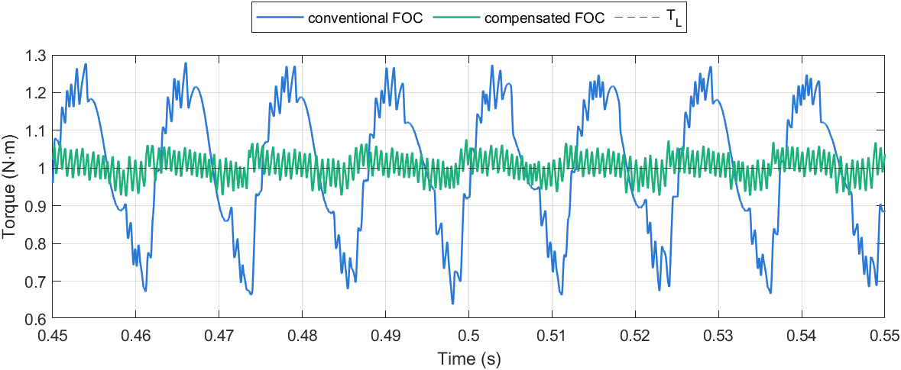
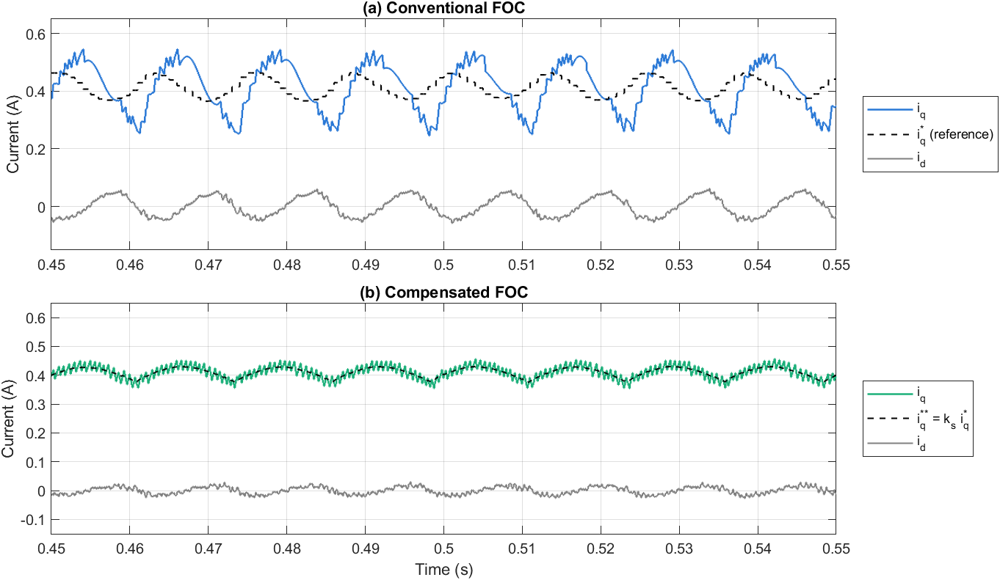
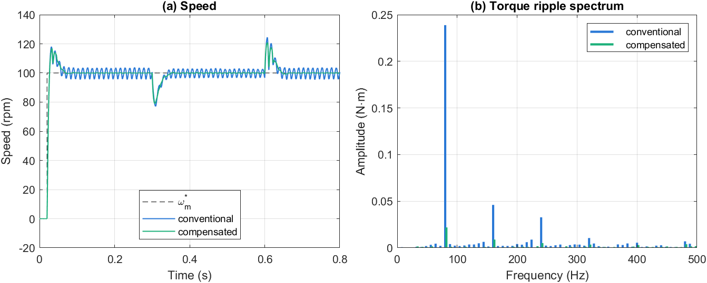
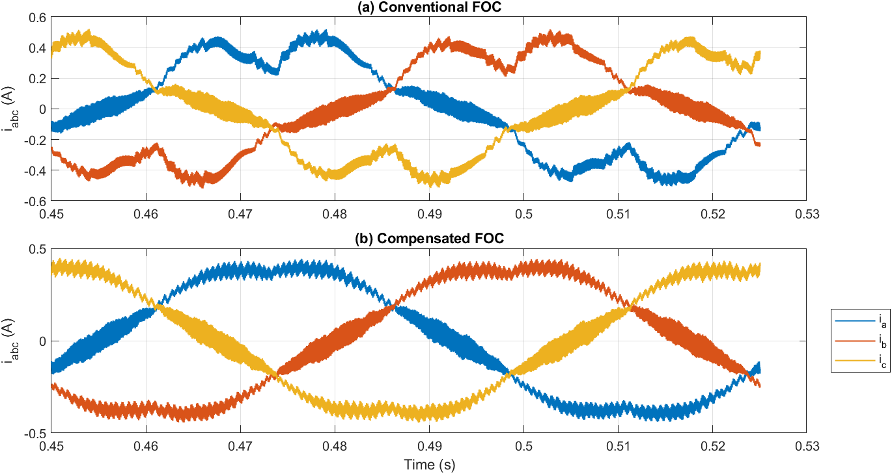
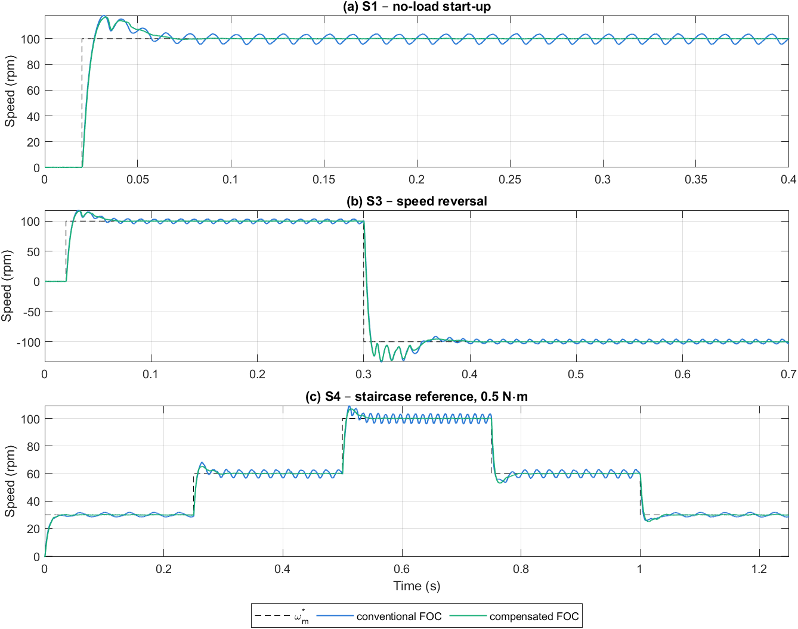
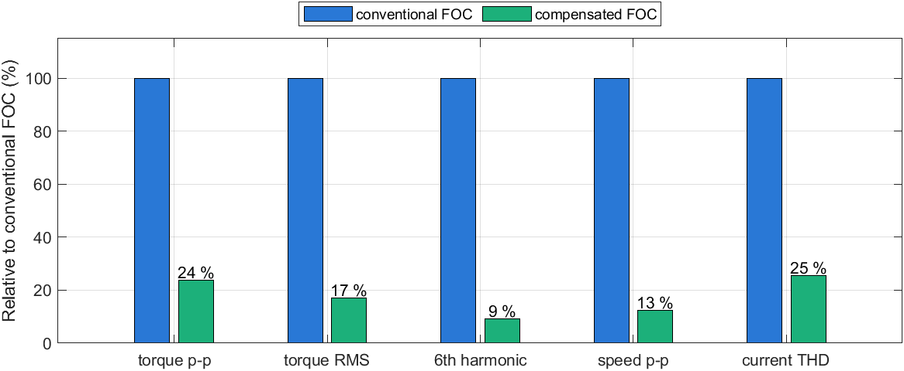

# Mô phỏng và so sánh FOC thông thường với FOC bù back-EMF hình thang

**Tài liệu 05** trong bộ tài liệu lý thuyết của đề tài *Điều khiển định hướng từ trường cho động cơ BLDC có sức phản điện động hình thang*.

| Tài liệu | Nội dung |
|---|---|
| [01 – Mô hình toán học động cơ BLDC](01_BLDC_model.md) | Chương 2 |
| [02 – Mô hình BLDC trên hệ tọa độ quay](02_dq_model.md) | Chương 3 |
| [03 – Thiết kế FOC và FOC thông thường](03_FOC_conventional.md) | Chương 4, 5 và mô hình Simulink FOC thông thường |
| [04 – FOC bù back-EMF hình thang](04_FOC_compensated.md) | Chương 6 và mô hình Simulink FOC bù |
| **05 – Mô phỏng và so sánh** (tài liệu này) | Chương 7 |

---

## Tóm tắt

Tài liệu so sánh FOC thông thường (Tài liệu 03) và FOC bù back-EMF hình thang (Tài liệu 04) trên cùng một mô hình Simulink ở mức chuyển mạch van, với cùng thông số động cơ, nghịch lưu, bộ PI và bốn kịch bản vận hành S1–S4. Các chỉ tiêu được tính tự động từ dữ liệu mô phỏng bằng các hàm dùng chung của repo, theo định nghĩa thống nhất. Ở chế độ có tải 1 N·m, 100 vòng/phút, FOC bù giảm gợn mô-men đỉnh–đỉnh 76 %, gợn mô-men RMS 83 %, thành phần gợn bậc 6 tới 91 %, gợn tốc độ 87 % và độ méo hài dòng pha 75 %, trong khi đặc tính quá độ gần như không thay đổi. Kết quả mô phỏng khớp với các ước lượng lý thuyết ở chương 5.

**Từ khóa:** BLDC; FOC; back-EMF hình thang; gợn mô-men; mô phỏng Simulink; so sánh chỉ tiêu.

---

## Mục lục

- [7. Mô phỏng và thảo luận](#7-mô-phỏng-và-thảo-luận)
  - [7.1. Thiết lập mô phỏng](#71-thiết-lập-mô-phỏng)
  - [7.2. Định nghĩa các chỉ tiêu](#72-định-nghĩa-các-chỉ-tiêu)
  - [7.3. Kết quả](#73-kết-quả)
  - [7.4. Thảo luận](#74-thảo-luận)
  - [7.5. Hạn chế của nghiên cứu mô phỏng](#75-hạn-chế-của-nghiên-cứu-mô-phỏng)
  - [7.6. Tái lập kết quả](#76-tái-lập-kết-quả)
- [Tài liệu tham khảo](#tài-liệu-tham-khảo)

---

## 7. Mô phỏng và thảo luận

### 7.1. Thiết lập mô phỏng

Hai bộ điều khiển được mô phỏng trên cùng một mô hình đối tượng (thư viện `bldc_plant_lib.slx` trong thư mục `03_Simulation/Common`):

- nghịch lưu ba pha IGBT/diode chuyển mạch từng van, nguồn DC 36 V;
- khối PMSM back-EMF hình thang, đỉnh phẳng 120° (Simscape Electrical – Specialized Power Systems), thông số ở Bảng 5.3 (Tài liệu 03);
- `powergui` rời rạc, bước 1 µs; PWM và vòng dòng 10 kHz; vòng tốc độ 1 kHz;
- PI dòng, PI tốc độ, giới hạn điện áp và SVPWM **giống hệt nhau** ở hai bộ điều khiển. Khác biệt cấu trúc chỉ nằm ở khối bộ điều khiển dòng (Bảng 6.1, Tài liệu 04).

Các chỉ tiêu được đánh giá trên bốn kịch bản:

- **S1:** khởi động không tải, tham chiếu 0 → 100 vòng/phút tại 0,02 s;
- **S2:** tốc độ 100 vòng/phút, đóng tải 1 N·m tại 0,3 s và cắt tải tại 0,6 s;
- **S3:** đảo chiều +100 → −100 vòng/phút tại 0,3 s;
- **S4:** tham chiếu bậc thang 30 → 60 → 100 → 60 → 30 vòng/phút, tải 0,5 N·m.

### 7.2. Định nghĩa các chỉ tiêu

Các chỉ tiêu được tính bằng hàm `Common/bldc_kpi.m` (dựa trên `Common/bldc_metrics.m`) từ dữ liệu ghi với bước 10 µs. Mô-men được lấy trung bình trượt trên một chu kỳ PWM (100 µs) trước khi tính gợn và phổ, để loại gợn tần số chuyển mạch.

*Bảng 7.1. Định nghĩa các chỉ tiêu.*

| Chỉ tiêu | Định nghĩa |
|---|---|
| Thời gian lên | Từ 10 % đến 90 % của bước tham chiếu tốc độ (S1) |
| Độ quá điều chỉnh | $(\omega_{max} - \omega^*)/\omega^*$ (S1); với S3 là phần vượt quá −100 vòng/phút |
| Thời gian xác lập / phục hồi | Thời điểm sau đó tốc độ ở trong dải ±2 vòng/phút quanh giá trị đặt cho tới hết đoạn đánh giá (ít nhất 20 ms); "–" nếu không đạt |
| Gợn tốc độ, gợn mô-men, gợn $i_q$ | Giá trị đỉnh–đỉnh (và RMS với mô-men) trong cửa sổ xác lập: S1 0,20–0,40 s; S2 0,45–0,58 s; S3 0,50–0,70 s; S4 1,10–1,25 s |
| Độ sụt tốc | Chênh lệch giữa tốc độ đặt và tốc độ nhỏ nhất trong 150 ms sau khi đóng tải |
| Biên độ gợn bậc 6 | Biên độ thành phần $f_6 = 6f_e$ (80 Hz tại 100 vòng/phút) của mô-men, theo (7.1), trên 10 chu kỳ $f_6$ từ 0,45 s |
| THD dòng pha | Theo (7.2) với dòng $i_a$, bậc 2–41, trên 2 chu kỳ điện từ 0,45 s |
| Thời gian qua tốc độ 0 | Từ lệnh đảo chiều (0,3 s) tới khi tốc độ đổi dấu (S3) |

Biên độ của thành phần tần số $f$ trong cửa sổ $[t_1, t_1 + T_w]$, với $T_w$ là bội nguyên của $1/f$, được tính bằng DFT một điểm:

$$
A(f) = \frac{2}{N}\left|\sum_{k} \big(x_k - \bar{x}\big)\, e^{-j 2\pi f t_k}\right|, \tag{7.1}
$$

và độ méo hài tổng của dòng pha với tần số cơ bản $f_e = p\,n/60$:

$$
\mathrm{THD} = \frac{\sqrt{\sum_{h=2}^{41} A(h f_e)^2}}{A(f_e)} \times 100\ \%. \tag{7.2}
$$

### 7.3. Kết quả

Bảng 7.2 tổng hợp các chỉ tiêu; các hình 7.1–7.6 minh họa đáp ứng.

*Bảng 7.2. Chỉ tiêu chất lượng của hai bộ điều khiển (KB: kịch bản). "–": không vào được dải ±2 vòng/phút vì dao động xác lập lớn hơn dải. Thay đổi tính theo FOC bù so với FOC thông thường.*

| KB | Chỉ tiêu | FOC thông thường | FOC bù | Thay đổi |
|---|---|---|---|---|
| S1 | Thời gian lên (ms) | 4,74 | 4,82 | +2 % |
| S1 | Độ quá điều chỉnh (%) | 18,0 | 16,9 | −6 % |
| S1 | Thời gian xác lập ±2 vòng/phút (ms) | – | 42,3 | |
| S1 | Gợn tốc độ không tải (vòng/phút) | 8,42 | 0,49 | −94 % |
| S1 | Gợn mô-men không tải đ–đ (N·m) | 0,767 | 0,137 | −82 % |
| S2 | Độ sụt tốc khi đóng tải (vòng/phút) | 22,9 | 21,1 | −8 % |
| S2 | Thời gian phục hồi ±2 vòng/phút (ms) | – | 39,9 | |
| S2 | Gợn mô-men đỉnh–đỉnh (N·m) | 0,642 | 0,153 | **−76 %** |
| S2 | Gợn mô-men RMS (N·m) | 0,177 | 0,030 | **−83 %** |
| S2 | Biên độ gợn bậc 6, 80 Hz (N·m) | 0,239 | 0,022 | **−91 %** |
| S2 | Gợn tốc độ đỉnh–đỉnh (vòng/phút) | 6,90 | 0,87 | **−87 %** |
| S2 | THD dòng pha, bậc 2–41 (%) | 22,0 | 5,6 | −75 % |
| S3 | Thời gian qua tốc độ 0 (ms) | 2,81 | 2,63 | −7 % |
| S3 | Độ vọt lố khi đảo chiều (%) | 33,8 | 32,4 | −4 % |
| S3 | Dòng pha đỉnh (A) | 2,56 | 2,72 | +6 % |
| S4 | Thời gian xác lập TB các bậc (ms) | – | 33,7 | |
| S4 | Gợn tốc độ ở 30 vòng/phút (vòng/phút) | 3,62 | 0,81 | −78 % |



*Hình 7.1. Mô-men điện từ ở chế độ xác lập có tải 1 N·m, 100 vòng/phút (S2, trung bình một chu kỳ PWM). FOC thông thường gợn 0,64 N·m đỉnh–đỉnh với chu kỳ 12,5 ms (80 Hz); FOC bù còn 0,15 N·m.*



*Hình 7.2. Dòng $i_d$, $i_q$ trong đoạn có tải (S2). (a) FOC thông thường: $i_q$ dao động khoảng 0,30 A đỉnh–đỉnh ngoài ý muốn do nhiễu back-EMF (cơ chế 1); dòng đặt $i_q^*$ cũng dao động vì PI tốc độ phản ứng với gợn tốc độ. (b) FOC bù: $i_q$ bám sát $i_q^{**}$ đã định dạng (đường đứt); dao động nhỏ của $i_q$ là có chủ đích.*



*Hình 7.3. Kịch bản S2: (a) tốc độ; (b) phổ biên độ của gợn mô-men trong đoạn có tải. Thành phần 80 Hz (bậc 6) chiếm ưu thế ở FOC thông thường và gần như bị triệt ở FOC bù.*



*Hình 7.4. Dòng ba pha trong đoạn có tải (S2). Dòng pha của FOC thông thường bị méo rõ do dao động bậc 6 của $i_q$; dòng của FOC bù gần với dạng sin có định dạng nhẹ.*



*Hình 7.5. Đáp ứng tốc độ ở các kịch bản S1, S3, S4: quá độ của hai bộ điều khiển gần như trùng nhau, khác biệt nằm ở dao động xác lập.*



*Hình 7.6. Các chỉ tiêu xác lập chính của FOC bù ở kịch bản S2, tính theo phần trăm so với FOC thông thường.*

### 7.4. Thảo luận

**Chế độ xác lập.** FOC bù giảm gợn mô-men đỉnh–đỉnh 76 % (0,642 xuống 0,153 N·m), gợn mô-men RMS 83 % và biên độ thành phần bậc 6 tới 91 %. Gợn tốc độ giảm 78–94 % tùy kịch bản, nhờ đó FOC bù xác lập được trong dải ±2 vòng/phút ở các kịch bản S1, S2, S4, điều mà FOC thông thường không đạt được. Độ méo hài dòng pha (bậc 2–41, [3]) giảm từ 22,0 % xuống 5,6 %, vì dao động bậc 6 không mong muốn của $i_q$ (cơ chế 1) bị loại bỏ; dao động còn lại của $i_q$ là thành phần định dạng có chủ đích (Hình 7.2). Gợn mô-men còn lại chủ yếu là gợn tần số chuyển mạch PWM và sai lệch bám của vòng dòng đối với tín hiệu định dạng.

**Chế độ quá độ.** Thời gian lên (≈ 4,8 ms), độ sụt tốc khi đóng tải (21–23 vòng/phút) và thời gian qua điểm 0 khi đảo chiều (2,6–2,8 ms) gần như không đổi. Điều này phù hợp với thiết kế: khâu định dạng giữ nguyên hệ số mô-men trung bình $K_t = \tfrac32 p\lambda_1$, nên vòng tốc độ không bị thay đổi. Dòng pha đỉnh ở S3 của FOC bù lớn hơn 6 %, phù hợp với việc $i_q^{**}$ được điều chế ±7 % quanh $i_q^*$ [2].

**Đối chiếu với phân tích lý thuyết.**

- *Cơ chế 1 (nhiễu điện áp lên vòng dòng).* Ước lượng ở mục 5.2 cho dao động $i_q \approx 0{,}23$ A đỉnh–đỉnh với FOC thông thường; mô phỏng cho khoảng 0,30 A đỉnh–đỉnh, gồm cả gợn PWM do lấy mẫu và phần dao động thêm của dòng đặt $i_q^*$ (PI tốc độ phản ứng với gợn tốc độ, Hình 7.2a).
- *Cơ chế 2 (gợn nội tại khi $i_q$ phẳng).* Lý thuyết cho gợn nội tại 14,7 %. Gợn đo được của FOC thông thường (≈ 64 % đỉnh–đỉnh) lớn hơn nhiều, cho thấy tại điểm làm việc này cơ chế 1 chiếm ưu thế: dao động $i_q$ khoảng ±0,15 A quanh 0,41 A.
- *Tần số gợn.* Phổ mô-men (Hình 7.3b) có thành phần chính tại 80 Hz $= 6 f_e$ và các bội 160, 240 Hz, đúng như phân tích ở mục 3.4 [1].
- *Độ nhạy với góc bảng tra.* Khi hiệu chỉnh `TAB_SHIFT` (mục 6.7.4), gợn mô-men đỉnh–đỉnh của FOC bù là 0,153 N·m tại 0°, nhưng tăng lên 0,43–0,49 N·m khi lệch ±5° và 0,82–0,86 N·m khi lệch ±15°, tức còn lớn hơn FOC thông thường. Khâu bù chỉ hiệu quả khi góc đo chính xác tới vài độ điện.

### 7.5. Hạn chế của nghiên cứu mô phỏng

1. **Động cơ lý tưởng.** Back-EMF là hình thang lý tưởng và bảng tra được dựng từ chính dạng sóng đó, nên khâu bù khớp hoàn toàn với đối tượng. Với động cơ thực, cần dựng bảng tra từ back-EMF đo được (Tài liệu 04, ghi chú hạn chế).
2. **Cảm biến lý tưởng.** Góc và tốc độ lấy trực tiếp từ mô hình (encoder lý tưởng, không nhiễu, không lượng tử hóa); dòng đo không nhiễu.
3. **Nghịch lưu.** Không có thời gian chết và sụt áp van ($R_{on}$ = 1 mΩ, điện áp thuận bằng 0); các phi tuyến này sẽ thêm gợn ở bậc 6 trong thực tế.
4. **Dải tốc độ.** Các kịch bản chỉ tới ±100 vòng/phút; ở S3, khi vọt lố tới ≈ 130 vòng/phút, tốc độ đã vượt giới hạn điện áp của FOC ($V_{dc}/(\sqrt3\,p\lambda_1) \approx 119$ vòng/phút) nên vòng dòng bão hòa ở cả hai bộ điều khiển. Vai trò của bù trễ số (6.3), (6.5) chỉ thể hiện rõ ở tốc độ cao hơn.
5. **Bão hòa hai lần.** PI dòng tự giới hạn ±$V_{dc}/\sqrt3$ trước khi cộng phần bù, nên cơ chế chống bão hòa không thấy giới hạn của tổng điện áp (Tài liệu 03, mục 5.3.4). Ở 100 vòng/phút ảnh hưởng không đáng kể.

### 7.6. Tái lập kết quả

Toàn bộ bảng và hình của tài liệu này được tạo tự động từ dữ liệu mô phỏng:

```matlab
% 1. chạy mô phỏng (mỗi bộ điều khiển khoảng 30-60 s)
run('03_Simulation/Conventional_FOC/run_conv_foc.m')
run('03_Simulation/Compensated_FOC/run_comp_foc.m')
% 2. tính chỉ tiêu, xuất bảng và hình
run('04_Results/make_results.m')
% 3. (tùy chọn) kiểm tra hồi quy
addpath('03_Simulation/Tests'); bldc_regression('Scenarios', {'S1','S2','S3','S4'})
```

`make_results.m` ghi bảng chỉ tiêu vào `04_Results/Tables/` (`kpi_comparison.csv`, `.md`, `.tex` và `metrics_all.csv`) và các hình `fig7_*.png` vào `01_Documents/Thesis/figures/`. Bộ điều khiển mới được đăng ký trong `Tests/bldc_controllers.m` sẽ tự động xuất hiện trong bảng.

---

## Tài liệu tham khảo

1. T. M. Jahns and W. L. Soong, "Pulsating torque minimization techniques for permanent magnet AC motor drives — A review," *IEEE Trans. Ind. Electron.*, vol. 43, no. 2, pp. 321–330, 1996.
2. J. Y. Hung and Z. Ding, "Design of currents to reduce torque ripple in brushless permanent magnet motors," *IEE Proc. B – Electric Power Applications*, vol. 140, no. 4, pp. 260–266, 1993.
3. D. G. Holmes and T. A. Lipo, *Pulse Width Modulation for Power Converters: Principles and Practice*. Piscataway, NJ, USA: IEEE Press / Wiley, 2003.
