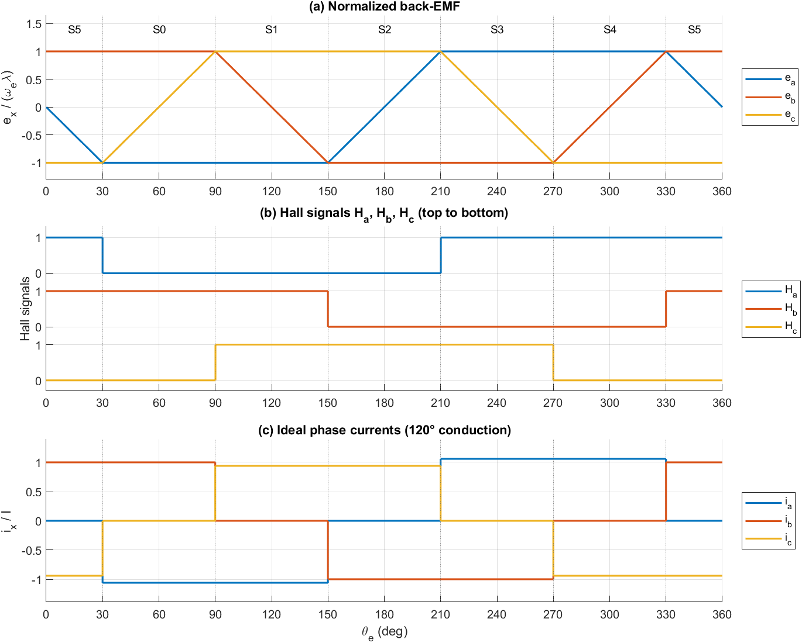
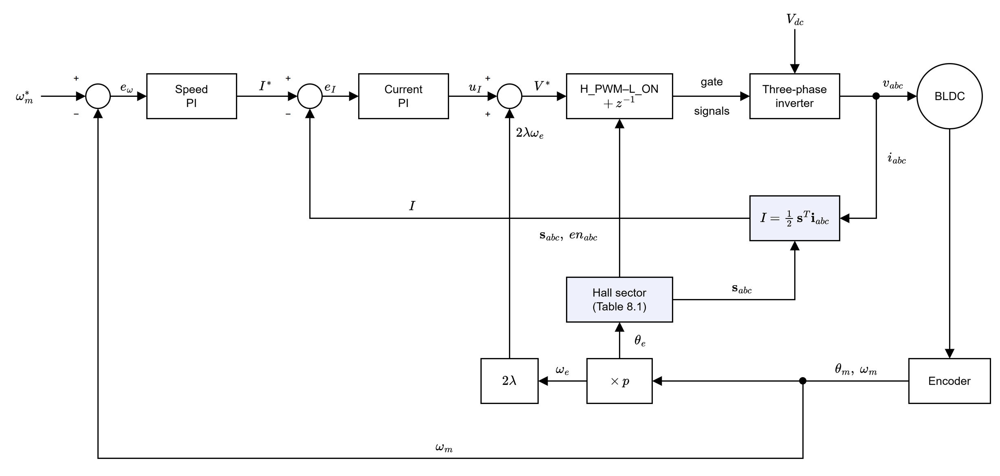
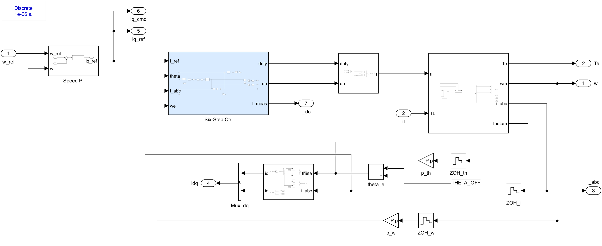
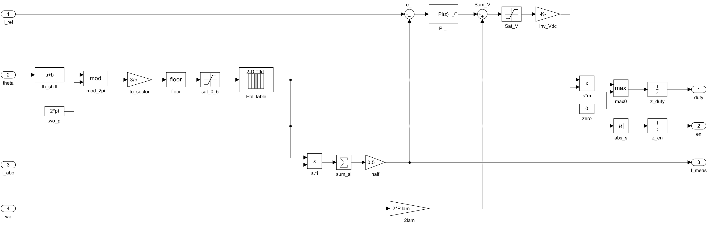
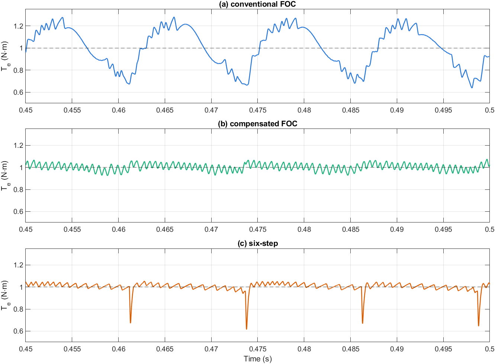
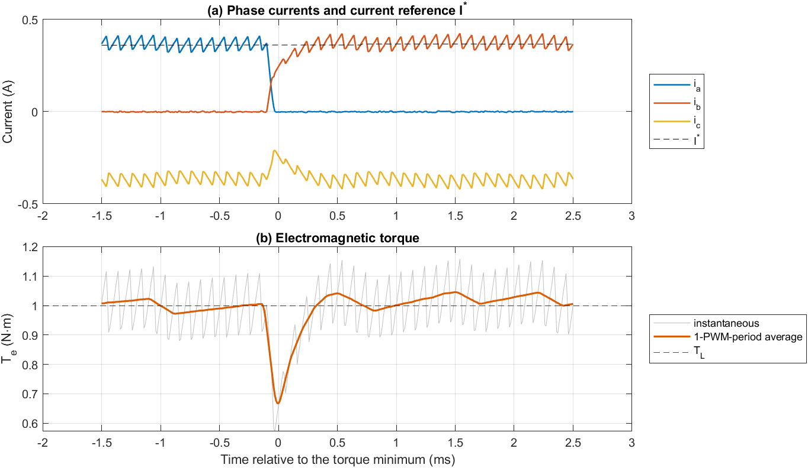
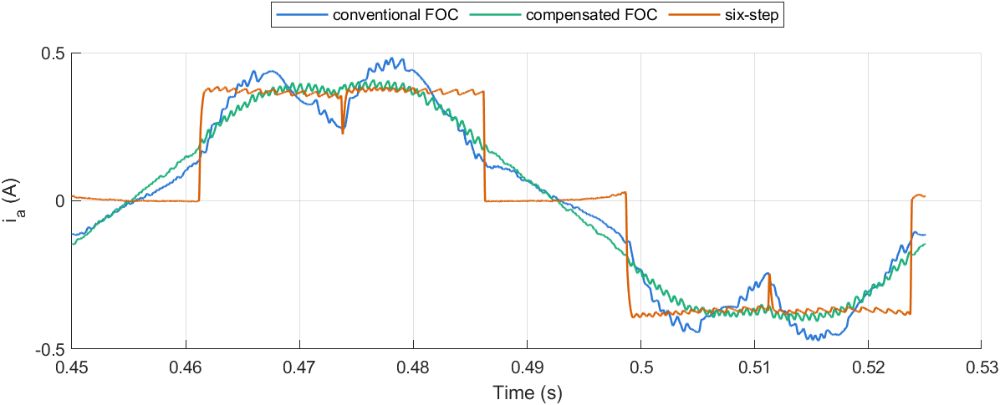
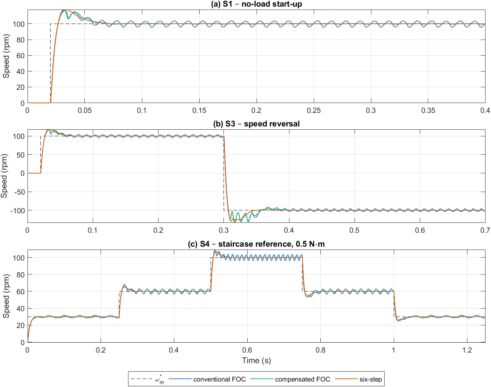
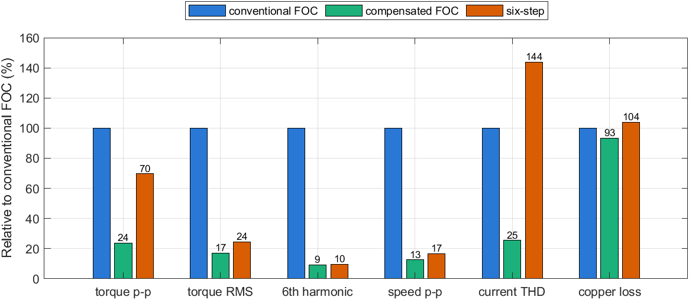

# Điều khiển six-step và so sánh ba bộ điều khiển

**Tài liệu 06** trong bộ tài liệu lý thuyết của đề tài *Điều khiển định hướng từ trường cho động cơ BLDC có sức phản điện động hình thang*.

| Tài liệu | Nội dung |
|---|---|
| [01 – Mô hình toán học động cơ BLDC](01_BLDC_model.md) | Chương 2 |
| [02 – Mô hình BLDC trên hệ tọa độ quay](02_dq_model.md) | Chương 3 |
| [03 – Thiết kế FOC và FOC thông thường](03_FOC_conventional.md) | Chương 4, 5 và mô hình Simulink FOC thông thường |
| [04 – FOC bù back-EMF hình thang](04_FOC_compensated.md) | Chương 6 và mô hình Simulink FOC bù |
| [05 – Mô phỏng và so sánh](05_simulation_results.md) | Chương 7 |
| **06 – Điều khiển six-step và so sánh ba bộ điều khiển** (tài liệu này) | Chương 8 và mô hình Simulink six-step |

---

## Tóm tắt

Tài liệu trình bày phương pháp điều khiển six-step (chuyển mạch 120°), là phương pháp kinh điển cho động cơ BLDC có back-EMF hình thang, và so sánh nó với FOC thông thường và FOC bù (Tài liệu 03–05) trên cùng mô hình Simulink mức chuyển mạch van, cùng thông số động cơ, nghịch lưu và bốn kịch bản S1–S4. Bộ điều khiển six-step gồm: xác định sector từ tín hiệu Hall, một bộ PI cho dòng của hai pha đang dẫn, bù sức phản điện động dây và điều chế H_PWM–L_ON. Ở chế độ có tải 1 N·m, 100 vòng/phút, six-step gần như triệt tiêu gợn bậc 6 liên tục (0,023 N·m, bằng FOC bù) nhưng tạo các xung sụt mô-men hẹp 33–39 % tại mỗi lần chuyển mạch, khớp với công thức giải tích của gợn chuyển mạch. Gợn mô-men RMS của six-step (0,043 N·m) thấp hơn nhiều so với FOC thông thường (0,177 N·m) và gần FOC bù (0,030 N·m), song tổn hao đồng lớn hơn khoảng 11 % và độ méo hài dòng pha cao (31,6 %). Đặc tính quá độ của ba bộ điều khiển gần như như nhau.

**Từ khóa:** BLDC; six-step; chuyển mạch 120°; cảm biến Hall; gợn mô-men chuyển mạch; FOC; so sánh bộ điều khiển.

---

## Mục lục

- [8. Điều khiển six-step](#8-điều-khiển-six-step)
  - [8.1. Nguyên lý chuyển mạch 120°](#81-nguyên-lý-chuyển-mạch-120)
  - [8.2. Cấu trúc bộ điều khiển](#82-cấu-trúc-bộ-điều-khiển)
  - [8.3. Gợn mô-men do chuyển mạch](#83-gợn-mô-men-do-chuyển-mạch)
  - [8.4. Tổn hao đồng so với FOC](#84-tổn-hao-đồng-so-với-foc)
  - [8.5. Mô hình Simulink](#85-mô-hình-simulink)
  - [8.6. Kết quả mô phỏng và so sánh ba bộ điều khiển](#86-kết-quả-mô-phỏng-và-so-sánh-ba-bộ-điều-khiển)
  - [8.7. Thảo luận](#87-thảo-luận)
  - [8.8. Hạn chế](#88-hạn-chế)
  - [8.9. Tái lập kết quả](#89-tái-lập-kết-quả)
- [Tài liệu tham khảo](#tài-liệu-tham-khảo)

---

## 8. Điều khiển six-step

### 8.1. Nguyên lý chuyển mạch 120°

#### 8.1.1. Mô-men với dòng chữ nhật 120°

Theo chương 2, sức phản điện động của pha $x \in \{a, b, c\}$ là

$$
e_x = \lambda\,\omega_e\, f_x(\theta_e), \qquad f_a = -F(\theta_e),\quad f_b = -F(\theta_e - 2\pi/3),\quad f_c = -F(\theta_e + 2\pi/3), \tag{8.1}
$$

với $F$ là dạng hình thang chuẩn hóa (biên độ 1, đỉnh phẳng 120°, sườn 60°, hàm `bldc_trap`). Trong mỗi khoảng 60° điện luôn có đúng hai pha nằm trên đỉnh phẳng (một pha $+1$, một pha $-1$) và một pha nằm trên sườn (Hình 8.1a). Six-step đưa dòng vào đúng hai pha có back-EMF phẳng: pha $+1$ mang dòng $+I$, pha $-1$ mang dòng $-I$, pha còn lại thả nổi. Gọi $s_x \in \{-1, 0, +1\}$ là trạng thái dẫn của pha $x$, dòng lý tưởng là $i_x = s_x I$ và mô-men điện từ

$$
T_e = \frac{e_a i_a + e_b i_b + e_c i_c}{\omega_m} = \frac{p\,\lambda\,\omega_m (1\cdot I + (-1)(-I))}{\omega_m} = 2p\lambda\, I = K_{t,6}\, I. \tag{8.2}
$$

Mô-men không phụ thuộc góc trong suốt sector, tức không có gợn nếu dòng là chữ nhật lý tưởng. Với thông số ở Bảng 5.3, $K_{t,6} = 2p\lambda = 2{,}736$ N·m/A, lớn hơn hệ số mô-men của FOC $K_t = \tfrac32 p\lambda_1 = 2{,}495$ N·m/A khoảng 10 %. Hai hệ số không so sánh trực tiếp được vì $I$ là biên độ dòng chữ nhật còn $i_q$ là biên độ dòng sin; so sánh công bằng theo tổn hao đồng được trình bày ở mục 8.4.

#### 8.1.2. Tín hiệu Hall và bảng chuyển mạch

Thời điểm chuyển mạch là các điểm $\theta_e = 30^\circ + k\cdot 60^\circ$, nơi một pha rời đỉnh phẳng và pha khác vừa lên đỉnh phẳng. Ba cảm biến Hall đặt lệch nhau 120° điện cho tín hiệu $H_x = 1$ trong nửa chu kỳ $f_x(\theta_e - 30^\circ) > 0$; các sườn của $H_a$, $H_b$, $H_c$ trùng đúng với sáu điểm chuyển mạch (Hình 8.1b). Chỉ số sector được tính từ góc điện:

$$
k = \left\lfloor \frac{\mathrm{mod}(\theta_e - \pi/6,\ 2\pi)}{\pi/3} \right\rfloor \in \{0, \ldots, 5\}. \tag{8.3}
$$

Bảng 8.1 là bảng chuyển mạch, được tạo tự động trong `six_step_init.m` bằng cách lấy dấu của (8.1) tại tâm mỗi sector.

*Bảng 8.1. Bảng chuyển mạch 120° (thứ tự quay thuận).*

| Sector | $\theta_e$ (độ) | $H_a H_b H_c$ | Pha $+$ (van trên PWM) | Pha $-$ (van dưới dẫn) | $\mathbf{s}_{abc}$ |
|---|---|---|---|---|---|
| 0 | 30–90 | 010 | b | a | $[-1,\ 1,\ 0]$ |
| 1 | 90–150 | 011 | c | a | $[-1,\ 0,\ 1]$ |
| 2 | 150–210 | 001 | c | b | $[0,\ -1,\ 1]$ |
| 3 | 210–270 | 101 | a | b | $[1,\ -1,\ 0]$ |
| 4 | 270–330 | 100 | a | c | $[1,\ 0,\ -1]$ |
| 5 | 330–30 | 110 | b | c | $[0,\ 1,\ -1]$ |

Mỗi lần chuyển mạch chỉ đổi một pha: chuyển mạch phía trên (ví dụ sector 4 → 5, pha dương đổi từ a sang b) và chuyển mạch phía dưới (sector 5 → 0, pha âm đổi từ c sang a) xen kẽ nhau.



*Hình 8.1. (a) Back-EMF chuẩn hóa và các sector S0–S5; (b) tín hiệu Hall; (c) dòng pha lý tưởng của chuyển mạch 120°. Đường chấm là các điểm chuyển mạch $\theta_e = 30^\circ + k\cdot 60^\circ$.*

> **Ghi chú – Hall và encoder.** Trong mô hình, sector được tính từ góc encoder theo (8.3), tương đương với việc giải mã ba tín hiệu Hall lý tưởng. Cách này giữ nguyên khối Power Stage dùng chung với FOC. Tham số `COMM_SHIFT` (rad điện) dịch toàn bộ bảng để mô phỏng sai lệch lắp đặt Hall hoặc góc chuyển mạch sớm (mục 8.7).

### 8.2. Cấu trúc bộ điều khiển

Sơ đồ khối của hệ six-step được cho ở Hình 8.2. So với FOC (Hình 4.1), six-step không cần biến đổi Clarke/Park, không cần SVPWM và chỉ có một bộ PI dòng.



*Hình 8.2. Sơ đồ khối hệ truyền động six-step: vòng tốc độ, vòng dòng hai pha dẫn với bù back-EMF dây, bảng chuyển mạch Hall và điều chế H_PWM–L_ON.*

#### 8.2.1. Đo dòng hai pha dẫn

Trong khoảng dẫn, dòng hai pha dẫn bằng nhau về độ lớn và ngược dấu. Đại lượng được điều khiển là

$$
I = \tfrac12\,\mathbf{s}^{T}\mathbf{i}_{abc} = \tfrac12\,(s_a i_a + s_b i_b + s_c i_c), \tag{8.4}
$$

bằng $I$ khi dòng là chữ nhật lý tưởng và tương đương với dòng một chiều phía nguồn. Dòng ba pha được lấy mẫu ở đáy sóng mang (10 kHz) như ở FOC.

#### 8.2.2. Vòng dòng và bù back-EMF

Hai pha dẫn mắc nối tiếp giữa hai cực nghịch lưu. Điện áp dây đặt lên chúng là

$$
v_{xy} = 2R\,I + 2L\,\frac{dI}{dt} + 2\lambda\,\omega_e, \tag{8.5}
$$

tức đối tượng là khâu quán tính bậc nhất $1/(2Ls + 2R)$ với nhiễu là back-EMF dây $2\lambda\omega_e$. Bộ điều khiển dòng là PI theo phương pháp IMC (như mục 4.2) cộng thêm bù $2\lambda\omega_e$:

$$
V^* = K_{p,i}\,e_I + K_{i,i}\!\int e_I\,dt + 2\lambda\,\omega_e, \qquad K_{p,i} = \frac{2L}{\tau_c} = 20{,}9\ \text{V/A},\quad K_{i,i} = \frac{2R}{\tau_c} = 2876\ \text{V/(A·s)}, \tag{8.6}
$$

với cùng $\tau_c = 0{,}318$ ms như FOC, nên băng thông vòng dòng của ba bộ điều khiển như nhau. Đầu ra PI được giới hạn ±$V_{dc}$, chống bão hòa kiểu back-calculation, và tổng $V^*$ được giới hạn ±$V_{dc}$.

#### 8.2.3. Điều chế H_PWM–L_ON

Với chỉ số điều chế $m = V^*/V_{dc} \in [-1, 1]$, hệ số điều chế và tín hiệu cho phép của từng pha là

$$
d_x = \max(s_x\, m,\ 0), \qquad en_x = |s_x|. \tag{8.7}
$$

Khi $m > 0$, pha $+$ được băm xung ở van trên với hệ số $m$, pha $-$ có van dưới dẫn liên tục, pha thả nổi bị khóa cả hai van ($en_x = 0$); điện áp dây trung bình là $m V_{dc}$. Khi $m < 0$ (hãm, đảo chiều), vai trò hai pha đổi cho nhau và điện áp dây là $-|m| V_{dc}$. Khối PWM dùng chung là khối so sánh bù (van trên và van dưới của một nhánh đóng ngắt bù nhau), nên trong thời gian van trên của pha $+$ ngắt, van dưới của nó dẫn (chỉnh lưu đồng bộ). Như ở SVPWM, $d_x$ và $en_x$ được trễ một chu kỳ lấy mẫu để mô phỏng thời gian tính toán.

#### 8.2.4. Vòng tốc độ

Vòng tốc độ giống FOC (mục 4.3): PI rời rạc 1 kHz, đặt cực tại 20 Hz, $\zeta = 1$, giới hạn dòng ±$I_{max} = 3$ A, nhưng với hệ số mô-men $K_{t,6}$:

$$
K_{p,\omega} = \frac{2\zeta\omega_n J - B}{K_{t,6}} = 0{,}135, \qquad K_{i,\omega} = \frac{J\,\omega_n^2}{K_{t,6}} = 8{,}48. \tag{8.8}
$$

Nhờ đó vòng tốc độ của six-step có cùng động học danh định với FOC (FOC: 0,148 và 9,30), và các chỉ tiêu quá độ của ba bộ điều khiển so sánh được với nhau.

### 8.3. Gợn mô-men do chuyển mạch

Dòng chữ nhật lý tưởng không thể đạt được vì điện cảm pha làm dòng pha ra giảm và dòng pha vào tăng với tốc độ hữu hạn. Xét chuyển mạch phía trên từ sector 4 sang 5 (pha $+$ đổi từ a sang b, pha c dẫn liên tục ở van dưới). Ngay sau chuyển mạch, dòng $i_a > 0$ của pha ra tiếp tục chảy qua diode dưới ($v_a = 0$), van trên pha b dẫn với hệ số $d$, van dưới pha c dẫn ($v_c = 0$); $e_a \approx e_b \approx E$, $e_c = -E$ với $E = \lambda\omega_e$. Bỏ qua điện trở, điện áp điểm trung tính là $v_n = (dV_{dc} - E)/3$ và

$$
L\frac{di_a}{dt} = -\frac{dV_{dc} + 2E}{3}, \qquad L\frac{d|i_c|}{dt} = \frac{dV_{dc} - 4E}{3}. \tag{8.9}
$$

Mô-men trong khoảng chuyển mạch tỉ lệ với dòng pha không chuyển mạch: $T_e = 2p\lambda\,|i_c|$. Khoảng chuyển mạch kết thúc khi $i_a = 0$, sau $t_c = 3LI/(dV_{dc} + 2E)$; khi đó $|i_c|$ đã thay đổi một lượng tương đối

$$
\frac{\Delta T_e}{T_e} = \frac{\Delta |i_c|}{I} = \frac{d\,V_{dc} - 4E}{d\,V_{dc} + 2E}. \tag{8.10}
$$

Với $d = 1$ (bộ PI dòng bão hòa), (8.10) trở thành công thức kinh điển của Carlson và cộng sự [1]; chuyển mạch phía dưới cho cùng kết quả khi $d = 1$. Từ (8.10):

- $V_{dc} > 4E$ (tốc độ thấp): dòng pha không chuyển mạch tăng, mô-men nhô lên;
- $V_{dc} = 4E$: không có gợn chuyển mạch; với động cơ này điều đó xảy ra tại $\omega_m = V_{dc}/(4p\lambda) = 62{,}8$ vòng/phút;
- $V_{dc} < 4E$ (tốc độ cao): mô-men sụt.

Tại 100 vòng/phút, $E = 14{,}3$ V, $4E = 57{,}3$ V > $V_{dc} = 36$ V, nên (8.10) dự báo mô-men sụt ít nhất 33 % tại mỗi lần chuyển mạch. Vì gợn này lặp lại sáu lần mỗi chu kỳ điện, tần số cơ bản của nó cũng là $6 f_e$, nhưng các xung rất hẹp ($t_c = 3LI/(V_{dc}+2E) \approx 0{,}06$ ms tại 1 N·m, 100 vòng/phút) nên biên độ thành phần bậc 6 nhỏ.

### 8.4. Tổn hao đồng so với FOC

So sánh hai cách cấp dòng cho cùng mô-men $T$, bỏ qua gợn:

- six-step: $I = T/(2p\lambda)$, mỗi pha dẫn 2/3 chu kỳ nên $I_{rms}^2 = \tfrac23 I^2$ và $P_{Cu,6} = 3R\,I_{rms}^2 = 2R\,I^2$;
- FOC với dòng sin: $i_q = T/(\tfrac32 p\lambda_1)$ và $P_{Cu,FOC} = \tfrac32 R\,i_q^2$.

Tỉ số tổn hao đồng là

$$
\frac{P_{Cu,6}}{P_{Cu,FOC}} = \frac{2R\,T^2/(2p\lambda)^2}{\tfrac32 R\,T^2/(\tfrac32 p\lambda_1)^2} = \frac34\left(\frac{\lambda_1}{\lambda}\right)^2 = \frac34\, b_1^2 = 1{,}109, \tag{8.11}
$$

với $b_1 = 12/\pi^2$ (chương 2). Với back-EMF hình thang có sườn 60°, dòng sin cho cùng mô-men với tổn hao đồng ít hơn khoảng 10 % so với dòng chữ nhật 120°. Nguyên nhân là phần sườn chiếm 1/3 chu kỳ, nên dạng sóng này còn khá gần sin và thành phần cơ bản của nó đã chứa phần lớn năng lượng ($b_1^2/2 \big/ \overline{f^2} = 0{,}95$). Ưu thế của dòng chữ nhật chỉ xuất hiện khi đỉnh phẳng rộng hơn, sườn dốc hơn.

### 8.5. Mô hình Simulink

Mô hình `Six_Step.slx` nằm trong thư mục `03_Simulation/Six_Step` và được dựng theo quy trình thêm bộ điều khiển mới của repo. Các khối Power Stage, PWM và abc_to_dq là liên kết tới thư viện dùng chung `bldc_plant_lib.slx`; mô hình dùng `powergui` rời rạc 1 µs và có giao diện cổng giống hai mô hình FOC (Hình 8.3). Khối abc_to_dq chỉ dùng để ghi $i_d$, $i_q$ phục vụ so sánh và không tham gia điều khiển. Cổng ra thêm `i_dc` (cổng 7) ghi dòng đo $I$ theo (8.4).



*Hình 8.3. Tầng ngoài cùng của mô hình `Six_Step.slx`. Khối Six-Step Ctrl thay cho Current PI và SVPWM của mô hình FOC; Speed PI, PWM, Power Stage và phần đo góc/tốc độ được giữ nguyên.*

Khối Six-Step Ctrl (Hình 8.4) hiện thực trực tiếp các phương trình (8.3), (8.4), (8.6) và (8.7): chuỗi `th_shift`–`mod_2pi`–`to_sector`–`floor`–`sat_0_5` tính sector, khối tra trực tiếp `Hall table` (bảng `SS.tab` 3×6) cho $\mathbf{s}_{abc}$, nhánh `s.*i`–`sum_si`–`half` tính $I$, khối `PI_I` cộng bù `2lam` tạo $V^*$, và nhánh `s*m`–`max0`, `abs_s` tạo $d_{abc}$, $en_{abc}$ qua hai khâu trễ `z_duty`, `z_en`.



*Hình 8.4. Khối Six-Step Ctrl: xác định sector, bảng chuyển mạch, đo dòng hai pha dẫn, PI dòng với bù back-EMF và điều chế H_PWM–L_ON.*

*Bảng 8.2. Tham số của bộ điều khiển six-step (`six_step_init.m`). Thông số động cơ, nghịch lưu và chu kỳ lấy mẫu lấy từ `Common/bldc_params.m`.*

| Tham số | Ký hiệu trong mã | Giá trị |
|---|---|---|
| Hệ số mô-men $K_{t,6} = 2p\lambda$ | `P.Kt_6s` | 2,736 N·m/A |
| PI dòng $K_{p,i}$, $K_{i,i}$ | `P.Kp_i6`, `P.Ki_i6` | 20,9 V/A; 2876 V/(A·s) |
| PI tốc độ $K_{p,\omega}$, $K_{i,\omega}$ | `P.Kp_w_6s`, `P.Ki_w_6s` | 0,135; 8,48 |
| Bảng chuyển mạch (Bảng 8.1) | `SS.tab` | ma trận 3×6 |
| Biên sector đầu tiên | `SS.th0` | $\pi/6$ |
| Dịch góc chuyển mạch | `SS.shift` (`COMM_SHIFT`) | 0 |
| Giới hạn điện áp, dòng | `P.Vdc`, `P.Imax` | 36 V; 3 A |

### 8.6. Kết quả mô phỏng và so sánh ba bộ điều khiển

Ba bộ điều khiển được mô phỏng trên cùng đối tượng và cùng bốn kịch bản S1–S4 như chương 7; các chỉ tiêu được tính bằng cùng hàm `Common/bldc_kpi.m` theo các định nghĩa ở Bảng 7.1.

*Bảng 8.3. Chỉ tiêu chất lượng của ba bộ điều khiển (KB: kịch bản). "–": không vào được dải ±2 vòng/phút.*

| KB | Chỉ tiêu | FOC thông thường | FOC bù | Six-step |
|---|---|---|---|---|
| S1 | Thời gian lên (ms) | 4,74 | 4,82 | 4,73 |
| S1 | Độ quá điều chỉnh (%) | 18,0 | 16,9 | 17,9 |
| S1 | Thời gian xác lập ±2 vòng/phút (ms) | – | 42,3 | 39,0 |
| S1 | Gợn tốc độ không tải (vòng/phút) | 8,42 | 0,49 | 0,86 |
| S1 | Gợn mô-men không tải đ–đ (N·m) | 0,767 | 0,137 | 0,142 |
| S2 | Độ sụt tốc khi đóng tải (vòng/phút) | 22,9 | 21,1 | 20,8 |
| S2 | Thời gian phục hồi ±2 vòng/phút (ms) | – | 39,9 | 36,5 |
| S2 | Gợn mô-men đỉnh–đỉnh (N·m) | 0,642 | 0,153 | 0,447 |
| S2 | Gợn mô-men RMS (N·m) | 0,177 | 0,030 | 0,043 |
| S2 | Biên độ gợn bậc 6, 80 Hz (N·m) | 0,239 | 0,022 | 0,023 |
| S2 | Gợn tốc độ đỉnh–đỉnh (vòng/phút) | 6,90 | 0,87 | 1,16 |
| S2 | THD dòng pha, bậc 2–41 (%) | 22,0 | 5,6 | 31,6 |
| S2 | Dòng pha RMS (A) | 0,296 | 0,286 | 0,302 |
| S2 | Tổn hao đồng (W) | 0,121 | 0,113 | 0,125 |
| S3 | Thời gian qua tốc độ 0 (ms) | 2,81 | 2,63 | 2,61 |
| S3 | Độ vọt lố khi đảo chiều (%) | 33,8 | 32,4 | 30,0 |
| S3 | Dòng pha đỉnh (A) | 2,56 | 2,72 | 2,81 |
| S4 | Thời gian xác lập TB các bậc (ms) | – | 33,7 | 28,3 |
| S4 | Gợn tốc độ ở 30 vòng/phút (vòng/phút) | 3,62 | 0,81 | 2,02 |



*Hình 8.5. Mô-men điện từ ở chế độ xác lập có tải 1 N·m, 100 vòng/phút (S2, trung bình một chu kỳ PWM) của ba bộ điều khiển. Six-step có mô-men gần phẳng xen kẽ các xung sụt hẹp mỗi 12,5 ms (mỗi lần chuyển mạch).*



*Hình 8.6. Một lần chuyển mạch phía trên của six-step (S2, pha $+$ đổi từ a sang b). (a) Dòng pha ra $i_a$ giảm về 0 trong khoảng 0,1 ms, dòng pha vào $i_b$ tăng chậm hơn, nên độ lớn dòng pha không chuyển mạch $|i_c|$ sụt từ 0,37 A xuống khoảng 0,21 A; (b) mô-men sụt tương ứng.*



*Hình 8.7. Dòng pha $i_a$ trong một chu kỳ điện (S2). Six-step cho dòng chữ nhật 120° với các vết lõm khi pha khác chuyển mạch; hai bộ FOC cho dòng gần sin.*



*Hình 8.8. Đáp ứng tốc độ ở các kịch bản S1, S3, S4 của ba bộ điều khiển. Quá độ gần như trùng nhau; khác biệt nằm ở dao động xác lập.*



*Hình 8.9. Các chỉ tiêu xác lập chính ở kịch bản S2, tính theo phần trăm so với FOC thông thường.*

### 8.7. Thảo luận

**Gợn mô-men.** Ở S2, six-step giảm gợn mô-men RMS 76 % và biên độ bậc 6 tới 90 % so với FOC thông thường, gần bằng FOC bù, vì trong phần lớn mỗi sector mô-men gần phẳng theo (8.2). Tuy nhiên gợn đỉnh–đỉnh (0,447 N·m) lớn gấp ba FOC bù vì các xung sụt chuyển mạch (Hình 8.5, 8.6). Mô-men trung bình một chu kỳ PWM sụt xuống 0,61–0,68 N·m (33–39 %) và mô-men tức thời xuống khoảng 0,58 N·m (42 %), trong khi (8.10) với $d = 1$ dự báo 33 %. Sụt thực tế lớn hơn một chút vì lúc bắt đầu chuyển mạch $d \approx 0{,}8$ (phần dư điện áp $V_{dc} - 2E$ nhỏ) và PI dòng cần vài chu kỳ lấy mẫu để bão hòa; với $d = 0{,}8$, (8.10) cho khoảng 50 %. Độ sâu các xung xen kẽ nhau (0,61 và 0,67 N·m) giữa chuyển mạch phía trên và phía dưới, vì hai kiểu chuyển mạch chỉ cho cùng kết quả khi $d = 1$.

**Gợn tốc độ.** Các xung sụt hẹp bị quán tính lọc mạnh, nên gợn tốc độ của six-step ở 100 vòng/phút (1,16 vòng/phút) chỉ lớn hơn FOC bù một chút. Ở 30 vòng/phút (S4) gợn tốc độ của six-step là 2,02 vòng/phút, lớn gấp 2,5 lần FOC bù: tại tốc độ này $V_{dc} > 4E$, mô-men nhô lên thay vì sụt, và chu kỳ gợn dài hơn (24 Hz) nên quán tính lọc kém hơn.

**Dòng pha và tổn hao.** THD dòng pha của six-step là 31,6 %, gần với giá trị của sóng chữ nhật 120° lý tưởng tính tới bậc 41 (≈ 29,8 %); phần chênh do sườn chuyển mạch hữu hạn và gợn PWM. Dòng pha RMS lớn hơn FOC bù 5,5 %, tổn hao đồng lớn hơn 11,2 %, khớp với (8.11) (10,9 %). So với FOC thông thường, chênh lệch chỉ còn 3,9 % vì dòng của FOC thông thường bị dao động bậc 6 làm tăng giá trị RMS.

**Chế độ quá độ.** Nhờ thiết kế vòng tốc độ theo $K_{t,6}$ (8.8), thời gian lên, độ quá điều chỉnh và độ sụt tốc của ba bộ điều khiển gần như trùng nhau (Bảng 8.3, Hình 8.8). Six-step có thời gian xác lập và phục hồi ngắn nhất vì không có dao động xác lập kéo dài, và vọt lố khi đảo chiều thấp nhất (30,0 %). Dòng pha đỉnh ở S3 lớn hơn FOC thông thường 10 %, do dòng chữ nhật có biên độ bằng $I$ trong khi dòng sin chỉ đạt biên độ tại một điểm.

**Độ nhạy với góc chuyển mạch.** Quét `COMM_SHIFT` trong kịch bản hiệu chỉnh (tải 1 N·m, 100 vòng/phút) cho gợn mô-men đỉnh–đỉnh 0,447 N·m tại 0°, 0,50–0,66 N·m tại ±5°, 1,0–1,5 N·m tại ±10° và 2,5–3,4 N·m tại ±15°. Six-step ít nhạy hơn FOC bù ở sai lệch nhỏ (FOC bù tăng gấp ba khi lệch ±5°, mục 7.4), nhưng sai lệch Hall cỡ 10° đã làm gợn đỉnh–đỉnh lớn hơn FOC thông thường. Chuyển mạch sớm +5° giảm nhẹ gợn RMS (0,041 so với 0,043 N·m), phù hợp với việc bù một phần độ trễ lấy mẫu và thời gian chuyển mạch.

*Bảng 8.4. So sánh định tính ba bộ điều khiển trên động cơ BLDC back-EMF hình thang.*

| Tiêu chí | FOC thông thường | FOC bù | Six-step |
|---|---|---|---|
| Cảm biến vị trí | Encoder (góc liên tục) | Encoder chính xác vài độ điện | 3 Hall (6 trạng thái) |
| Biến đổi tọa độ | Clarke, Park, Park ngược | Clarke, Park, Park ngược | Không |
| Số bộ PI dòng | 2 | 2 | 1 |
| Điều chế | SVPWM | SVPWM | H_PWM–L_ON |
| Thông tin động cơ cần biết | $L$, $\lambda_1$ | $L$, dạng back-EMF (bảng tra), trễ số | $L$, $\lambda$ |
| Gợn mô-men xác lập | Lớn (bậc 6) | Nhỏ nhất | Xung sụt khi chuyển mạch |
| Tổn hao đồng | Trung bình | Thấp nhất | Cao nhất (+11 %) |
| Độ méo dòng pha | Trung bình | Thấp | Cao (sóng chữ nhật) |
| Độ phức tạp tính toán | Trung bình | Cao | Thấp |

**Kết luận của so sánh.** Trên động cơ BLDC back-EMF hình thang, FOC thông thường là lựa chọn kém nhất: phức tạp hơn six-step mà gợn mô-men lớn hơn bốn lần (RMS). Six-step đạt gợn RMS gần FOC bù với phần cứng và tính toán đơn giản nhất, phù hợp khi ưu tiên chi phí và tốc độ thấp. FOC bù cho mô-men êm nhất và tổn hao đồng thấp nhất, phù hợp với các ứng dụng đòi hỏi mô-men êm (servo, robot), với điều kiện có encoder chính xác và dạng back-EMF được nhận dạng tốt. Ở tốc độ cao ($V_{dc} < 4E$), gợn chuyển mạch của six-step tăng theo (8.10) và cần các kỹ thuật bù chuyển mạch [1], [3].

### 8.8. Hạn chế

1. **Hall lý tưởng.** Sector được tính từ góc encoder lý tưởng, nên không có sai lệch lắp đặt, độ trễ và rung tín hiệu Hall. Ảnh hưởng của sai lệch góc được đánh giá riêng bằng `COMM_SHIFT`.
2. **Không bù chuyển mạch.** Bộ điều khiển dùng chiến lược six-step cơ bản; các kỹ thuật giảm gợn chuyển mạch (điều khiển dòng pha không chuyển mạch, chồng lấn chuyển mạch, thay đổi kiểu PWM trong khoảng chuyển mạch [3]) chưa được xét.
3. **Đo dòng.** Dòng $I$ được tính từ ba dòng pha đo được; trong thực tế six-step thường đo một điện trở shunt ở DC bus, khi đó dòng của pha thả nổi trong khoảng chuyển mạch không đo được.
4. **Các hạn chế chung** của mô hình động cơ và nghịch lưu lý tưởng như ở mục 7.5 (không thời gian chết, back-EMF hình thang lý tưởng, chỉ xét tới ±100 vòng/phút).

### 8.9. Tái lập kết quả

```matlab
% 1. chạy mô phỏng (mỗi bộ điều khiển khoảng 15-60 s)
run('03_Simulation/Conventional_FOC/run_conv_foc.m')
run('03_Simulation/Compensated_FOC/run_comp_foc.m')
run('03_Simulation/Six_Step/run_six_step.m')
% 2. bảng chỉ tiêu ba bộ điều khiển (04_Results/Tables/kpi_comparison.*)
run('04_Results/make_results.m')
% 3. hình fig8_* và các số liệu của chương 8 (04_Results/Tables/six_step_numbers.csv)
SIMULINK_SCREENSHOTS = true; run('04_Results/make_six_step_figures.m')
% 4. (tùy chọn) kiểm tra hồi quy
addpath('03_Simulation/Tests')
bldc_regression('Controllers', {'six'}, 'Scenarios', {'S1','S2','S3','S4'})
```

Hình 8.2 được vẽ trong trang *Fig. 8.2 - Six-step drive* của `foc_block_diagram.drawio` và xuất PNG bằng draw.io.

---

## Tài liệu tham khảo

1. R. Carlson, M. Lajoie-Mazenc, and J. C. dos S. Fagundes, "Analysis of torque ripple due to phase commutation in brushless dc machines," *IEEE Trans. Ind. Appl.*, vol. 28, no. 3, pp. 632–638, 1992.
2. P. Pillay and R. Krishnan, "Modeling, simulation, and analysis of permanent-magnet motor drives, Part II: The brushless DC motor drive," *IEEE Trans. Ind. Appl.*, vol. 25, no. 2, pp. 274–279, 1989.
3. R. Krishnan, *Permanent Magnet Synchronous and Brushless DC Motor Drives*. Boca Raton, FL, USA: CRC Press, 2010.
4. T. M. Jahns and W. L. Soong, "Pulsating torque minimization techniques for permanent magnet AC motor drives — A review," *IEEE Trans. Ind. Electron.*, vol. 43, no. 2, pp. 321–330, 1996.
5. D. G. Holmes and T. A. Lipo, *Pulse Width Modulation for Power Converters: Principles and Practice*. Piscataway, NJ, USA: IEEE Press / Wiley, 2003.
