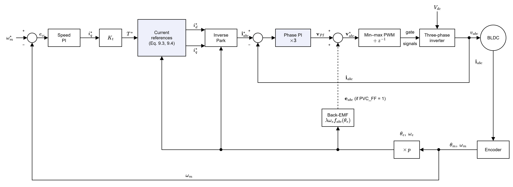
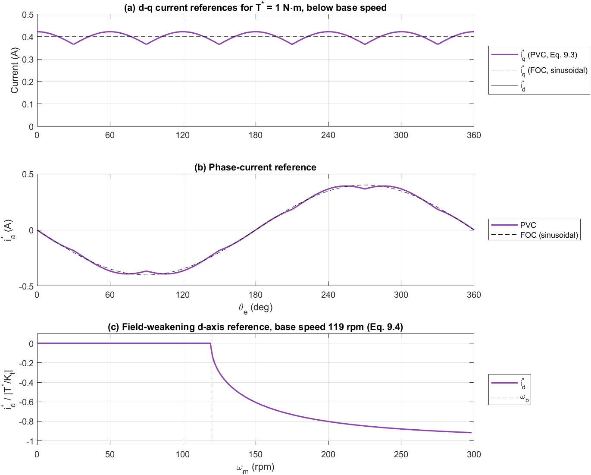
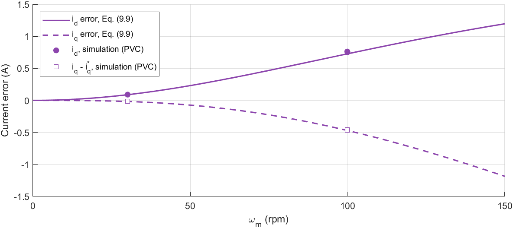
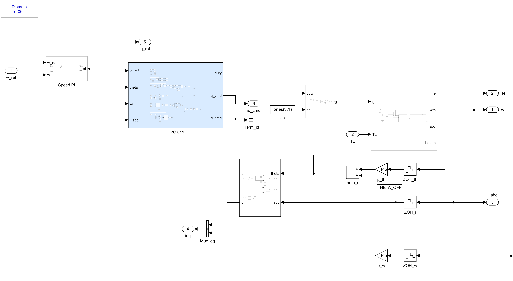
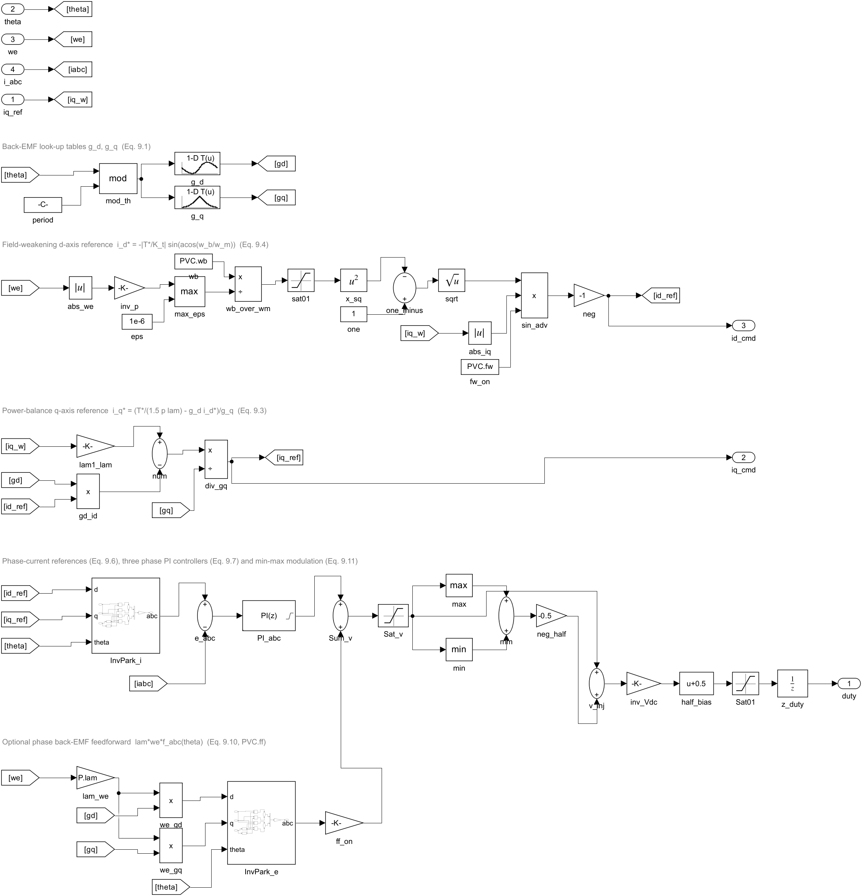
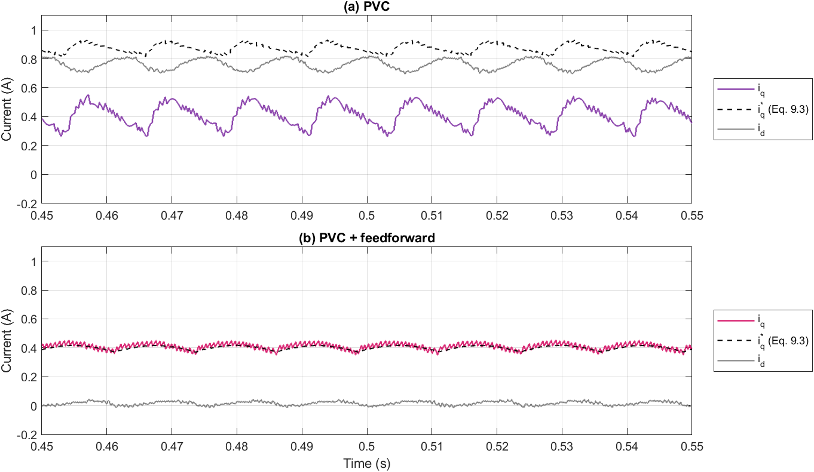
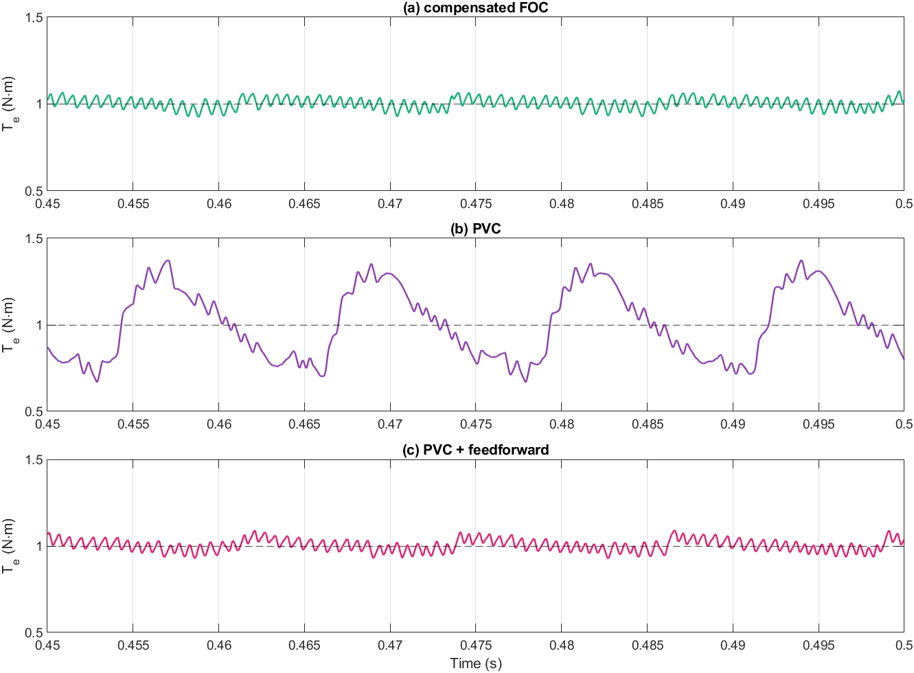
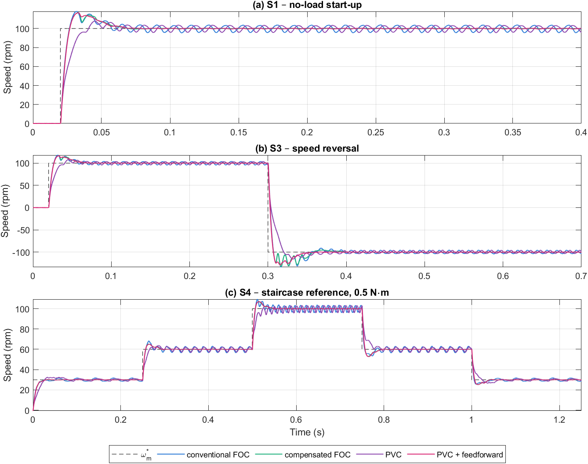
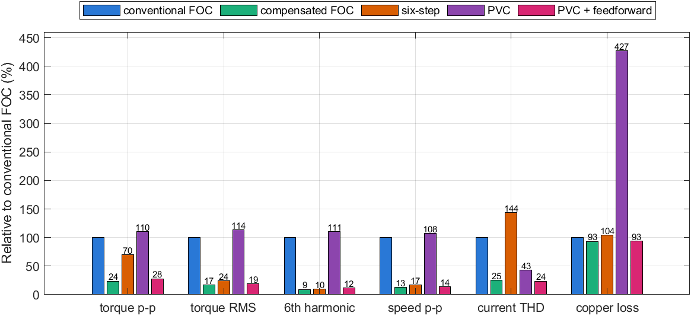

# Điều khiển giả vector (PVC) cho động cơ BLDC back-EMF hình thang

**Tài liệu 07** trong bộ tài liệu lý thuyết của đề tài *Điều khiển định hướng từ trường cho động cơ BLDC có sức phản điện động hình thang*.

| Tài liệu | Nội dung |
|---|---|
| [01 – Mô hình toán học động cơ BLDC](01_BLDC_model.md) | Chương 2 |
| [02 – Mô hình BLDC trên hệ tọa độ quay](02_dq_model.md) | Chương 3 |
| [03 – Thiết kế FOC và FOC thông thường](03_FOC_conventional.md) | Chương 4, 5 và mô hình Simulink FOC thông thường |
| [04 – FOC bù back-EMF hình thang](04_FOC_compensated.md) | Chương 6 và mô hình Simulink FOC bù |
| [05 – Mô phỏng và so sánh](05_simulation_results.md) | Chương 7 |
| [06 – Điều khiển six-step và so sánh ba bộ điều khiển](06_six_step.md) | Chương 8 và mô hình Simulink six-step |
| **07 – Điều khiển giả vector (PVC)** (tài liệu này) | Chương 9 và mô hình Simulink PVC |

---

## Tóm tắt

Tài liệu trình bày phương pháp điều khiển giả vector (pseudo vector control, PVC) theo bằng sáng chế US 7,339,346 của NSK và đánh giá nó trên cùng mô hình Simulink mức chuyển mạch van, cùng thông số và bốn kịch bản S1–S4 như các bộ điều khiển trước. PVC tính dòng đặt bằng lý thuyết vector (dòng $i_q^*$ từ cân bằng công suất với back-EMF hình thang, dòng $i_d^*$ suy yếu từ thông), đổi sang dòng đặt ba pha, rồi điều khiển từng pha bằng một bộ PI riêng thay cho vòng dòng $d$–$q$. Phân tích cho thấy khi dưới tốc độ cơ sở, dòng đặt của PVC trùng với khâu định dạng dòng của FOC bù (6.4). Điểm yếu nằm ở vòng dòng: bộ PI trên hệ tọa độ đứng yên phải tự tạo điện áp back-EMF xoay chiều nên sinh ra sai lệch dòng tỉ lệ với tốc độ, tính được bằng công thức (9.9). Tại 100 vòng/phút, sai lệch này là 0,87 A (mô phỏng: 0,76 A trục $d$ và −0,46 A trục $q$), làm dòng RMS tăng gấp đôi và tổn hao đồng tăng 4,6 lần so với FOC bù, trong khi gợn mô-men còn lớn hơn FOC thông thường. Khi thêm bù back-EMF từng pha, sai lệch này biến mất và PVC đạt gợn mô-men RMS 0,034 N·m, gần FOC bù (0,030 N·m).

**Từ khóa:** BLDC; điều khiển giả vector; PVC; back-EMF hình thang; điều khiển dòng pha; bộ PI hệ tọa độ đứng yên; gợn mô-men.

---

## Mục lục

- [9. Điều khiển giả vector (PVC)](#9-điều-khiển-giả-vector-pvc)
  - [9.1. Ý tưởng của PVC](#91-ý-tưởng-của-pvc)
  - [9.2. Tính dòng đặt bằng lý thuyết vector](#92-tính-dòng-đặt-bằng-lý-thuyết-vector)
  - [9.3. Điều khiển dòng từng pha](#93-điều-khiển-dòng-từng-pha)
  - [9.4. Mô hình Simulink](#94-mô-hình-simulink)
  - [9.5. Kết quả mô phỏng](#95-kết-quả-mô-phỏng)
  - [9.6. Thảo luận](#96-thảo-luận)
  - [9.7. Hạn chế](#97-hạn-chế)
  - [9.8. Tái lập kết quả](#98-tái-lập-kết-quả)
- [Tài liệu tham khảo](#tài-liệu-tham-khảo)

---

## 9. Điều khiển giả vector (PVC)

### 9.1. Ý tưởng của PVC

PVC được đề xuất cho động cơ BLDC dùng trong hệ trợ lực lái điện [1]. Lập luận của bằng sáng chế: FOC thông thường điều khiển dòng trong hệ $d$–$q$, nên các phi tuyến của từng pha (thời gian chết, mạch đo dòng) bị phép biến đổi Park trộn sang cả ba pha. PVC tách bài toán làm hai phần:

- **Tính dòng đặt bằng lý thuyết vector:** back-EMF ba pha được đổi sang hệ $d$–$q$, dòng $i_q^*$ được tính từ phương trình công suất có xét back-EMF hình thang, dòng $i_d^*$ được dùng để suy yếu từ thông ở tốc độ cao. Sau đó dòng đặt được đổi về ba pha.
- **Điều khiển dòng theo từng pha:** mỗi pha có một bộ PI riêng so sánh dòng đặt và dòng đo của pha đó; không có biến đổi Park trong vòng hồi tiếp.

Vì lý thuyết vector chỉ dùng ở khâu tính dòng đặt, phương pháp được gọi là điều khiển "giả" vector. Sơ đồ khối được cho ở Hình 9.1.



*Hình 9.1. Sơ đồ khối hệ truyền động PVC: vòng tốc độ, khối tính dòng đặt theo lý thuyết vector, biến đổi Park ngược, ba bộ PI dòng pha và điều chế min–max. Nhánh nét đứt là phần bù back-EMF từng pha, không có trong bằng sáng chế, được thêm vào ở biến thể PVC + bù.*

### 9.2. Tính dòng đặt bằng lý thuyết vector

#### 9.2.1. Back-EMF trên hệ $d$–$q$

Như chương 3, back-EMF trên hệ $d$–$q$ là

$$
e_d = \lambda\,\omega_e\, g_d(\theta_e), \qquad e_q = \lambda\,\omega_e\, g_q(\theta_e), \tag{9.1}
$$

với $g_d$, $g_q$ là các hàm tuần hoàn chu kỳ $\pi/3$ (3.6) và $g_q \in [1{,}155;\ 1{,}333]$ (3.8). Bằng sáng chế dùng bảng tra back-EMF pha theo góc rồi biến đổi Park; mô hình dùng trực tiếp hai bảng $g_d$, $g_q$ giống FOC bù (6.6), cho cùng kết quả.

#### 9.2.2. Dòng trục $q$ từ cân bằng công suất

Bằng sáng chế cho công suất điện từ bằng công suất cơ:

$$
T^*\,\omega_m = \tfrac32\,\big(e_d\, i_d^* + e_q\, i_q^*\big). \tag{9.2}
$$

Rút $i_q^*$ và chia cả tử và mẫu cho $\omega_e = p\,\omega_m$ để tránh dạng $0/0$ khi đứng yên:

$$
i_q^* = \frac{T^*/(\tfrac32\,p\lambda) - g_d(\theta_e)\, i_d^*}{g_q(\theta_e)}. \tag{9.3}
$$

Mô-men đặt được lấy từ đầu ra PI tốc độ (giống FOC): $T^* = K_t\, i_{q,\omega}^*$ với $K_t = \tfrac32 p\lambda_1$. Khi $i_d^* = 0$, (9.3) trở thành $i_q^* = i_{q,\omega}^*\,(\lambda_1/\lambda)/g_q(\theta_e)$, **trùng với khâu định dạng dòng $k_s$ của FOC bù** (6.4). Khác biệt duy nhất là FOC bù tra bảng tại góc đã bù trễ $\theta_a$ (6.5), còn PVC dùng góc đo $\theta_e$. Như vậy dòng đặt của PVC cũng khử gợn mô-men bậc 6 theo nguyên lý của chương 6 (Hình 9.2a, b).

#### 9.2.3. Dòng trục $d$ suy yếu từ thông

Trên tốc độ cơ sở $\omega_b$, bằng sáng chế đặt

$$
i_d^* = \begin{cases} 0, & |\omega_m| \le \omega_b \\[2pt] -\left|\dfrac{T^*}{K_t}\right| \sin\!\Big(\arccos\dfrac{\omega_b}{|\omega_m|}\Big), & |\omega_m| > \omega_b \end{cases} \tag{9.4}
$$

Bằng sáng chế tính $\omega_b$ từ mô-men đặt. Mô hình dùng một hằng số: tốc độ tại đó biên độ back-EMF cơ bản bằng giới hạn điện áp pha của SVPWM,

$$
\omega_b = \frac{V_{dc}/\sqrt3}{p\,\lambda_1} = 12{,}49\ \text{rad/s} = 119{,}3\ \text{vòng/phút}. \tag{9.5}
$$

Hệ số $\sin(\arccos(\omega_b/\omega_m))$ tăng nhanh ngay sau $\omega_b$ rồi tiến dần tới 1 (Hình 9.2c). Trong các kịch bản S1–S4 (tối đa ±100 vòng/phút), $i_d^*$ chỉ khác 0 trong đoạn vọt lố khi đảo chiều (S3).

#### 9.2.4. Dòng đặt ba pha

Dòng đặt pha được tính bằng biến đổi Park ngược và Clarke ngược:

$$
\begin{bmatrix} i_a^* \\ i_b^* \\ i_c^* \end{bmatrix} = \mathbf{K}_{ic}
\begin{bmatrix} \cos\theta_e & -\sin\theta_e \\ \sin\theta_e & \cos\theta_e \end{bmatrix}
\begin{bmatrix} i_d^* \\ i_q^* \end{bmatrix}. \tag{9.6}
$$

Dòng đặt pha gần sin với các "vết lõm" nhỏ tại các điểm chuyển mạch của back-EMF (Hình 9.2b). Đây chính là dạng dòng giữ cho mô-men phẳng với back-EMF hình thang có sườn 60°.



*Hình 9.2. Dòng đặt của PVC: (a) $i_d^*$, $i_q^*$ theo (9.3) cho $T^* = 1$ N·m dưới tốc độ cơ sở, so với $i_q^*$ hằng của FOC; (b) dòng đặt pha $a$; (c) dòng $i_d^*$ suy yếu từ thông theo (9.4).*

### 9.3. Điều khiển dòng từng pha

#### 9.3.1. Bộ PI dòng pha

Mỗi pha có một bộ PI rời rạc 10 kHz:

$$
v_{PI,x} = K_{p,i}\, e_x + K_{i,i}\!\int e_x\,dt, \qquad e_x = i_x^* - i_x,\quad x \in \{a, b, c\}, \tag{9.7}
$$

với cùng hệ số IMC như FOC ($K_{p,i} = L/\tau_c = 10{,}46$ V/A, $K_{i,i} = R/\tau_c = 1438$ V/(A·s), $\tau_c = 0{,}318$ ms), giới hạn ±$V_{dc}/\sqrt3$ và chống bão hòa back-calculation. Ba dòng pha luôn có tổng bằng 0 (động cơ nối sao, không nối trung tính) nên tổng ba sai lệch cũng bằng 0 và ba khâu tích phân không trôi theo thứ tự không.

#### 9.3.2. Bám tín hiệu xoay chiều

Với $Z(j\omega) = R + j\omega L$ và $C(j\omega) = K_{p,i} + K_{i,i}/(j\omega)$, hàm truyền từ dòng đặt tới dòng pha (bỏ qua trễ số) là

$$
T(j\omega) = \frac{C(j\omega)}{Z(j\omega) + C(j\omega)} = \frac{1}{1 + j\omega\tau_c}. \tag{9.8}
$$

Khác với vòng dòng $d$–$q$ (nơi dòng đặt gần như không đổi), dòng đặt pha của PVC là tín hiệu xoay chiều tần số $f_e$ cộng các sóng hài bậc $6k \pm 1$ của khâu định dạng. Bảng 9.1 cho sai lệch bám tương đối tại 100 vòng/phút ($f_e = 13{,}3$ Hz).

*Bảng 9.1. Đáp ứng của bộ PI dòng pha với các thành phần của dòng đặt tại 100 vòng/phút, theo (9.8).*

| Bậc | Tần số (Hz) | $\lvert T \rvert$ | Góc lệch (độ) | Sai lệch $\lvert 1 - T \rvert$ |
|---|---|---|---|---|
| 1 | 13,3 | 1,000 | −1,5 | 0,027 |
| 5 | 66,7 | 0,991 | −7,6 | 0,132 |
| 7 | 93,3 | 0,983 | −10,6 | 0,183 |
| 11 | 146,7 | 0,960 | −16,3 | 0,281 |
| 13 | 173,3 | 0,945 | −19,1 | 0,328 |

Thành phần cơ bản được bám tốt, nhưng các sóng hài định dạng bị lệch pha 8–19° và sai lệch 13–33 %. Đây là giới hạn cố hữu của bộ PI trên hệ tọa độ đứng yên: khâu tích phân chỉ triệt sai lệch ở tần số 0, còn với tín hiệu xoay chiều cần bộ điều khiển cộng hưởng hoặc tăng băng thông [3].

#### 9.3.3. Nhiễu back-EMF

Ảnh hưởng lớn hơn đến từ back-EMF. Phương trình pha là $v_x = R i_x + L\,di_x/dt + e_x$; bộ PI phải tự tạo điện áp $e_x$, vốn là tín hiệu xoay chiều biên độ $\lambda_1\omega_e$ ở tần số cơ bản. Với dòng đặt bám tốt, sai lệch dòng do back-EMF gây ra là

$$
\underline{i}_{err} = -\frac{\underline{e}}{Z(j\omega_e) + C(j\omega_e)}, \tag{9.9}
$$

với $\underline{e}$ là phasor back-EMF cơ bản, nằm trên trục $q$. Tại 100 vòng/phút: $\lambda_1\omega_e = 17{,}4$ V, $|Z + C| = 20{,}1$ Ω, nên $|\underline{i}_{err}| = 0{,}87$ A, gồm 0,73 A trên trục $d$ và −0,47 A trên trục $q$. Hệ quả:

- **Dòng trục $q$ bị hụt 0,47 A**, tạo mô-men hãm. Vòng tốc độ phải bù bằng cách tăng $i_{q,\omega}^*$ thêm đúng lượng đó, kể cả khi không tải.
- **Xuất hiện dòng trục $d$ dương 0,73 A**, không sinh mô-men nhưng làm tăng dòng RMS, tổn hao đồng, và tăng từ thông (ngược với suy yếu từ thông).
- **Sai lệch phụ thuộc tốc độ:** gần như tỉ lệ $\omega_e^2$ ở tốc độ thấp (0,09 A tại 30 vòng/phút), nên mô-men hãm do nó gây ra tác động như một khâu cản nhớt.

Hình 9.3 so sánh (9.9) với mô phỏng tại 30 và 100 vòng/phút; sai khác không quá 5 %.



*Hình 9.3. Sai lệch dòng do back-EMF của PVC theo tốc độ: đường liền và đứt là (9.9), điểm là giá trị trung bình mô phỏng ở S1, S2 (100 vòng/phút) và S4 (30 vòng/phút).*

#### 9.3.4. Bù back-EMF từng pha

Bằng sáng chế không nêu khâu bù back-EMF. Để tách ảnh hưởng của mục 9.3.3, mô hình có thêm tùy chọn `PVC_FF`:

$$
\mathbf{v}_{abc}^* = \mathbf{v}_{PI} + \texttt{PVC\_FF}\cdot \lambda\,\omega_e\,\mathbf{f}_{abc}(\theta_e), \tag{9.10}
$$

với $\mathbf{f}_{abc}$ được tạo lại từ $g_d$, $g_q$ bằng (9.6). Khi `PVC_FF = 1`, bộ PI chỉ còn phải bù phần sụt áp trên $R$, $L$, giống vòng dòng $d$–$q$ có bù back-EMF của FOC.

#### 9.3.5. Điều chế

Điện áp pha đặt được chuyển thành hệ số điều chế bằng phương pháp bơm thứ tự không min–max, tương đương SVPWM về dải điện áp:

$$
v_0 = -\tfrac12\big(\max_x v_x^* + \min_x v_x^*\big), \qquad d_x = \tfrac12 + \frac{v_x^* + v_0}{V_{dc}}, \tag{9.11}
$$

rồi trễ một chu kỳ lấy mẫu như ở FOC.

### 9.4. Mô hình Simulink

Mô hình `Pseudo_Vector_Control.slx` nằm trong thư mục `03_Simulation/PVC` và được dựng theo quy trình thêm bộ điều khiển mới của repo (Hình 9.4). Các khối Power Stage, PWM và abc_to_dq là liên kết tới thư viện dùng chung `bldc_plant_lib.slx`; khối abc_to_dq chỉ dùng để ghi $i_d$, $i_q$ phục vụ so sánh. Tên mô hình khác tên thư mục để không trùng với biến cấu hình `PVC` trong workspace.



*Hình 9.4. Tầng ngoài cùng của mô hình `Pseudo_Vector_Control.slx`. Khối PVC Ctrl thay cho Current PI và SVPWM của mô hình FOC; Speed PI, PWM, Power Stage và phần đo góc/tốc độ được giữ nguyên.*

Khối PVC Ctrl (Hình 9.5) hiện thực các phương trình của mục 9.2–9.3: hai bảng `g_d`, `g_q` (9.1); nhánh `abs_we`–`inv_p`–`wb_over_wm`–`sqrt`–`sin_adv` tính $i_d^*$ (9.4); nhánh `lam1_lam`–`num`–`div_gq` tính $i_q^*$ (9.3); khối `InvPark_i` tạo dòng đặt pha (9.6); khối `PI_abc` là ba bộ PI pha dạng véc-tơ (9.7); nhánh `InvPark_e`–`ff_on` là bù back-EMF (9.10); nhánh `max`, `min`, `neg_half`, `v_inj` là điều chế min–max (9.11).



*Hình 9.5. Khối PVC Ctrl: tính dòng đặt theo lý thuyết vector, Park ngược, ba bộ PI dòng pha, bù back-EMF tùy chọn và điều chế min–max.*

*Bảng 9.2. Tham số của bộ điều khiển PVC (`pvc_init.m`). Thông số động cơ, nghịch lưu, chu kỳ lấy mẫu và hệ số PI lấy từ `Common/bldc_params.m`.*

| Tham số | Ký hiệu trong mã | Giá trị |
|---|---|---|
| Bảng $g_d$, $g_q$ (chu kỳ $\pi/3$, 361 điểm) | `TAB.gd`, `TAB.gq` | như FOC bù |
| PI dòng pha $K_{p,i}$, $K_{i,i}$ | `P.Kp_i`, `P.Ki_i` | 10,46 V/A; 1438 V/(A·s) |
| PI tốc độ $K_{p,\omega}$, $K_{i,\omega}$ | `P.Kp_w_foc`, `P.Ki_w_foc` | 0,148; 9,30 |
| Tốc độ cơ sở $\omega_b$ (9.5) | `PVC.wb` | 12,49 rad/s (119,3 vòng/phút) |
| Bật suy yếu từ thông (9.4) | `PVC.fw` | 1 |
| Bật bù back-EMF pha (9.10) | `PVC.ff` (`PVC_FF`) | 0: PVC; 1: PVC + bù |

`run_pvc.m` chạy cả hai biến thể và lưu `<SCEN>_pvc.mat`, `<SCEN>_pvcff.mat`. Hai biến thể được đăng ký trong kiểm tra hồi quy với tag `pvc` và `pvcff`.

### 9.5. Kết quả mô phỏng

*Bảng 9.3. Chỉ tiêu chất lượng của năm bộ điều khiển (KB: kịch bản; 6-step: six-step; PVC+bù: PVC có bù back-EMF pha). "–": không vào được dải ±2 vòng/phút.*

| KB | Chỉ tiêu | FOC thường | FOC bù | 6-step | PVC | PVC+bù |
|---|---|---|---|---|---|---|
| S1 | Thời gian lên (ms) | 4,74 | 4,82 | 4,73 | 11,53 | 4,87 |
| S1 | Độ quá điều chỉnh (%) | 18,0 | 16,9 | 17,9 | 7,9 | 16,7 |
| S1 | Thời gian xác lập (ms) | – | 42,3 | 39,0 | – | 43,9 |
| S1 | Gợn tốc độ không tải (vòng/phút) | 8,42 | 0,49 | 0,86 | 7,79 | 1,01 |
| S2 | Độ sụt tốc khi đóng tải (vòng/phút) | 22,9 | 21,1 | 20,8 | 14,9 | 21,2 |
| S2 | Thời gian phục hồi (ms) | – | 39,9 | 36,5 | – | 36,3 |
| S2 | Gợn mô-men đỉnh–đỉnh (N·m) | 0,642 | 0,153 | 0,447 | 0,707 | 0,179 |
| S2 | Gợn mô-men RMS (N·m) | 0,177 | 0,030 | 0,043 | 0,200 | 0,034 |
| S2 | Biên độ gợn bậc 6 (N·m) | 0,239 | 0,022 | 0,023 | 0,264 | 0,028 |
| S2 | Gợn tốc độ đỉnh–đỉnh (vòng/phút) | 6,90 | 0,87 | 1,16 | 7,42 | 0,95 |
| S2 | THD dòng pha (%) | 22,0 | 5,6 | 31,6 | 9,4 | 5,2 |
| S2 | Dòng $i_d$ trung bình (A) | 0,00 | 0,00 | 0,00 | 0,76 | 0,02 |
| S2 | Dòng pha RMS (A) | 0,296 | 0,286 | 0,302 | 0,612 | 0,286 |
| S2 | Tổn hao đồng (W) | 0,121 | 0,113 | 0,125 | 0,515 | 0,113 |
| S3 | Thời gian qua tốc độ 0 (ms) | 2,81 | 2,63 | 2,61 | 3,72 | 2,61 |
| S3 | Độ vọt lố khi đảo chiều (%) | 33,8 | 32,4 | 30,0 | 15,7 | 28,8 |
| S3 | Dòng pha đỉnh (A) | 2,56 | 2,72 | 2,81 | 2,73 | 2,76 |
| S4 | Thời gian xác lập TB các bậc (ms) | – | 33,7 | 28,3 | – | 34,5 |
| S4 | Gợn tốc độ ở 30 vòng/phút (vòng/phút) | 3,62 | 0,81 | 2,02 | 2,78 | 0,40 |



*Hình 9.6. Dòng $d$–$q$ đo được và dòng đặt $i_q^*$ (9.3) ở S2. (a) PVC: dòng $i_q^*$ cao gấp đôi dòng $i_q$ thực vì vòng tốc độ phải bù phần dòng hụt (9.9), và có dòng $i_d \approx 0{,}76$ A; (b) PVC + bù: $i_q$ bám sát $i_q^*$ đã định dạng, $i_d \approx 0$.*



*Hình 9.7. Mô-men điện từ ở chế độ xác lập có tải 1 N·m, 100 vòng/phút (S2, trung bình một chu kỳ PWM): (a) FOC bù; (b) PVC; (c) PVC + bù.*



*Hình 9.8. Đáp ứng tốc độ ở các kịch bản S1, S3, S4 của FOC thông thường, FOC bù, PVC và PVC + bù. PVC không bù tăng tốc chậm hơn rõ rệt nhưng vọt lố ít hơn.*



*Hình 9.9. Các chỉ tiêu xác lập chính ở kịch bản S2 của năm bộ điều khiển, tính theo phần trăm so với FOC thông thường.*

### 9.6. Thảo luận

**PVC theo bằng sáng chế.** Dù dòng đặt đã được định dạng để khử gợn bậc 6, PVC không bù có gợn mô-men RMS 0,200 N·m, lớn hơn cả FOC thông thường (0,177 N·m). Nguyên nhân là vòng dòng, không phải dòng đặt. Sai lệch do back-EMF (9.9) chồng lên dòng thực, và các sóng hài định dạng bị lệch pha 8–19° (Bảng 9.1), nên dòng thực gần sin hơn dòng đặt: THD dòng chỉ 9,4 % so với 5,6 % của FOC bù. Dòng gần sin trên động cơ back-EMF hình thang lại tạo gợn bậc 6 như FOC thông thường (mục 3.4). Dòng $i_d \approx 0{,}76$ A và phần $i_q$ bù thêm làm dòng RMS tăng gấp đôi (0,612 so với 0,286 A) và tổn hao đồng tăng 4,6 lần. Ở chế độ không tải (S1), tổn hao đồng của PVC là 0,39 W, trong khi FOC bù gần như bằng 0.

**Đặc tính động của PVC không bù.** Sai lệch dòng tỉ lệ gần với $\omega_e^2$ tạo ra một mô-men hãm phụ thuộc tốc độ. Vòng tốc độ thấy thêm một khâu cản, nên đáp ứng chậm hơn (thời gian lên 11,5 ms so với 4,7–4,9 ms), vọt lố ít hơn (7,9 % ở S1, 15,7 % ở S3) và sụt tốc khi đóng tải nhỏ hơn (14,9 so với khoảng 21 vòng/phút). Đây không phải ưu điểm thực sự: cùng tác dụng có thể đạt được bằng cách chỉnh PI tốc độ, mà không phải trả giá bằng dòng phản kháng.

**PVC + bù back-EMF.** Khi bù $\lambda\omega_e\mathbf{f}_{abc}$ vào đầu ra PI (9.10), sai lệch (9.9) bị loại bỏ: $i_d \approx 0{,}02$ A, dòng RMS và tổn hao đồng bằng FOC bù. Gợn mô-men RMS 0,034 N·m và gợn bậc 6 0,028 N·m, gần FOC bù (0,030 và 0,022 N·m). Phần chênh còn lại đến từ sai lệch bám các sóng hài (Bảng 9.1) và từ việc PVC không bù trễ số cho góc định dạng (FOC bù dùng $\theta_a$, (6.5)). Ở 30 vòng/phút (S4), các sóng hài có tần số thấp hơn nên được bám tốt hơn, và PVC + bù có gợn tốc độ thấp nhất trong năm bộ điều khiển (0,40 vòng/phút).

**So sánh với FOC bù.** Hai phương pháp dùng cùng dòng đặt; khác biệt chỉ nằm ở chỗ vòng dòng ở hệ $d$–$q$ hay hệ $abc$. Trong hệ $d$–$q$, dòng đặt gần như không đổi và back-EMF cơ bản là một hằng số, nên PI đạt sai lệch xác lập bằng 0 cho thành phần chính. Trong hệ $abc$, mọi đại lượng đều xoay chiều, nên PVC chỉ đạt chất lượng tương đương khi có bù back-EMF và băng thông dòng đủ cao so với $6f_e$. Lợi ích được bằng sáng chế nêu (phi tuyến của từng pha không bị trộn sang pha khác) không thể hiện trong mô phỏng này vì nghịch lưu không có thời gian chết (mục 9.7).

*Bảng 9.4. So sánh định tính PVC với các bộ điều khiển trước.*

| Tiêu chí | FOC bù | PVC | PVC + bù |
|---|---|---|---|
| Dòng đặt | $i_q^{**} = k_s(\theta_a)\, i_q^*$ | (9.3), (9.4) tại $\theta_e$ | (9.3), (9.4) tại $\theta_e$ |
| Vòng dòng | 2 PI trên $d$–$q$ | 3 PI pha | 3 PI pha |
| Bù back-EMF | $\omega_e\lambda\, g_{dq}(\theta_p)$ | Không | $\lambda\omega_e\,\mathbf{f}_{abc}(\theta_e)$ |
| Bù trễ số | Có ($\theta_p$, $\theta_a$) | Không | Không |
| Suy yếu từ thông | Không | Có (9.4) | Có (9.4) |
| Gợn mô-men RMS (S2) | 0,030 N·m | 0,200 N·m | 0,034 N·m |
| Tổn hao đồng (S2) | 0,113 W | 0,515 W | 0,113 W |

### 9.7. Hạn chế

1. **Không có thời gian chết và sụt áp van.** Lợi ích chính được bằng sáng chế nêu (cách ly phi tuyến của từng pha) chưa được đánh giá. Cần thêm mô hình thời gian chết vào Power Stage để so sánh công bằng PVC với FOC trên khía cạnh này.
2. **Tốc độ cơ sở cố định.** Bằng sáng chế tính $\omega_b$ theo mô-men đặt; mô hình dùng hằng số (9.5). Các kịch bản S1–S4 gần như không đi vào vùng suy yếu từ thông, nên (9.4) chưa được kiểm chứng.
3. **Bộ PI pha đơn giản.** Có thể cải thiện khả năng bám tín hiệu xoay chiều bằng bộ điều khiển cộng hưởng tại $f_e$ và $6f_e$ [3] hoặc bù trễ số cho góc dòng đặt; các phương án này chưa được xét.
4. **Các hạn chế chung** của mô hình động cơ và cảm biến lý tưởng như ở mục 7.5.

### 9.8. Tái lập kết quả

```matlab
% 1. chạy mô phỏng PVC (hai biến thể, khoảng 30 s)
run('03_Simulation/PVC/run_pvc.m')
% các bộ điều khiển khác: run_conv_foc, run_comp_foc, run_six_step
% 2. bảng chỉ tiêu (04_Results/Tables/kpi_comparison.*)
run('04_Results/make_results.m')
% 3. hình fig9_* và số liệu chương 9 (04_Results/Tables/pvc_numbers.csv)
SIMULINK_SCREENSHOTS = true; run('04_Results/make_pvc_figures.m')
% 4. (tùy chọn) kiểm tra hồi quy
addpath('03_Simulation/Tests')
bldc_regression('Controllers', {'pvc','pvcff'}, 'Scenarios', {'S1','S2','S3','S4'})
```

Hình 9.1 được vẽ trong trang *Fig. 9.1 - Pseudo vector control* của `foc_block_diagram.drawio` và xuất PNG bằng draw.io.

---

## Tài liệu tham khảo

1. C. M. Ta and S. Endo, "Motor and drive control device therefor," U.S. Patent 7,339,346 B2, Mar. 4, 2008 (NSK Ltd.).
2. J. Y. Hung and Z. Ding, "Design of currents to reduce torque ripple in brushless permanent magnet motors," *IEE Proc. B – Electric Power Applications*, vol. 140, no. 4, pp. 260–266, 1993.
3. D. N. Zmood and D. G. Holmes, "Stationary frame current regulation of PWM inverters with zero steady-state error," *IEEE Trans. Power Electron.*, vol. 18, no. 3, pp. 814–822, 2003.
4. D. G. Holmes and T. A. Lipo, *Pulse Width Modulation for Power Converters: Principles and Practice*. Piscataway, NJ, USA: IEEE Press / Wiley, 2003.
