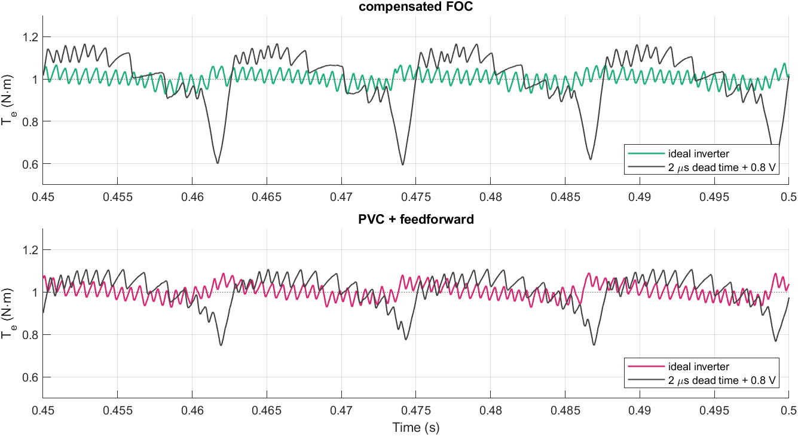
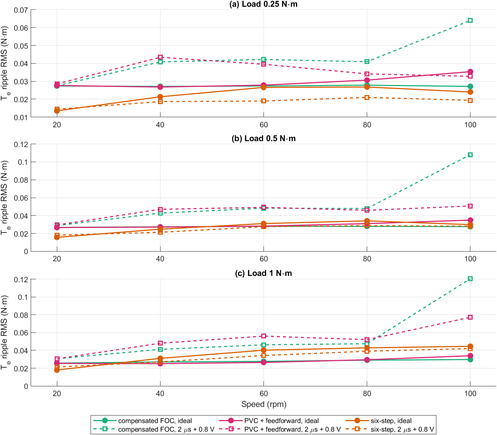
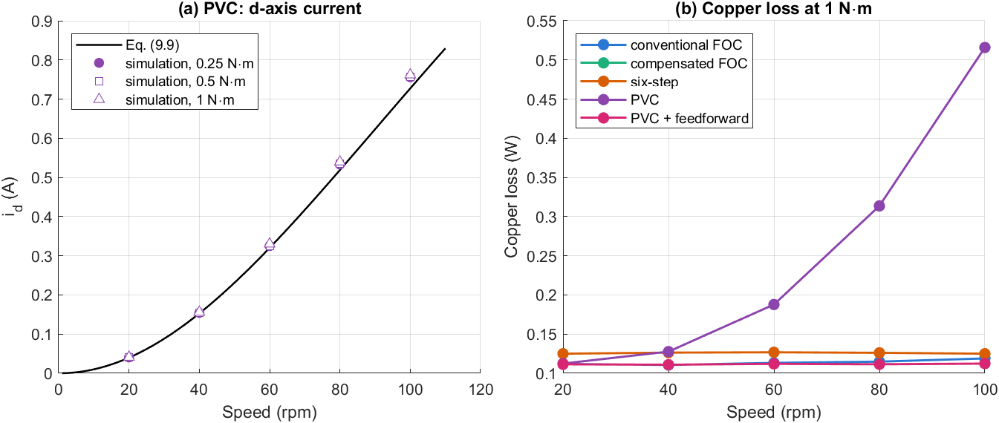
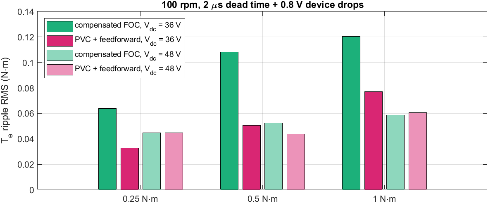
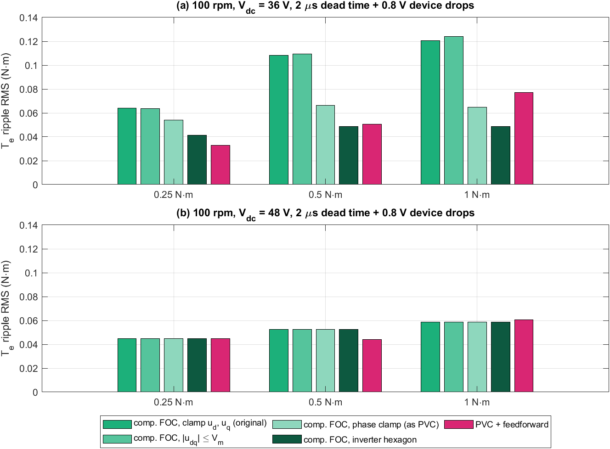
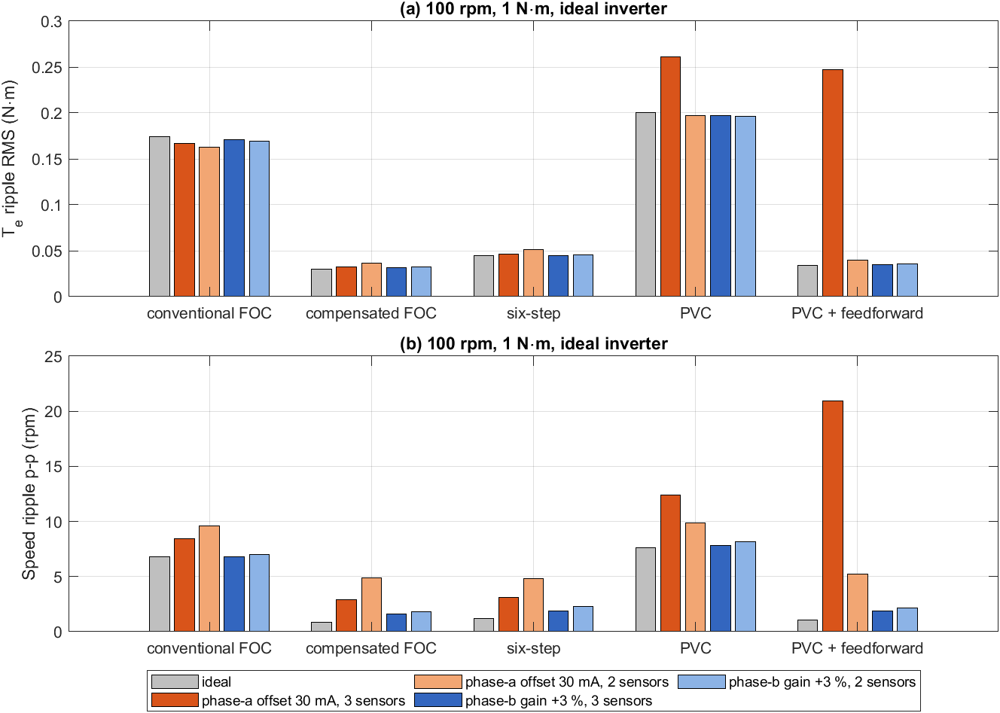
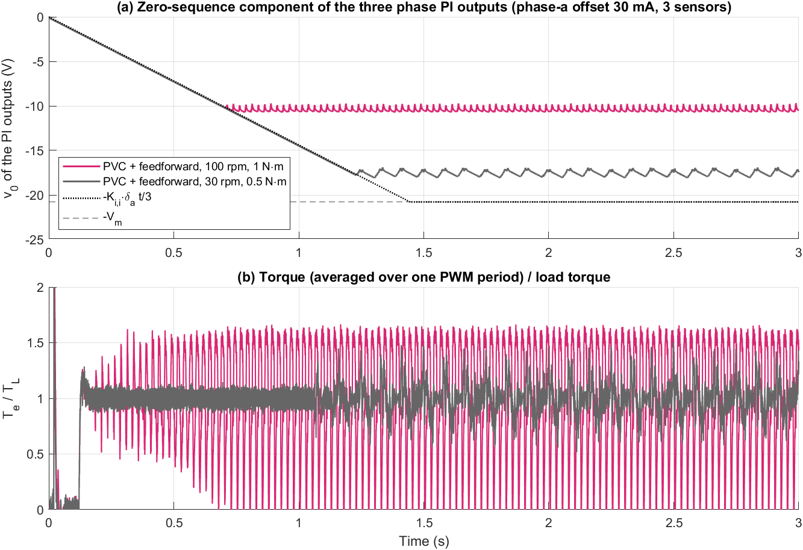
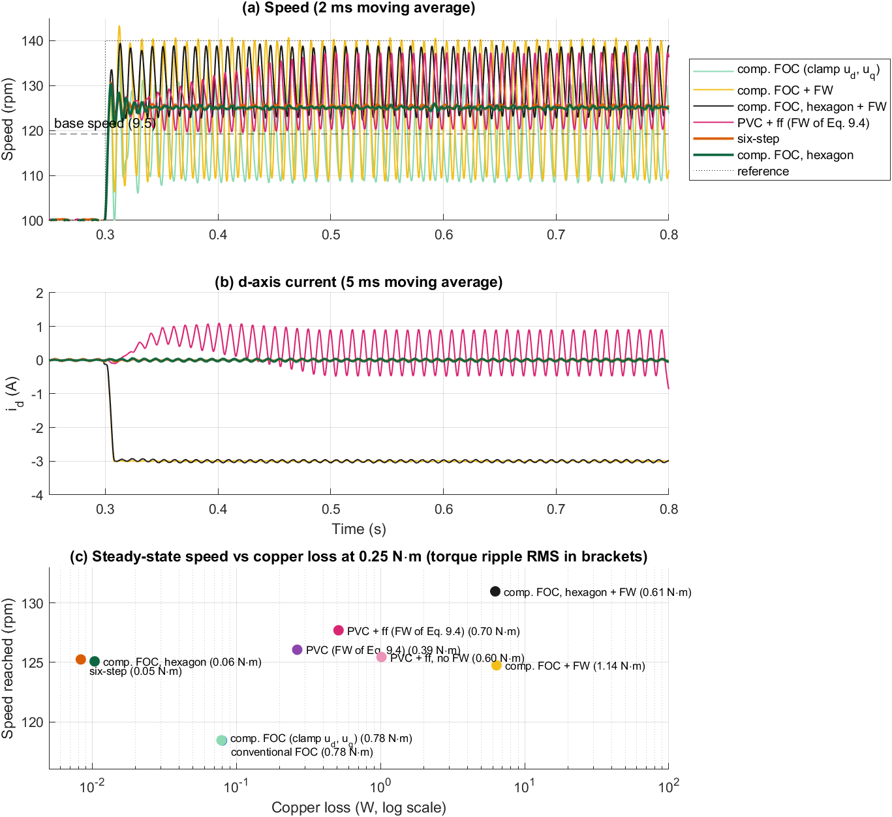

# Điều khiển giả vector (PVC) cho động cơ BLDC back-EMF hình thang

**Tài liệu 07** trong bộ tài liệu lý thuyết của đề tài *Điều khiển định hướng từ trường cho động cơ BLDC có sức phản điện động hình thang*.

| Tài liệu | Nội dung |
|---|---|
| [01 – Mô hình toán học động cơ BLDC](01_BLDC_model.md) | Chương 2 |
| [02 – Mô hình BLDC trên hệ tọa độ quay](02_dq_model.md) | Chương 3 |
| [03 – Thiết kế FOC và FOC thông thường](03_FOC_conventional.md) | Chương 4, 5 và mô hình Simulink FOC thông thường |
| [04 – FOC bù back-EMF hình thang](04_FOC_compensated.md) | Chương 6 và mô hình Simulink FOC bù |
| [05 – Mô phỏng và so sánh](05_simulation_results.md) | Chương 7 |
| [06 – Điều khiển six-step và so sánh ba bộ điều khiển](06_six_step.md) | Chương 8 và mô hình Simulink six-step |
| **07 – Điều khiển giả vector (PVC)** (tài liệu này) | Chương 9 và mô hình Simulink PVC |

---

## Tóm tắt

Tài liệu trình bày phương pháp điều khiển giả vector (pseudo vector control, PVC) theo bằng sáng chế US 7,339,346 của NSK và đánh giá nó trên cùng mô hình Simulink mức chuyển mạch van, cùng thông số và bốn kịch bản S1–S4 như các bộ điều khiển trước. PVC tính dòng đặt bằng lý thuyết vector (dòng $i_q^*$ từ cân bằng công suất với back-EMF hình thang, dòng $i_d^*$ suy yếu từ thông), đổi sang dòng đặt ba pha, rồi điều khiển từng pha bằng một bộ PI riêng thay cho vòng dòng $d$–$q$. Phân tích cho thấy khi dưới tốc độ cơ sở, dòng đặt của PVC trùng với khâu định dạng dòng của FOC bù (6.4). Điểm yếu nằm ở vòng dòng: bộ PI trên hệ tọa độ đứng yên phải tự tạo điện áp back-EMF xoay chiều nên sinh ra sai lệch dòng tỉ lệ với tốc độ, tính được bằng công thức (9.9). Tại 100 vòng/phút, sai lệch này là 0,87 A (mô phỏng: 0,76 A trục $d$ và −0,46 A trục $q$), làm dòng RMS tăng gấp đôi và tổn hao đồng tăng 4,6 lần so với FOC bù, trong khi gợn mô-men còn lớn hơn FOC thông thường. Khi thêm bù back-EMF từng pha, sai lệch này biến mất và PVC đạt gợn mô-men RMS 0,034 N·m, gần FOC bù (0,030 N·m). Kiểm chứng thêm với nghịch lưu có thời gian chết và sụt áp van, trên dải 20–100 vòng/phút và 0,25–1 N·m, cho thấy PVC có bù tương đương FOC bù; ưu thế của PVC chỉ xuất hiện ở 100 vòng/phút với $V_{dc} = 36$ V và biến mất khi tăng $V_{dc}$ lên 48 V, tức là do cách giới hạn điện áp chứ không do việc tách phi tuyến theo từng pha như bằng sáng chế nêu. Điều này được khẳng định khi thay bộ giới hạn của FOC bù: với giới hạn theo lục giác nghịch lưu, FOC bù có gợn 0,049 N·m so với 0,077 N·m của PVC + bù ở 1 N·m. Với sai số đo dòng, PVC không có ưu thế; khi dùng 3 cảm biến có lệch không, thành phần thứ tự không của ba bộ PI pha trôi với tốc độ $K_{i,i}\sum\delta/3$ và làm gợn mô-men tăng tới 0,57 N·m. Ở vùng trên tốc độ cơ sở, luật suy yếu từ thông của bằng sáng chế không tạo được dòng $i_d$ âm ở tải nhẹ; với động cơ này ($\lambda_1/L = 62$ A $\gg I_{max}$), dùng hết điện áp nghịch lưu hiệu quả hơn mọi luật suy yếu từ thông.

**Từ khóa:** BLDC; điều khiển giả vector; PVC; back-EMF hình thang; điều khiển dòng pha; bộ PI hệ tọa độ đứng yên; gợn mô-men; giới hạn điện áp; sai số đo dòng; suy yếu từ thông.

---

## Mục lục

- [9. Điều khiển giả vector (PVC)](#9-điều-khiển-giả-vector-pvc)
  - [9.1. Ý tưởng của PVC](#91-ý-tưởng-của-pvc)
  - [9.2. Tính dòng đặt bằng lý thuyết vector](#92-tính-dòng-đặt-bằng-lý-thuyết-vector)
  - [9.3. Điều khiển dòng từng pha](#93-điều-khiển-dòng-từng-pha)
  - [9.4. Mô hình Simulink](#94-mô-hình-simulink)
  - [9.5. Kết quả mô phỏng](#95-kết-quả-mô-phỏng)
  - [9.6. Thảo luận](#96-thảo-luận)
  - [9.7. Kiểm chứng với nghịch lưu không lý tưởng](#97-kiểm-chứng-với-nghịch-lưu-không-lý-tưởng)
  - [9.8. Bộ giới hạn điện áp của FOC bù](#98-bộ-giới-hạn-điện-áp-của-foc-bù)
  - [9.9. Sai số đo dòng](#99-sai-số-đo-dòng)
  - [9.10. Vùng tốc độ cao và suy yếu từ thông](#910-vùng-tốc-độ-cao-và-suy-yếu-từ-thông)
  - [9.11. Kết luận về PVC](#911-kết-luận-về-pvc)
  - [9.12. Hạn chế](#912-hạn-chế)
  - [9.13. Tái lập kết quả](#913-tái-lập-kết-quả)
- [Tài liệu tham khảo](#tài-liệu-tham-khảo)

---

## 9. Điều khiển giả vector (PVC)

### 9.1. Ý tưởng của PVC

PVC được đề xuất cho động cơ BLDC dùng trong hệ trợ lực lái điện [1]. Lập luận của bằng sáng chế: FOC thông thường điều khiển dòng trong hệ $d$–$q$, nên các phi tuyến của từng pha (thời gian chết, mạch đo dòng) bị phép biến đổi Park trộn sang cả ba pha. PVC tách bài toán làm hai phần:

- **Tính dòng đặt bằng lý thuyết vector:** back-EMF ba pha được đổi sang hệ $d$–$q$, dòng $i_q^*$ được tính từ phương trình công suất có xét back-EMF hình thang, dòng $i_d^*$ được dùng để suy yếu từ thông ở tốc độ cao. Sau đó dòng đặt được đổi về ba pha.
- **Điều khiển dòng theo từng pha:** mỗi pha có một bộ PI riêng so sánh dòng đặt và dòng đo của pha đó; không có biến đổi Park trong vòng hồi tiếp.

Vì lý thuyết vector chỉ dùng ở khâu tính dòng đặt, phương pháp được gọi là điều khiển "giả" vector. Sơ đồ khối được cho ở Hình 9.1.


*Hình 9.1. Sơ đồ khối hệ truyền động PVC: vòng tốc độ, khối tính dòng đặt theo lý thuyết vector, biến đổi Park ngược, ba bộ PI dòng pha và điều chế min–max. Nhánh nét đứt là phần bù back-EMF từng pha, không có trong bằng sáng chế, được thêm vào ở biến thể PVC + bù.*

### 9.2. Tính dòng đặt bằng lý thuyết vector

#### 9.2.1. Back-EMF trên hệ $d$–$q$

Như chương 3, back-EMF trên hệ $d$–$q$ là

$$
e_d = \lambda\,\omega_e\, g_d(\theta_e), \qquad e_q = \lambda\,\omega_e\, g_q(\theta_e), \tag{9.1}
$$

với $g_d$, $g_q$ là các hàm tuần hoàn chu kỳ $\pi/3$ (3.6) và $g_q \in [1{,}155;\ 1{,}333]$ (3.8). Bằng sáng chế dùng bảng tra back-EMF pha theo góc rồi biến đổi Park; mô hình dùng trực tiếp hai bảng $g_d$, $g_q$ giống FOC bù (6.6), cho cùng kết quả.

#### 9.2.2. Dòng trục $q$ từ cân bằng công suất

Bằng sáng chế cho công suất điện từ bằng công suất cơ:

$$
T^*\,\omega_m = \tfrac32\,\big(e_d\, i_d^* + e_q\, i_q^*\big). \tag{9.2}
$$

Rút $i_q^*$ và chia cả tử và mẫu cho $\omega_e = p\,\omega_m$ để tránh dạng $0/0$ khi đứng yên:

$$
i_q^* = \frac{T^*/(\tfrac32\,p\lambda) - g_d(\theta_e)\, i_d^*}{g_q(\theta_e)}. \tag{9.3}
$$

Mô-men đặt được lấy từ đầu ra PI tốc độ (giống FOC): $T^* = K_t\, i_{q,\omega}^*$ với $K_t = \tfrac32 p\lambda_1$. Khi $i_d^* = 0$, (9.3) trở thành $i_q^* = i_{q,\omega}^*\,(\lambda_1/\lambda)/g_q(\theta_e)$, **trùng với khâu định dạng dòng $k_s$ của FOC bù** (6.4). Khác biệt duy nhất là FOC bù tra bảng tại góc đã bù trễ $\theta_a$ (6.5), còn PVC dùng góc đo $\theta_e$. Như vậy dòng đặt của PVC cũng khử gợn mô-men bậc 6 theo nguyên lý của chương 6 (Hình 9.2a, b).

#### 9.2.3. Dòng trục $d$ suy yếu từ thông

Trên tốc độ cơ sở $\omega_b$, bằng sáng chế đặt

$$
i_d^* = \begin{cases} 0, & |\omega_m| \le \omega_b \\[2pt] -\left|\dfrac{T^*}{K_t}\right| \sin\!\Big(\arccos\dfrac{\omega_b}{|\omega_m|}\Big), & |\omega_m| > \omega_b \end{cases} \tag{9.4}
$$

Bằng sáng chế tính $\omega_b$ từ mô-men đặt. Mô hình dùng một hằng số: tốc độ tại đó biên độ back-EMF cơ bản bằng giới hạn điện áp pha của SVPWM,

$$
\omega_b = \frac{V_{dc}/\sqrt3}{p\,\lambda_1} = 12{,}49\ \text{rad/s} = 119{,}3\ \text{vòng/phút}. \tag{9.5}
$$

Hệ số $\sin(\arccos(\omega_b/\omega_m))$ tăng nhanh ngay sau $\omega_b$ rồi tiến dần tới 1 (Hình 9.2c). Trong các kịch bản S1–S4 (tối đa ±100 vòng/phút), $i_d^*$ chỉ khác 0 trong đoạn vọt lố khi đảo chiều (S3).

#### 9.2.4. Dòng đặt ba pha

Dòng đặt pha được tính bằng biến đổi Park ngược và Clarke ngược:

$$
\begin{bmatrix} i_a^* \\ i_b^* \\ i_c^* \end{bmatrix} = \mathbf{K}_{ic}
\begin{bmatrix} \cos\theta_e & -\sin\theta_e \\ \sin\theta_e & \cos\theta_e \end{bmatrix}
\begin{bmatrix} i_d^* \\ i_q^* \end{bmatrix}. \tag{9.6}
$$

Dòng đặt pha gần sin với các "vết lõm" nhỏ tại các điểm chuyển mạch của back-EMF (Hình 9.2b). Đây chính là dạng dòng giữ cho mô-men phẳng với back-EMF hình thang có sườn 60°.


*Hình 9.2. Dòng đặt của PVC: (a) $i_d^*$, $i_q^*$ theo (9.3) cho $T^* = 1$ N·m dưới tốc độ cơ sở, so với $i_q^*$ hằng của FOC; (b) dòng đặt pha $a$; (c) dòng $i_d^*$ suy yếu từ thông theo (9.4).*

### 9.3. Điều khiển dòng từng pha

#### 9.3.1. Bộ PI dòng pha

Mỗi pha có một bộ PI rời rạc 10 kHz:

$$
v_{PI,x} = K_{p,i}\, e_x + K_{i,i}\!\int e_x\,dt, \qquad e_x = i_x^* - i_x,\quad x \in \{a, b, c\}, \tag{9.7}
$$

với cùng hệ số IMC như FOC ($K_{p,i} = L/\tau_c = 10{,}46$ V/A, $K_{i,i} = R/\tau_c = 1438$ V/(A·s), $\tau_c = 0{,}318$ ms), giới hạn ±$V_{dc}/\sqrt3$ và chống bão hòa back-calculation. Ba dòng pha luôn có tổng bằng 0 (động cơ nối sao, không nối trung tính) nên tổng ba sai lệch cũng bằng 0 và ba khâu tích phân không trôi theo thứ tự không. Điều này chỉ đúng khi dòng đo không có sai số; trường hợp có lệch không được xét ở mục 9.9.

#### 9.3.2. Bám tín hiệu xoay chiều

Với $Z(j\omega) = R + j\omega L$ và $C(j\omega) = K_{p,i} + K_{i,i}/(j\omega)$, hàm truyền từ dòng đặt tới dòng pha (bỏ qua trễ số) là

$$
T(j\omega) = \frac{C(j\omega)}{Z(j\omega) + C(j\omega)} = \frac{1}{1 + j\omega\tau_c}. \tag{9.8}
$$

Khác với vòng dòng $d$–$q$ (nơi dòng đặt gần như không đổi), dòng đặt pha của PVC là tín hiệu xoay chiều tần số $f_e$ cộng các sóng hài bậc $6k \pm 1$ của khâu định dạng. Bảng 9.1 cho sai lệch bám tương đối tại 100 vòng/phút ($f_e = 13{,}3$ Hz).

*Bảng 9.1. Đáp ứng của bộ PI dòng pha với các thành phần của dòng đặt tại 100 vòng/phút, theo (9.8).*

| Bậc | Tần số (Hz) | $\lvert T \rvert$ | Góc lệch (độ) | Sai lệch $\lvert 1 - T \rvert$ |
|---|---|---|---|---|
| 1 | 13,3 | 1,000 | −1,5 | 0,027 |
| 5 | 66,7 | 0,991 | −7,6 | 0,132 |
| 7 | 93,3 | 0,983 | −10,6 | 0,183 |
| 11 | 146,7 | 0,960 | −16,3 | 0,281 |
| 13 | 173,3 | 0,945 | −19,1 | 0,328 |

Thành phần cơ bản được bám tốt, nhưng các sóng hài định dạng bị lệch pha 8–19° và sai lệch 13–33 %. Đây là giới hạn cố hữu của bộ PI trên hệ tọa độ đứng yên: khâu tích phân chỉ triệt sai lệch ở tần số 0, còn với tín hiệu xoay chiều cần bộ điều khiển cộng hưởng hoặc tăng băng thông [3].

#### 9.3.3. Nhiễu back-EMF

Ảnh hưởng lớn hơn đến từ back-EMF. Phương trình pha là $v_x = R i_x + L\,di_x/dt + e_x$; bộ PI phải tự tạo điện áp $e_x$, vốn là tín hiệu xoay chiều biên độ $\lambda_1\omega_e$ ở tần số cơ bản. Với dòng đặt bám tốt, sai lệch dòng do back-EMF gây ra là

$$
\underline{i}_{err} = -\frac{\underline{e}}{Z(j\omega_e) + C(j\omega_e)}, \tag{9.9}
$$

với $\underline{e}$ là phasor back-EMF cơ bản, nằm trên trục $q$. Tại 100 vòng/phút: $\lambda_1\omega_e = 17{,}4$ V, $|Z + C| = 20{,}1$ Ω, nên $|\underline{i}_{err}| = 0{,}87$ A, gồm 0,73 A trên trục $d$ và −0,47 A trên trục $q$. Hệ quả:

- **Dòng trục $q$ bị hụt 0,47 A**, tạo mô-men hãm. Vòng tốc độ phải bù bằng cách tăng $i_{q,\omega}^*$ thêm đúng lượng đó, kể cả khi không tải.
- **Xuất hiện dòng trục $d$ dương 0,73 A**, không sinh mô-men nhưng làm tăng dòng RMS, tổn hao đồng, và tăng từ thông (ngược với suy yếu từ thông).
- **Sai lệch phụ thuộc tốc độ:** gần như tỉ lệ $\omega_e^2$ ở tốc độ thấp (0,09 A tại 30 vòng/phút), nên mô-men hãm do nó gây ra tác động như một khâu cản nhớt.

Hình 9.3 so sánh (9.9) với mô phỏng tại 30 và 100 vòng/phút; sai khác không quá 5 %.


*Hình 9.3. Sai lệch dòng do back-EMF của PVC theo tốc độ: đường liền và đứt là (9.9), điểm là giá trị trung bình mô phỏng ở S1, S2 (100 vòng/phút) và S4 (30 vòng/phút).*

#### 9.3.4. Bù back-EMF từng pha

Bằng sáng chế không nêu khâu bù back-EMF. Để tách ảnh hưởng của mục 9.3.3, mô hình có thêm tùy chọn `PVC_FF`:

$$
\mathbf{v}_{abc}^* = \mathbf{v}_{PI} + \texttt{PVC\_FF}\cdot \lambda\,\omega_e\,\mathbf{f}_{abc}(\theta_e), \tag{9.10}
$$

với $\mathbf{f}_{abc}$ được tạo lại từ $g_d$, $g_q$ bằng (9.6). Khi `PVC_FF = 1`, bộ PI chỉ còn phải bù phần sụt áp trên $R$, $L$, giống vòng dòng $d$–$q$ có bù back-EMF của FOC.

#### 9.3.5. Điều chế

Điện áp pha đặt được chuyển thành hệ số điều chế bằng phương pháp bơm thứ tự không min–max, tương đương SVPWM về dải điện áp:

$$
v_0 = -\tfrac12\big(\max_x v_x^* + \min_x v_x^*\big), \qquad d_x = \tfrac12 + \frac{v_x^* + v_0}{V_{dc}}, \tag{9.11}
$$

rồi trễ một chu kỳ lấy mẫu như ở FOC.

### 9.4. Mô hình Simulink

Mô hình `Pseudo_Vector_Control.slx` nằm trong thư mục `03_Simulation/PVC` và được dựng theo quy trình thêm bộ điều khiển mới của repo (Hình 9.4). Các khối Power Stage, PWM và abc_to_dq là liên kết tới thư viện dùng chung `bldc_plant_lib.slx`; khối abc_to_dq chỉ dùng để ghi $i_d$, $i_q$ phục vụ so sánh. Tên mô hình khác tên thư mục để không trùng với biến cấu hình `PVC` trong workspace.


*Hình 9.4. Tầng ngoài cùng của mô hình `Pseudo_Vector_Control.slx`. Khối PVC Ctrl thay cho Current PI và SVPWM của mô hình FOC; Speed PI, PWM, Power Stage và phần đo góc/tốc độ được giữ nguyên. Các khối Current Sensor (sau `ZOH_i`) và Position Sensor (sau `ZOH_th`) được thêm ở chương 9–10 để mô phỏng sai số đo dòng và encoder; mặc định chúng lý tưởng.*

Khối PVC Ctrl (Hình 9.5) hiện thực các phương trình của mục 9.2–9.3: hai bảng `g_d`, `g_q` (9.1); nhánh `abs_we`–`inv_p`–`wb_over_wm`–`sqrt`–`sin_adv` tính $i_d^*$ (9.4); nhánh `lam1_lam`–`num`–`div_gq` tính $i_q^*$ (9.3); khối `InvPark_i` tạo dòng đặt pha (9.6); khối `PI_abc` là ba bộ PI pha dạng véc-tơ (9.7); nhánh `InvPark_e`–`ff_on` là bù back-EMF (9.10); nhánh `max`, `min`, `neg_half`, `v_inj` là điều chế min–max (9.11).


*Hình 9.5. Khối PVC Ctrl: tính dòng đặt theo lý thuyết vector, Park ngược, ba bộ PI dòng pha, bù back-EMF tùy chọn và điều chế min–max.*

*Bảng 9.2. Tham số của bộ điều khiển PVC (`pvc_init.m`). Thông số động cơ, nghịch lưu, chu kỳ lấy mẫu và hệ số PI lấy từ `Common/bldc_params.m`.*

| Tham số | Ký hiệu trong mã | Giá trị |
|---|---|---|
| Bảng $g_d$, $g_q$ (chu kỳ $\pi/3$, 361 điểm) | `TAB.gd`, `TAB.gq` | như FOC bù |
| PI dòng pha $K_{p,i}$, $K_{i,i}$ | `P.Kp_i`, `P.Ki_i` | 10,46 V/A; 1438 V/(A·s) |
| PI tốc độ $K_{p,\omega}$, $K_{i,\omega}$ | `P.Kp_w_foc`, `P.Ki_w_foc` | 0,148; 9,30 |
| Tốc độ cơ sở $\omega_b$ (9.5) | `PVC.wb` | 12,49 rad/s (119,3 vòng/phút) |
| Bật suy yếu từ thông (9.4) | `PVC.fw` | 1 |
| Bật bù back-EMF pha (9.10) | `PVC.ff` (`PVC_FF`) | 0: PVC; 1: PVC + bù |

`run_pvc.m` chạy cả hai biến thể và lưu `<SCEN>_pvc.mat`, `<SCEN>_pvcff.mat`. Hai biến thể được đăng ký trong kiểm tra hồi quy với tag `pvc` và `pvcff`.

### 9.5. Kết quả mô phỏng

*Bảng 9.3. Chỉ tiêu chất lượng của năm bộ điều khiển (KB: kịch bản; 6-step: six-step; PVC+bù: PVC có bù back-EMF pha). "–": không vào được dải ±2 vòng/phút.*

| KB | Chỉ tiêu | FOC thường | FOC bù | 6-step | PVC | PVC+bù |
|---|---|---|---|---|---|---|
| S1 | Thời gian lên (ms) | 4,74 | 4,82 | 4,73 | 11,53 | 4,87 |
| S1 | Độ quá điều chỉnh (%) | 18,0 | 16,9 | 17,9 | 7,9 | 16,7 |
| S1 | Thời gian xác lập (ms) | – | 42,3 | 39,0 | – | 43,9 |
| S1 | Gợn tốc độ không tải (vòng/phút) | 8,42 | 0,49 | 0,86 | 7,79 | 1,01 |
| S2 | Độ sụt tốc khi đóng tải (vòng/phút) | 22,9 | 21,1 | 20,8 | 14,9 | 21,2 |
| S2 | Thời gian phục hồi (ms) | – | 39,9 | 36,5 | – | 36,3 |
| S2 | Gợn mô-men đỉnh–đỉnh (N·m) | 0,642 | 0,153 | 0,447 | 0,707 | 0,179 |
| S2 | Gợn mô-men RMS (N·m) | 0,177 | 0,030 | 0,043 | 0,200 | 0,034 |
| S2 | Biên độ gợn bậc 6 (N·m) | 0,239 | 0,022 | 0,023 | 0,264 | 0,028 |
| S2 | Gợn tốc độ đỉnh–đỉnh (vòng/phút) | 6,90 | 0,87 | 1,16 | 7,42 | 0,95 |
| S2 | THD dòng pha (%) | 22,0 | 5,6 | 31,6 | 9,4 | 5,2 |
| S2 | Dòng $i_d$ trung bình (A) | 0,00 | 0,00 | 0,00 | 0,76 | 0,02 |
| S2 | Dòng pha RMS (A) | 0,296 | 0,286 | 0,302 | 0,612 | 0,286 |
| S2 | Tổn hao đồng (W) | 0,121 | 0,113 | 0,125 | 0,515 | 0,113 |
| S3 | Thời gian qua tốc độ 0 (ms) | 2,81 | 2,63 | 2,61 | 3,72 | 2,61 |
| S3 | Độ vọt lố khi đảo chiều (%) | 33,8 | 32,4 | 30,0 | 15,7 | 28,8 |
| S3 | Dòng pha đỉnh (A) | 2,56 | 2,72 | 2,81 | 2,73 | 2,76 |
| S4 | Thời gian xác lập TB các bậc (ms) | – | 33,7 | 28,3 | – | 34,5 |
| S4 | Gợn tốc độ ở 30 vòng/phút (vòng/phút) | 3,62 | 0,81 | 2,02 | 2,78 | 0,40 |


*Hình 9.6. Dòng $d$–$q$ đo được và dòng đặt $i_q^*$ (9.3) ở S2. (a) PVC: dòng $i_q^*$ cao gấp đôi dòng $i_q$ thực vì vòng tốc độ phải bù phần dòng hụt (9.9), và có dòng $i_d \approx 0{,}76$ A; (b) PVC + bù: $i_q$ bám sát $i_q^*$ đã định dạng, $i_d \approx 0$.*


*Hình 9.7. Mô-men điện từ ở chế độ xác lập có tải 1 N·m, 100 vòng/phút (S2, trung bình một chu kỳ PWM): (a) FOC bù; (b) PVC; (c) PVC + bù.*


*Hình 9.8. Đáp ứng tốc độ ở các kịch bản S1, S3, S4 của FOC thông thường, FOC bù, PVC và PVC + bù. PVC không bù tăng tốc chậm hơn rõ rệt nhưng vọt lố ít hơn.*


*Hình 9.9. Các chỉ tiêu xác lập chính ở kịch bản S2 của năm bộ điều khiển, tính theo phần trăm so với FOC thông thường.*

### 9.6. Thảo luận

**PVC theo bằng sáng chế.** Dù dòng đặt đã được định dạng để khử gợn bậc 6, PVC không bù có gợn mô-men RMS 0,200 N·m, lớn hơn cả FOC thông thường (0,177 N·m). Nguyên nhân là vòng dòng, không phải dòng đặt. Sai lệch do back-EMF (9.9) chồng lên dòng thực, và các sóng hài định dạng bị lệch pha 8–19° (Bảng 9.1), nên dòng thực gần sin hơn dòng đặt: THD dòng chỉ 9,4 % so với 5,6 % của FOC bù. Dòng gần sin trên động cơ back-EMF hình thang lại tạo gợn bậc 6 như FOC thông thường (mục 3.4). Dòng $i_d \approx 0{,}76$ A và phần $i_q$ bù thêm làm dòng RMS tăng gấp đôi (0,612 so với 0,286 A) và tổn hao đồng tăng 4,6 lần. Ở chế độ không tải (S1), tổn hao đồng của PVC là 0,39 W, trong khi FOC bù gần như bằng 0.

**Đặc tính động của PVC không bù.** Sai lệch dòng tỉ lệ gần với $\omega_e^2$ tạo ra một mô-men hãm phụ thuộc tốc độ. Vòng tốc độ thấy thêm một khâu cản, nên đáp ứng chậm hơn (thời gian lên 11,5 ms so với 4,7–4,9 ms), vọt lố ít hơn (7,9 % ở S1, 15,7 % ở S3) và sụt tốc khi đóng tải nhỏ hơn (14,9 so với khoảng 21 vòng/phút). Đây không phải ưu điểm thực sự: cùng tác dụng có thể đạt được bằng cách chỉnh PI tốc độ, mà không phải trả giá bằng dòng phản kháng.

**PVC + bù back-EMF.** Khi bù $\lambda\omega_e\mathbf{f}_{abc}$ vào đầu ra PI (9.10), sai lệch (9.9) bị loại bỏ: $i_d \approx 0{,}02$ A, dòng RMS và tổn hao đồng bằng FOC bù. Gợn mô-men RMS 0,034 N·m và gợn bậc 6 0,028 N·m, gần FOC bù (0,030 và 0,022 N·m). Phần chênh còn lại đến từ sai lệch bám các sóng hài (Bảng 9.1) và từ việc PVC không bù trễ số cho góc định dạng (FOC bù dùng $\theta_a$, (6.5)). Ở 30 vòng/phút (S4), các sóng hài có tần số thấp hơn nên được bám tốt hơn, và PVC + bù có gợn tốc độ thấp nhất trong năm bộ điều khiển (0,40 vòng/phút).

**So sánh với FOC bù.** Hai phương pháp dùng cùng dòng đặt; khác biệt chỉ nằm ở chỗ vòng dòng ở hệ $d$–$q$ hay hệ $abc$. Trong hệ $d$–$q$, dòng đặt gần như không đổi và back-EMF cơ bản là một hằng số, nên PI đạt sai lệch xác lập bằng 0 cho thành phần chính. Trong hệ $abc$, mọi đại lượng đều xoay chiều, nên PVC chỉ đạt chất lượng tương đương khi có bù back-EMF và băng thông dòng đủ cao so với $6f_e$. Lợi ích được bằng sáng chế nêu (phi tuyến của từng pha không bị trộn sang pha khác) được kiểm chứng riêng ở mục 9.7 với nghịch lưu có thời gian chết và sụt áp van.

*Bảng 9.4. So sánh định tính PVC với các bộ điều khiển trước.*

| Tiêu chí | FOC bù | PVC | PVC + bù |
|---|---|---|---|
| Dòng đặt | $i_q^{**} = k_s(\theta_a)\, i_q^*$ | (9.3), (9.4) tại $\theta_e$ | (9.3), (9.4) tại $\theta_e$ |
| Vòng dòng | 2 PI trên $d$–$q$ | 3 PI pha | 3 PI pha |
| Bù back-EMF | $\omega_e\lambda\, g_{dq}(\theta_p)$ | Không | $\lambda\omega_e\,\mathbf{f}_{abc}(\theta_e)$ |
| Bù trễ số | Có ($\theta_p$, $\theta_a$) | Không | Không |
| Suy yếu từ thông | Không | Có (9.4) | Có (9.4) |
| Gợn mô-men RMS (S2) | 0,030 N·m | 0,200 N·m | 0,034 N·m |
| Tổn hao đồng (S2) | 0,113 W | 0,515 W | 0,113 W |
| Gợn mô-men RMS (S2, 2 µs + 0,8 V, mục 9.7) | 0,127 N·m | 0,238 N·m | 0,079 N·m |
| Gợn mô-men RMS (100 vòng/phút, 1 N·m, 2 µs + 0,8 V, $V_{dc}$ = 48 V) | 0,059 N·m | – | 0,060 N·m |
| Gợn mô-men RMS (S2, 2 µs + 0,8 V, FOC bù giới hạn lục giác V3, mục 9.8) | 0,049 N·m | – | 0,077 N·m |
| Gợn mô-men RMS, lệch 30 mA pha a, 3 cảm biến (100 vòng/phút, 1 N·m, sau 2,9 s, mục 9.9) | 0,032 N·m | 0,264 N·m (trôi thứ tự không) | 0,572 N·m (trôi thứ tự không) |

### 9.7. Kiểm chứng với nghịch lưu không lý tưởng

Mục này kiểm tra lập luận chính của bằng sáng chế: phi tuyến của nghịch lưu ảnh hưởng tới PVC ít hơn FOC vì mỗi pha được điều khiển riêng. Các kết quả ở mục 9.5 dùng nghịch lưu lý tưởng nên chưa trả lời được câu hỏi này.

#### 9.7.1. Mô hình thời gian chết và sụt áp van

Khối PWM dùng chung (`bldc_plant_lib.slx`) được bổ sung một khâu trễ bật: mỗi tín hiệu điều khiển van chỉ lên mức 1 sau thời gian chết $T_d$ (làm tròn theo bước giải 1 µs) và xuống mức 0 ngay lập tức. Khối Universal Bridge dùng điện áp thuận $V_f$ cho IGBT và diode. Cả hai được đặt bằng `bldc_set_inverter` và mặc định tắt, nên mọi kết quả trước đó không đổi (kiểm tra hồi quy đạt toàn bộ). Sai lệch điện áp pha trung bình gây ra là

$$
\Delta v_x \approx -\Big(\frac{T_d}{T_s}\,V_{dc} + V_f\Big)\,\mathrm{sign}(i_x), \tag{9.12}
$$

tức một sóng vuông theo dấu dòng pha, biên độ 0,72 V + 0,8 V = 1,52 V với $T_d = 2$ µs, $V_f = 0{,}8$ V. Sóng vuông này chứa các hài bậc 5, 7, … nên gây gợn bậc 6 trong hệ $d$–$q$. Bốn trường hợp được xét: lý tưởng, $T_d$ = 1 µs, $T_d$ = 2 µs và $T_d$ = 2 µs + $V_f$ = 0,8 V.

#### 9.7.2. Kết quả tại kịch bản S2

*Bảng 9.5. Gợn mô-men RMS và biên độ gợn bậc 6 ở S2 (1 N·m, 100 vòng/phút) với các trường hợp nghịch lưu (`Studies/run_inverter_nonideal.m`).*

| Bộ điều khiển | Gợn RMS: lý tưởng / 1 µs / 2 µs / 2 µs + 0,8 V (N·m) | T6: lý tưởng / 1 µs / 2 µs / 2 µs + 0,8 V (N·m) |
|---|---|---|
| FOC thường | 0,177 / 0,158 / 0,183 / 0,199 | 0,239 / 0,211 / 0,249 / 0,266 |
| FOC bù | 0,030 / 0,032 / 0,040 / 0,127 | 0,022 / 0,008 / 0,040 / 0,136 |
| Six-step | 0,043 / 0,044 / 0,045 / 0,043 | 0,023 / 0,020 / 0,023 / 0,018 |
| PVC | 0,200 / 0,209 / 0,216 / 0,238 | 0,264 / 0,280 / 0,292 / 0,326 |
| PVC + bù | 0,034 / 0,032 / 0,041 / 0,079 | 0,028 / 0,013 / 0,041 / 0,087 |

Với thời gian chết đơn thuần, FOC bù và PVC + bù bị ảnh hưởng như nhau (gợn RMS 0,040 và 0,041 N·m ở 2 µs). Ở 1 µs, gợn bậc 6 của cả hai còn giảm, có thể do thành phần bậc 6 do (9.12) gây ra ngược pha với phần gợn còn lại tại điểm làm việc này. Khi có thêm sụt áp van, mô-men của FOC bù xuất hiện các xung sụt sâu tới khoảng 0,6 N·m sáu lần mỗi chu kỳ điện, còn PVC + bù chỉ sụt tới khoảng 0,75 N·m (Hình 9.10). Six-step gần như không bị ảnh hưởng vì van dưới của pha âm dẫn liên tục và mỗi lúc chỉ một nhánh băm xung.



*Hình 9.10. Mô-men ở S2 (trung bình một chu kỳ PWM) với nghịch lưu lý tưởng và với thời gian chết 2 µs + sụt áp van 0,8 V: FOC bù (trên) và PVC + bù (dưới).*

#### 9.7.3. Quét theo tốc độ và tải

Để biết kết quả ở S2 có đại diện hay không, năm bộ điều khiển được mô phỏng ở chế độ xác lập tại 20, 40, 60, 80, 100 vòng/phút và 0,25; 0,5; 1 N·m, với ba trường hợp nghịch lưu (225 lượt chạy song song, `Studies/run_sweep_speed_load.m`). Mỗi lượt đánh giá trên một số nguyên chu kỳ điện, tối thiểu 0,1 s.



*Hình 9.11. Gợn mô-men RMS theo tốc độ ở ba mức tải của FOC bù, PVC + bù và six-step; đường liền: nghịch lưu lý tưởng, đường đứt: thời gian chết 2 µs + sụt áp van 0,8 V.*

- **Nghịch lưu lý tưởng:** PVC + bù và FOC bù có gợn RMS tương đương trên toàn dải (0,025–0,035 so với 0,026–0,030 N·m). PVC + bù chỉ kém hơn đôi chút ở 100 vòng/phút, do sai lệch bám các sóng hài định dạng tăng theo tần số (Bảng 9.1).
- **Thời gian chết 2 µs + sụt áp van 0,8 V, từ 20 đến 80 vòng/phút:** FOC bù tốt bằng hoặc tốt hơn PVC + bù, ví dụ ở 1 N·m, 40–80 vòng/phút: 0,041–0,047 so với 0,048–0,056 N·m.
- **Cùng điều kiện, tại 100 vòng/phút:** PVC + bù tốt hơn rõ (0,033; 0,051; 0,077 N·m so với 0,064; 0,108; 0,121 N·m ở 0,25; 0,5; 1 N·m). Đây chính là điểm làm việc của S2.
- **Phân tích (9.9) đúng trên toàn dải:** dòng $i_d$ của PVC không bù khớp lý thuyết trong khoảng 5 % ở mọi tốc độ và không phụ thuộc tải, đúng như phân tích tuyến tính dự báo (Hình 9.12a). Tổn hao đồng của PVC không bù tăng nhanh theo tốc độ, trong khi các bộ khác gần như không đổi (Hình 9.12b).



*Hình 9.12. (a) Dòng $i_d$ của PVC không bù theo tốc độ: đường là (9.9), điểm là mô phỏng ở ba mức tải; (b) tổn hao đồng theo tốc độ ở 1 N·m của năm bộ điều khiển (nghịch lưu lý tưởng).*

#### 9.7.4. Vai trò của giới hạn điện áp

Ưu thế của PVC + bù chỉ xuất hiện ở 100 vòng/phút, nơi điện áp cần thiết gần chạm giới hạn: back-EMF dây đã khoảng 28,7 V, cộng thêm sụt áp (9.12) trên hai pha. Để kiểm tra, các bộ giới hạn điện áp trong bộ điều khiển và hệ số điều chế được ghi lại trong cửa sổ xác lập (`Studies/check_voltage_saturation.m`), với $V_{dc}$ = 36 V và 48 V.

*Bảng 9.6. Hoạt động của giới hạn điện áp tại 100 vòng/phút, 1 N·m, thời gian chết 2 µs + sụt áp van 0,8 V. Giới hạn trong bộ điều khiển là $V_{dc}/\sqrt3$: FOC bù giới hạn riêng $u_d$, $u_q$; PVC giới hạn từng điện áp pha.*

| Bộ điều khiển | $V_{dc}$ (V) | Thời gian giới hạn tác động (%) | Hệ số điều chế bị kẹp ở 0 hoặc 1 (%) | Điện áp yêu cầu lớn nhất (V) | Gợn mô-men RMS (N·m) |
|---|---|---|---|---|---|
| FOC bù | 36 | 14,7 | 0 | 22,6 | 0,127 |
| PVC + bù | 36 | 11,3 | 0 | 22,0 | 0,079 |
| FOC bù | 48 | 0 | 0 | 21,9 | 0,059 |
| PVC + bù | 48 | 0 | 0 | 22,0 | 0,060 |



*Hình 9.13. Gợn mô-men RMS tại 100 vòng/phút với thời gian chết 2 µs + sụt áp van 0,8 V, ở $V_{dc}$ = 36 V và 48 V.*

Ở 36 V, điện áp yêu cầu vượt giới hạn $V_{dc}/\sqrt3 = 20{,}8$ V trong 11–15 % thời gian ở cả hai bộ điều khiển, trong khi hệ số điều chế không lần nào bị kẹp, tức nghịch lưu vẫn còn dư điện áp. FOC bù cắt cả thành phần $u_q$, nên sai lệch điện áp rơi vào cả ba pha đúng lúc back-EMF hình thang đạt đỉnh, gây các xung sụt ở Hình 9.10. PVC chỉ cắt điện áp của pha đang vượt ngưỡng nên ảnh hưởng nhẹ hơn. Khi $V_{dc}$ = 48 V, không còn giới hạn nào tác động và gợn RMS của hai bộ gần bằng nhau: 0,059 và 0,060 N·m ở 1 N·m; ở ba mức tải, PVC + bù chỉ còn tốt hơn 0–16 %, thay vì 36–53 % ở 36 V (Hình 9.13). Như vậy ưu thế quan sát được ở S2 đến từ cách đặt giới hạn điện áp trong bộ điều khiển. Mục 9.8 kiểm tra trực tiếp giải thích này bằng cách thay bộ giới hạn của FOC bù.

#### 9.7.5. Kết luận kiểm chứng

1. Phân tích sai lệch dòng (9.9) của PVC đúng trên toàn dải 20–100 vòng/phút và mọi mức tải: PVC theo đúng bằng sáng chế (không bù back-EMF) có dòng phản kháng và tổn hao đồng tăng nhanh theo tốc độ.
2. Với thời gian chết và sụt áp van, PVC có bù back-EMF tương đương FOC bù trong phần lớn dải làm việc; mô phỏng không cho thấy lợi ích của việc tách phi tuyến theo từng pha.
3. Khác biệt duy nhất (100 vòng/phút, 36 V) do cách giới hạn điện áp và biến mất khi có đủ điện áp dự trữ (khẳng định ở mục 9.8).
4. Six-step ít nhạy nhất với thời gian chết và sụt áp van.

### 9.8. Bộ giới hạn điện áp của FOC bù

Mục 9.7.4 cho thấy ưu thế của PVC + bù ở 100 vòng/phút, 36 V có thể đến từ bộ giới hạn điện áp, nhưng chưa thử một bộ giới hạn khác cho FOC bù. Mục này thử trực tiếp: giữ nguyên mọi phần khác của FOC bù và chỉ thay bộ giới hạn.

#### 9.8.1. Bốn chiến lược giới hạn

Khối VLim (MATLAB Function, gọi `Common/bldc_vlim.m`) thay cho hai khối Sat_d, Sat_q của mô hình FOC bù. Tham số `P.vlim` chọn một trong bốn chiến lược, với $\mathbf{u}^* = [u_d^*, u_q^*]^T$ là điện áp yêu cầu (tổng của PI, bù chéo và bù back-EMF) và $\mathbf{v}^* = [v_a^*, v_b^*, v_c^*]^T$ là điện áp pha tương ứng sau Park ngược:

$$
\begin{aligned}
&\text{V0:}\ \ u_x = \mathrm{sat}_{\pm V_m}(u_x^*),\ x \in \{d, q\} &&\text{(mô hình gốc)}\\
&\text{V1:}\ \ \mathbf{u} = \min\!\Big(1, \tfrac{V_m}{|\mathbf{u}^*|}\Big)\,\mathbf{u}^* &&\text{(giới hạn biên độ vector)}\\
&\text{V2:}\ \ \mathbf{v} = \mathrm{sat}_{\pm V_m}(\mathbf{v}^*),\ \mathbf{u} = \text{Park}(\mathbf{v}) &&\text{(kẹp từng pha, như khối Sat\_v của PVC)}\\
&\text{V3:}\ \ \mathbf{u} = \min\!\Big(1, \tfrac{V_{dc}}{\max_x v_x^* - \min_x v_x^*}\Big)\,\mathbf{u}^* &&\text{(lục giác của nghịch lưu)}
\end{aligned} \tag{9.13}
$$

với $V_m = V_{dc}/\sqrt3$. V3 chỉ giới hạn khi điện áp dây yêu cầu vượt $V_{dc}$, tức đúng giới hạn vật lý của nghịch lưu khi dùng bơm thứ tự không min–max (9.11); V0–V2 bảo thủ hơn. Giá trị mặc định `P.vlim = 0` giữ nguyên mô hình gốc: kiểm tra hồi quy S1–S4 của cả năm bộ điều khiển (180 chỉ tiêu) đều đạt sau khi thay khối.

#### 9.8.2. Kết quả

FOC bù với V0–V3 và PVC + bù được mô phỏng ở chế độ xác lập tại 80 và 100 vòng/phút, 0,25; 0,5; 1 N·m, $V_{dc}$ = 36 và 48 V, nghịch lưu lý tưởng và có thời gian chết 2 µs + sụt áp van 0,8 V (120 lượt chạy, `Studies/run_voltage_limit.m`).

*Bảng 9.7. Gợn mô-men RMS (N·m) tại 100 vòng/phút với thời gian chết 2 µs + sụt áp van 0,8 V.*

| $V_{dc}$ | Tải (N·m) | FOC bù V0 (gốc) | V1 | V2 | V3 | PVC + bù |
|---|---|---|---|---|---|---|
| 36 V | 0,25 | 0,064 | 0,064 | 0,054 | 0,041 | **0,033** |
| 36 V | 0,5 | 0,108 | 0,110 | 0,066 | **0,049** | 0,051 |
| 36 V | 1 | 0,121 | 0,124 | 0,065 | **0,049** | 0,077 |
| 48 V | 0,25 | 0,045 | 0,045 | 0,045 | 0,045 | 0,045 |
| 48 V | 0,5 | 0,052 | 0,052 | 0,052 | 0,052 | 0,044 |
| 48 V | 1 | 0,059 | 0,059 | 0,059 | 0,059 | 0,061 |



*Hình 9.14. Gợn mô-men RMS của FOC bù với bốn bộ giới hạn (9.13) và của PVC + bù, tại 100 vòng/phút, thời gian chết 2 µs + sụt áp van 0,8 V: (a) $V_{dc}$ = 36 V; (b) $V_{dc}$ = 48 V.*

- **Khi giới hạn không tác động** (80 vòng/phút; 48 V; hoặc nghịch lưu lý tưởng), V0–V3 cho kết quả trùng nhau tới bốn chữ số, đúng như mong đợi.
- **V1 không tốt hơn V0.** Giới hạn biên độ vector giữ nguyên góc nhưng vẫn cắt cả ba pha cùng lúc. Với back-EMF hình thang, điện áp yêu cầu chỉ vượt vòng tròn $V_m$ ở các góc gần đỉnh hình thang, nên điều cần thiết là cho phép điện áp pha dùng phần lục giác nằm ngoài vòng tròn chứ không phải giữ góc.
- **V2 (cùng cách giới hạn với PVC)** giảm gợn của FOC bù xuống 0,054–0,066 N·m. Ở 1 N·m, FOC bù với V2 đã tốt hơn PVC + bù (0,065 so với 0,077 N·m).
- **V3 (lục giác)** cho gợn 0,041–0,049 N·m, giảm 36–60 % so với V0 và gần với kết quả ở 48 V. FOC bù với V3 tốt hơn PVC + bù ở 0,5 và 1 N·m; chỉ ở 0,25 N·m PVC + bù còn tốt hơn một chút (0,033 so với 0,041 N·m).

Như vậy, khi so sánh với cùng một cách giới hạn điện áp, ưu thế của PVC + bù ở S2 không còn. Kết luận của mục 9.7.4 được khẳng định trực tiếp: nguyên nhân là bộ giới hạn, không phải việc điều khiển từng pha. Với nghịch lưu không lý tưởng ở gần tốc độ cơ sở, bộ giới hạn V3 nên được dùng cho FOC bù.

### 9.9. Sai số đo dòng

Lập luận thứ hai của bằng sáng chế là sai số của mạch đo dòng một pha bị biến đổi Park trộn sang các pha khác ở FOC, còn PVC thì không. Mục này kiểm tra lập luận đó.

#### 9.9.1. Mô hình cảm biến

Khối Current Sensor (thêm vào `bldc_plant_lib.slx`, đặt sau khâu lấy mẫu dòng ở cả bốn mô hình) cho dòng đo

$$
\mathbf{i}_{meas} = \mathbf{M}\,\big(\mathbf{g} \circ \mathbf{i}_{abc} + \boldsymbol{\delta}\big), \qquad
\mathbf{M} = \mathbf{I}_3 \ \ \text{(3 cảm biến)} \quad\text{hoặc}\quad
\mathbf{M} = \begin{bmatrix} 1 & 0 & 0 \\ 0 & 1 & 0 \\ -1 & -1 & 0 \end{bmatrix} \ \ \text{(2 cảm biến, } i_c = -i_a - i_b\text{)}, \tag{9.14}
$$

với $\boldsymbol{\delta}$ là độ lệch không và $\mathbf{g}$ là hệ số khuếch đại của từng cảm biến, đặt bằng `bldc_set_sensor`. Mặc định $\mathbf{g} = \mathbf{1}$, $\boldsymbol{\delta} = \mathbf{0}$, $\mathbf{M} = \mathbf{I}_3$ cho $\mathbf{i}_{meas} = \mathbf{i}_{abc}$ chính xác, nên các kết quả trước không đổi. Bốn trường hợp được xét: lệch $\delta_a$ = 30 mA (1 % của $I_{max}$) ở pha a, và hệ số khuếch đại pha b lớn hơn 3 %, mỗi trường hợp với 3 và 2 cảm biến.

#### 9.9.2. Phân tích

**FOC.** Với 3 cảm biến, lệch $\delta_a$ qua biến đổi Clarke cho sai lệch $\Delta i_\alpha = \tfrac23\delta_a$, $\Delta i_\beta = 0$. Trên hệ $d$–$q$ đây là một vector biên độ $\tfrac23\delta_a$ quay ngược với tần số $f_e$. Vòng dòng ép dòng đo bằng dòng đặt, nên dòng thực mang sai lệch đó và mô-men có thành phần tần số $f_e$ biên độ

$$
\Delta T_1 = K_t \cdot \tfrac{2}{3}\,\delta_a\ \ \text{(3 cảm biến)}, \qquad \Delta T_1 = K_t \cdot \tfrac{2}{\sqrt3}\,\delta_a\ \ \text{(2 cảm biến)}, \tag{9.15}
$$

tức 0,050 và 0,086 N·m khi vòng tốc độ hở. Với 2 cảm biến, lệch của pha a đi vào cả $i_c$ tính được nên ảnh hưởng lớn hơn $\sqrt3$ lần. Sai số hệ số khuếch đại $\varepsilon$ ở pha b tạo sai lệch tỉ lệ với $i_b$, trên hệ $d$–$q$ gồm một thành phần một chiều và một thành phần tần số $2f_e$ biên độ khoảng $\varepsilon I/3$.

**PVC với 3 cảm biến.** Ba dòng thực luôn có tổng bằng 0 và ba dòng đặt cũng vậy, nhưng tổng ba dòng đo bằng $\delta_a + \delta_b + \delta_c \neq 0$. Do đó tổng ba sai lệch $e_a + e_b + e_c = -\sum\delta$ không thể bằng 0, dù dòng thực có thế nào. Phần vi sai của sai lệch được ba bộ PI triệt tiêu như FOC (dòng thực có cùng sai lệch tần số $f_e$ như (9.15)), còn phần thứ tự không làm ba khâu tích phân trôi đều với tốc độ

$$
\frac{dv_0}{dt} = -\frac{K_{i,i}}{3}\,(\delta_a + \delta_b + \delta_c), \tag{9.16}
$$

tức −14,4 V/s với $\delta_a$ = 30 mA. Điện áp thứ tự không $v_0$ không tới được động cơ vì bị điều chế min–max loại bỏ, nhưng nó được cộng vào cả ba điện áp pha trước giới hạn ±$V_m$ của từng bộ PI và của khối Sat_v. Sau vài phần mười giây, các giới hạn này tác động lệch nhau giữa ba pha và làm méo điện áp. Mục 9.3.1 nêu rằng ba khâu tích phân không trôi theo thứ tự không vì tổng ba sai lệch bằng 0; điều đó chỉ đúng khi dòng đo không có sai số. Với 2 cảm biến, tổng ba dòng đo luôn bằng 0 nên không có hiện tượng trôi.

#### 9.9.3. Kết quả

Năm bộ điều khiển được mô phỏng ở 100 vòng/phút, 1 N·m và 30 vòng/phút, 0,5 N·m với nghịch lưu lý tưởng (50 lượt chạy, `Studies/run_sensor_error.m`, cửa sổ đánh giá bắt đầu tại 0,25 s). Riêng FOC bù, PVC và PVC + bù được chạy thêm tới 3 s, đánh giá trong khoảng 2,9–3 s.

*Bảng 9.8. Gợn mô-men RMS (N·m) / gợn tốc độ đỉnh–đỉnh (vòng/phút) tại 100 vòng/phút, 1 N·m, nghịch lưu lý tưởng.*

| Bộ điều khiển | Lý tưởng | Lệch $\delta_a$, 3 cảm biến | Lệch $\delta_a$, 2 cảm biến | Hệ số pha b, 3 cảm biến | Hệ số pha b, 2 cảm biến |
|---|---|---|---|---|---|
| FOC thường | 0,174 / 6,8 | 0,167 / 8,4 | 0,163 / 9,6 | 0,171 / 6,8 | 0,169 / 7,0 |
| FOC bù | 0,030 / 0,8 | 0,032 / 2,9 | 0,036 / 4,9 | 0,031 / 1,6 | 0,033 / 1,8 |
| Six-step | 0,045 / 1,2 | 0,046 / 3,1 | 0,052 / 4,8 | 0,045 / 1,9 | 0,045 / 2,3 |
| PVC | 0,201 / 7,6 | 0,261 / 12,4 | 0,198 / 9,9 | 0,197 / 7,8 | 0,197 / 8,2 |
| PVC + bù | 0,034 / 1,0 | **0,247 / 20,9** | 0,040 / 5,3 | 0,035 / 1,9 | 0,036 / 2,2 |
| PVC + bù, sau 2,9 s | 0,034 / 1,0 | **0,572 / 42,9** | 0,039 / 4,9 | – | – |
| FOC bù, sau 2,9 s | 0,030 / 0,9 | 0,032 / 3,0 | 0,038 / 5,0 | – | – |



*Hình 9.15. Ảnh hưởng của sai số đo dòng tại 100 vòng/phút, 1 N·m: (a) gợn mô-men RMS; (b) gợn tốc độ đỉnh–đỉnh.*



*Hình 9.16. PVC + bù với lệch 30 mA ở pha a, 3 cảm biến: (a) thành phần thứ tự không ở đầu ra ba bộ PI pha, so với (9.16); (b) mô-men chuẩn hóa theo tải.*

- **Lệch không, FOC và six-step.** Gợn mô-men RMS hầu như không đổi nhưng gợn tốc độ của FOC bù và six-step tăng 2,7–5,8 lần. Thành phần $f_e$ của sai số (13,3 Hz ở 100 vòng/phút) nằm trong băng thông vòng tốc độ (20 Hz), nên vòng tốc độ bù phần lớn mô-men dao động và biến nó thành dao động tốc độ: biên độ mô-men tần số $f_e$ mô phỏng là 0,016 và 0,027 N·m, nhỏ hơn giá trị vòng hở (9.15) nhưng tỉ số giữa 2 và 3 cảm biến (1,71) khớp với $\sqrt3$. Ở 30 vòng/phút ($f_e$ = 4 Hz), vòng tốc độ bù gần hết và gợn mô-men tần số $f_e$ chỉ còn 0,002–0,003 N·m ở mọi bộ điều khiển.
- **Lệch không, PVC + bù, 2 cảm biến.** Kết quả gần như FOC bù (0,040 so với 0,036 N·m; 5,3 so với 4,9 vòng/phút). Sai lệch của pha a vẫn lan sang các pha khác, đúng như phân tích, vì dòng thực phải có tổng bằng 0.
- **Lệch không, PVC + bù, 3 cảm biến.** Thành phần thứ tự không trôi đúng với tốc độ (9.16): độ dốc mô phỏng −14,38 V/s (Hình 9.16a). Bộ PI pha đầu tiên chạm giới hạn ±$V_m$ sau 0,69 s ở 100 vòng/phút và 1,23 s ở 30 vòng/phút. Sau đó $v_0$ dừng lại ở khoảng −10,5 V và −17,4 V, nhưng mô-men dao động mạnh: gợn RMS 0,57 N·m (57 % tải) và gợn tốc độ 43 vòng/phút ở 100 vòng/phút; 0,072 N·m (gấp 2,8 lần lý tưởng) ở 30 vòng/phút. Đây là kiểu hỏng không có ở FOC, vì biến đổi Clarke tự loại bỏ thành phần thứ tự không của dòng đo.
- **Sai số hệ số khuếch đại.** Mọi bộ điều khiển có thêm gợn tần số $2f_e$ cỡ 0,005–0,019 N·m (100 vòng/phút), lớn hơn ở cấu hình 2 cảm biến. PVC không có ưu thế nào so với FOC bù.

Như vậy mô phỏng không ủng hộ lập luận thứ hai của bằng sáng chế: với cùng cấu hình cảm biến, sai số đo của một pha ảnh hưởng tới PVC giống như FOC; với 3 cảm biến, PVC còn có thêm hiện tượng trôi thứ tự không. Nếu dùng PVC, cần đo 2 pha, hoặc trừ thành phần trung bình $\tfrac13\sum e_x$ khỏi sai lệch trước ba bộ PI. Cách thứ hai tương đương với việc chiếu sai lệch lên mặt phẳng $\alpha\beta$, tức đã gần với FOC trên hệ tọa độ đứng yên.

### 9.10. Vùng tốc độ cao và suy yếu từ thông

#### 9.10.1. Giới hạn của suy yếu từ thông với động cơ này

Bỏ qua điện trở, tốc độ lớn nhất của FOC với dòng $i_d = -I_d$ là tốc độ tại đó biên độ điện áp cơ bản $\omega_e(\lambda_1 - L I_d)$ bằng $V_m$:

$$
\omega_{max} = \omega_b\,\frac{\lambda_1}{\lambda_1 - L\,I_d}, \qquad \frac{\lambda_1}{L} = 62{,}4\ \text{A}. \tag{9.17}
$$

Dòng đặc trưng $\lambda_1/L$ lớn hơn giới hạn dòng $I_{max}$ = 3 A khoảng 20 lần, nên ngay cả với $i_d = -3$ A, tốc độ chỉ tăng từ 119,3 lên 125,3 vòng/phút (5 %). Six-step có tốc độ không tải lớn nhất $V_{dc}/(2p\lambda) = 125{,}7$ vòng/phút, vì dùng trực tiếp điện áp dây $V_{dc}$. Động cơ này có từ thông lớn và điện cảm nhỏ, tức không được thiết kế cho vùng suy yếu từ thông. Mục này vẫn kiểm tra luật (9.4) của bằng sáng chế, vốn không được kích hoạt trong S1–S4.

#### 9.10.2. Suy yếu từ thông cho FOC bù

Để so sánh công bằng với PVC, FOC bù được thêm khâu suy yếu từ thông kiểu phản hồi điện áp (khối FW, mặc định tắt):

$$
i_d^* = \mathrm{sat}_{[-I_{d,max},\,0]}\Big(K_{fw}\!\int \big(k\,V_m - |\mathbf{u}^*|\big)\,dt\Big), \tag{9.18}
$$

với $|\mathbf{u}^*|$ là biên độ điện áp yêu cầu trước bộ giới hạn (trễ một chu kỳ lấy mẫu), $K_{fw}$ = 500 A/(V·s), $k$ = 0,95, $I_{d,max} = I_{max}$ (`P.FW`). Khâu này không có giới hạn tổng dòng $\sqrt{i_d^2 + i_q^2} \le I_{max}$, giống PVC.

#### 9.10.3. Kịch bản S5

Kịch bản S5: tăng tốc lên 100 vòng/phút, tải 0,25 N·m từ 0,15 s, tại 0,3 s đặt 140 vòng/phút, cao hơn tốc độ mọi bộ điều khiển đạt được; đánh giá trong khoảng 0,6–0,8 s (`Studies/run_high_speed.m`).

*Bảng 9.9. Kết quả xác lập ở S5 ($V_{dc}$ = 36 V, nghịch lưu lý tưởng, tải 0,25 N·m). FW: suy yếu từ thông.*

| Biến thể | Tốc độ (vòng/phút) | Gợn tốc độ đ–đ (vòng/phút) | Gợn mô-men RMS (N·m) | $i_d$ TB (A) | Dòng RMS (A) | Tổn hao đồng (W) | Dòng pha đỉnh (A) |
|---|---|---|---|---|---|---|---|
| FOC thường | 118,4 | 24,2 | 0,781 | 0,00 | 0,241 | 0,079 | 1,55 |
| FOC bù (V0) | 118,5 | 24,3 | 0,783 | 0,00 | 0,239 | 0,079 | 1,41 |
| FOC bù (V0) + FW (9.18) | 124,8 | 34,4 | 1,137 | −3,00 | 2,154 | 6,37 | 3,10 |
| **FOC bù (V3)** | **125,1** | **1,8** | **0,057** | 0,00 | 0,087 | 0,010 | 1,41 |
| FOC bù (V3) + FW | 131,0 | 18,1 | 0,613 | −3,00 | 2,133 | 6,25 | 3,09 |
| **Six-step** | **125,3** | **1,4** | **0,053** | 0,00 | 0,078 | 0,008 | 1,45 |
| PVC, FW (9.4) | 126,1 | 11,5 | 0,385 | +0,43 | 0,438 | 0,264 | 1,36 |
| PVC + bù, FW (9.4) | 127,7 | 19,4 | 0,697 | +0,20 | 0,610 | 0,511 | 1,40 |
| PVC + bù, không FW | 125,5 | 16,8 | 0,596 | +0,98 | 0,859 | 1,01 | 2,17 |



*Hình 9.17. Kịch bản S5: (a) tốc độ; (b) dòng trục d; (c) tốc độ xác lập theo tổn hao đồng, trong ngoặc là gợn mô-men RMS.*

- **Bộ giới hạn quyết định nhiều nhất.** Với V0, FOC dừng ở 118,4 vòng/phút và dao động mạnh (gợn mô-men 0,78 N·m, tức 3 lần tải; gợn tốc độ 24 vòng/phút). Chỉ cần đổi sang V3, FOC bù đạt 125,1 vòng/phút với gợn 0,057 N·m và không tốn thêm dòng, tương đương six-step (125,3 vòng/phút, 0,053 N·m). Đây là cách mở rộng tốc độ hiệu quả nhất với động cơ này.
- **Suy yếu từ thông tốn kém.** FW (9.18) đưa $i_d$ tới giới hạn −3 A nhưng chỉ thêm khoảng 6 vòng/phút (V3: 125,1 → 131,0), đúng như (9.17) dự báo. Cái giá là tổn hao đồng tăng 600 lần (0,010 → 6,25 W) và dòng pha đỉnh vượt $I_{max}$. Mô-men vẫn dao động mạnh (0,61 N·m), vì dòng định dạng của FOC bù cần dư điện áp cho các sóng hài bậc 6, mà vùng suy yếu từ thông không còn điện áp dư.
- **Luật (9.4) của PVC không hoạt động như dự định.** Dòng $i_d$ trung bình của PVC là dương (+0,43 và +0,20 A), ngược với $i_d^* < 0$ của (9.4). Nguyên nhân là ở tải nhẹ $|T^*/K_t|$ nhỏ nên $i_d^*$ nhỏ, trong khi sai lệch (9.9) và bão hòa điện áp tạo dòng $i_d$ dương lớn hơn. PVC đạt 126–128 vòng/phút chủ yếu nhờ khối Sat_v (kẹp từng pha tạo điện áp pha đỉnh bằng, giống quá điều chế): khi tắt FW, PVC + bù vẫn đạt 125,5 vòng/phút. Mọi biến thể PVC đều dao động mạnh (gợn mô-men 0,39–0,70 N·m).

Kết luận: với động cơ có $\lambda_1/L \gg I_{max}$, suy yếu từ thông gần như không có ích; giới hạn tốc độ thực tế do điện áp nghịch lưu quyết định, và cách dùng hết điện áp (V3 cho FOC bù, hoặc six-step) quan trọng hơn mọi luật suy yếu từ thông. Các kết luận ở S1–S4 (tối đa 100 vòng/phút) không bị ảnh hưởng.

### 9.11. Kết luận về PVC

1. Phân tích sai lệch dòng (9.9) của PVC đúng trên toàn dải 20–100 vòng/phút và mọi mức tải: PVC theo đúng bằng sáng chế (không bù back-EMF) có dòng phản kháng và tổn hao đồng tăng nhanh theo tốc độ.
2. Với thời gian chết và sụt áp van, PVC có bù back-EMF tương đương FOC bù. Khác biệt ở 100 vòng/phút, 36 V do bộ giới hạn điện áp: khi FOC bù dùng giới hạn lục giác (V3), nó tốt hơn PVC + bù ở 0,5–1 N·m (mục 9.8).
3. Với sai số đo dòng, PVC không có ưu thế; với 3 cảm biến có lệch không, PVC bị trôi thứ tự không (9.16) và chất lượng suy giảm mạnh sau chưa tới 1 s (mục 9.9).
4. Luật suy yếu từ thông (9.4) không tạo được $i_d$ âm ở tải nhẹ; với động cơ này suy yếu từ thông nói chung không đáng giá (mục 9.10).
5. Six-step ít nhạy nhất với thời gian chết và sụt áp van; cùng với FOC bù dùng giới hạn V3, nó đạt tốc độ cao nhất mà không cần dòng phụ.

Hai lợi ích bằng sáng chế nêu (tách phi tuyến nghịch lưu và sai số đo theo từng pha) đều không được mô phỏng xác nhận. Ưu điểm thực của PVC chỉ là cấu trúc: không cần biến đổi Park trong vòng hồi tiếp.

### 9.12. Hạn chế

1. **Mô hình phi tuyến đơn giản.** Thời gian chết cố định, sụt áp van hằng số, lệch không và hệ số khuếch đại của cảm biến dòng không đổi theo thời gian và nhiệt độ; chưa xét nhiễu đo, độ phân giải ADC và độ trễ của mạch lọc. Kết luận ở mục 9.7 và 9.9 chỉ áp dụng cho các phi tuyến đã mô hình hóa.
2. **Suy yếu từ thông.** Bằng sáng chế tính $\omega_b$ theo mô-men đặt; mô hình dùng hằng số (9.5). Luật (9.4) chỉ được kiểm tra ở S5 với một mức tải (0,25 N·m) và trên một động cơ có $\lambda_1/L \gg I_{max}$, vốn không phù hợp cho suy yếu từ thông; khâu FW (9.18) của FOC bù chưa có giới hạn tổng dòng và chưa được chỉnh định tối ưu.
3. **Bộ PI pha đơn giản.** Có thể cải thiện khả năng bám tín hiệu xoay chiều bằng bộ điều khiển cộng hưởng tại $f_e$ và $6f_e$ [3] hoặc bù trễ số cho góc dòng đặt; các phương án này chưa được xét.
4. **Giới hạn điện áp.** Bốn chiến lược (9.13) chỉ được áp dụng cho FOC bù; PVC vẫn dùng kẹp từng pha ±$V_m$. Chống bão hòa của PI dòng chỉ dựa trên giới hạn đầu ra PI, không dùng điện áp thực sau bộ giới hạn. Kết quả ở các chương trước vẫn dùng V0 để giữ khả năng so sánh.
5. **Các hạn chế chung** của mô hình động cơ và cảm biến lý tưởng như ở mục 7.5.

### 9.13. Tái lập kết quả

```matlab
% 1. chạy mô phỏng PVC (hai biến thể, khoảng 30 s)
run('03_Simulation/PVC/run_pvc.m')
% các bộ điều khiển khác: run_conv_foc, run_comp_foc, run_six_step
% 2. bảng chỉ tiêu (04_Results/Tables/kpi_comparison.*)
run('04_Results/make_results.m')
% 3. hình fig9_* và số liệu chương 9 (04_Results/Tables/pvc_numbers.csv)
SIMULINK_SCREENSHOTS = true; run('04_Results/make_pvc_figures.m')
% 4. (tùy chọn) kiểm tra hồi quy
addpath('03_Simulation/Tests')
bldc_regression('Controllers', {'pvc','pvcff'}, 'Scenarios', {'S1','S2','S3','S4'})
% 5. kiểm chứng mục 9.7 (khoảng 25 phút; quét dùng parsim)
addpath('03_Simulation/Studies')
run_inverter_nonideal()                                   % Bảng 9.5
run_sweep_speed_load('Cases', {'ideal','dt2','dt2vf'})   % Hình 9.11, 9.12
run_sweep_speed_load('Controllers', {'comp','pvcff'}, 'Speeds', [60 80 100], ...
                     'Cases', {'ideal','dt2vf'}, 'Vdc', 48)
check_voltage_saturation()                                % Bảng 9.6
run('04_Results/make_sweep_figures.m')                    % Hình 9.10-9.13
% 6. bộ giới hạn, sai số đo dòng, tốc độ cao (mục 9.8-9.10, khoảng 15 phút)
run_voltage_limit()                                       % Bảng 9.7 (P.vlim = 0..3)
run_sensor_error()                                        % Bảng 9.8
run_sensor_error('Controllers', {'comp','pvc','pvcff'}, 'Points', [100 1], ...
                 'Cases', {'ideal','offA3','offA2'}, 'Tstart', 2.9, ...
                 'File', 'sensor_error_long.csv')
check_zero_sequence()                                     % Hình 9.16, (9.16)
run_high_speed()                                          % Bảng 9.9, kịch bản S5
run('04_Results/make_pvc_study_figures.m')                    % Hình 9.14-9.17
```

Hình 9.1 được vẽ trong trang *Fig. 9.1 - Pseudo vector control* của `foc_block_diagram.drawio` và xuất PNG bằng draw.io.

---

## Tài liệu tham khảo

1. C. M. Ta and S. Endo, "Motor and drive control device therefor," U.S. Patent 7,339,346 B2, Mar. 4, 2008 (NSK Ltd.).
2. J. Y. Hung and Z. Ding, "Design of currents to reduce torque ripple in brushless permanent magnet motors," *IEE Proc. B – Electric Power Applications*, vol. 140, no. 4, pp. 260–266, 1993.
3. D. N. Zmood and D. G. Holmes, "Stationary frame current regulation of PWM inverters with zero steady-state error," *IEEE Trans. Power Electron.*, vol. 18, no. 3, pp. 814–822, 2003.
4. D. G. Holmes and T. A. Lipo, *Pulse Width Modulation for Power Converters: Principles and Practice*. Piscataway, NJ, USA: IEEE Press / Wiley, 2003.
