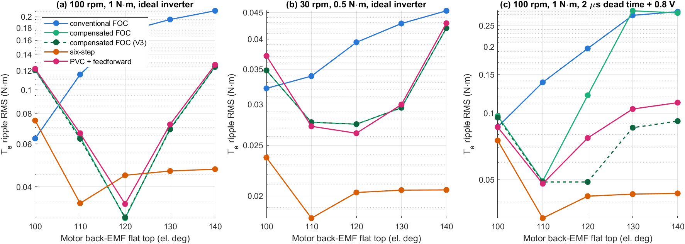
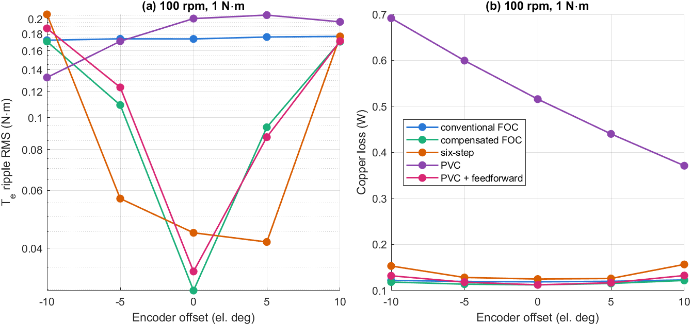

# Độ bền vững của các bộ điều khiển với sai lệch mô hình và cảm biến vị trí

**Tài liệu 08** trong bộ tài liệu lý thuyết của đề tài *Điều khiển định hướng từ trường cho động cơ BLDC có sức phản điện động hình thang*.

| Tài liệu | Nội dung |
|---|---|
| [01 – Mô hình toán học động cơ BLDC](01_BLDC_model.md) | Chương 2 |
| [02 – Mô hình BLDC trên hệ tọa độ quay](02_dq_model.md) | Chương 3 |
| [03 – Thiết kế FOC và FOC thông thường](03_FOC_conventional.md) | Chương 4, 5 và mô hình Simulink FOC thông thường |
| [04 – FOC bù back-EMF hình thang](04_FOC_compensated.md) | Chương 6 và mô hình Simulink FOC bù |
| [05 – Mô phỏng và so sánh](05_simulation_results.md) | Chương 7 |
| [06 – Điều khiển six-step và so sánh ba bộ điều khiển](06_six_step.md) | Chương 8 và mô hình Simulink six-step |
| [07 – Điều khiển giả vector (PVC)](07_pseudo_vector_control.md) | Chương 9 và mô hình Simulink PVC |
| **08 – Độ bền vững** (tài liệu này) | Chương 10 |

---

## Tóm tắt

Các chương trước so sánh năm bộ điều khiển trên một động cơ có thông số và dạng back-EMF đúng như bộ điều khiển giả định, với cảm biến vị trí lý tưởng. Tài liệu này kiểm tra điều gì xảy ra khi giả định đó sai. Động cơ trong mô hình được cho lệch khỏi thông số danh định: độ rộng đỉnh phẳng của back-EMF 100–140° (bảng tra của bộ điều khiển: 120°), từ thông ±10 %, điện cảm ±20 %, điện trở +30 %. Encoder được cho độ phân giải hữu hạn (256–4096 xung/vòng) và lệch góc lắp đặt ±5°, ±10° điện. Tổng cộng 306 lượt mô phỏng xác lập, tại 100 vòng/phút, 1 N·m và 30 vòng/phút, 0,5 N·m, với nghịch lưu lý tưởng và có thời gian chết. FOC bù rất nhạy với dạng back-EMF và góc encoder: lệch đỉnh phẳng 10° làm gợn mô-men RMS tăng 1,9–2,3 lần, lệch 20° tăng 3,6–4,2 lần; lệch góc 5° tăng 3–3,7 lần. Phân tích tuyến tính cho thấy nguyên nhân chính không phải khâu định dạng dòng mà là khâu bù back-EMF theo bảng tra: sai số của bảng tạo một nhiễu điện áp bậc 6 tỉ lệ với tốc độ mà vòng dòng chỉ triệt được một phần. Mô hình này dự báo gợn thấp hơn mô phỏng 10–27 % ở 100 vòng/phút. Sai lệch $R$, $L$ và từ thông −10 % hầu như không ảnh hưởng; từ thông +10 % làm FOC bù chạm giới hạn điện áp ở 100 vòng/phút, gợn tăng 3 lần với bộ giới hạn gốc nhưng chỉ 1,6 lần với giới hạn lục giác (V3). Six-step bền vững nhất: gợn của nó gần như không phụ thuộc dạng back-EMF (trừ đỉnh phẳng hẹp hơn 120°), thông số động cơ và phi tuyến nghịch lưu; điểm yếu duy nhất là lệch góc chuyển mạch từ 10° trở lên. Với nghịch lưu có thời gian chết và sụt áp van, six-step có gợn thấp nhất ở 16/17 trường hợp.

**Từ khóa:** BLDC; độ bền vững; sai lệch thông số; dạng back-EMF; encoder; FOC bù; six-step; PVC; gợn mô-men.

---

## Mục lục

- [10. Độ bền vững](#10-độ-bền-vững)
  - [10.1. Phương pháp](#101-phương-pháp)
  - [10.2. Dạng back-EMF](#102-dạng-back-emf)
  - [10.3. Thông số động cơ](#103-thông-số-động-cơ)
  - [10.4. Cảm biến vị trí](#104-cảm-biến-vị-trí)
  - [10.5. Kết hợp với nghịch lưu không lý tưởng](#105-kết-hợp-với-nghịch-lưu-không-lý-tưởng)
  - [10.6. Tổng hợp và lựa chọn bộ điều khiển](#106-tổng-hợp-và-lựa-chọn-bộ-điều-khiển)
  - [10.7. Hạn chế](#107-hạn-chế)
  - [10.8. Tái lập kết quả](#108-tái-lập-kết-quả)
- [Tài liệu tham khảo](#tài-liệu-tham-khảo)

---

## 10. Độ bền vững

### 10.1. Phương pháp

#### 10.1.1. Mở rộng mô hình

Bộ điều khiển luôn dùng thông số danh định ($R$, $L$, $\lambda$ trong `P`) và bảng tra back-EMF đỉnh phẳng 120°. Hai thay đổi trong thư viện dùng chung `bldc_plant_lib.slx` cho phép đối tượng lệch khỏi giả định đó:

- **Động cơ** (khối Permanent Magnet Synchronous Machine): điện trở, điện cảm và từ thông nhân với các hệ số `P.MIS.R`, `P.MIS.L`, `P.MIS.lam`; độ rộng đỉnh phẳng của back-EMF là `P.MIS.flat` (độ điện). Các giá trị được đặt bằng `bldc_set_plant`.
- **Cảm biến vị trí** (khối Position Sensor, đặt sau khâu lấy mẫu góc ở cả bốn mô hình): góc cơ đo được là

$$
\theta_{meas} = Q\,\Big\lfloor \frac{\theta}{Q} \Big\rfloor + \frac{\Delta\theta_e}{p}, \qquad Q = \frac{2\pi}{N_{enc}}, \tag{10.1}
$$

  với $N_{enc}$ là số xung trên một vòng cơ và $\Delta\theta_e$ là lệch góc lắp đặt (độ điện), đặt bằng `bldc_set_encoder`. Góc đo được dùng cho mọi phép biến đổi Park, mọi bảng tra và việc xác định sector của six-step; tốc độ đo vẫn lý tưởng.

Mặc định (`P.MIS` = 1, 1, 1, 120°; $N_{enc}$ = 0, tức không lượng tử hóa; $\Delta\theta_e$ = 0) cho kết quả trùng với mô hình cũ: kiểm tra hồi quy S1–S4 của năm bộ điều khiển (180 chỉ tiêu) đều đạt.

Khối máy điện của Simscape tạo back-EMF pha theo

$$
e_x = \lambda\,\omega_e\,\frac{\mathrm{sat}_{\pm c}\big(\cos(\theta_e - \varphi_x)\big)}{c}, \qquad c = \cos\frac{\Theta_{flat}}{2}, \tag{10.2}
$$

tức đỉnh phẳng rộng $\Theta_{flat}$ và sườn là các đoạn cosin. Với $\Theta_{flat}$ = 120°, dạng này gần như trùng với hình thang sườn thẳng `bldc_trap` dùng trong bảng tra (sai khác của $g_q$ dưới 0,2 %).

#### 10.1.2. Các trường hợp

*Bảng 10.1. Các trường hợp sai lệch (`Studies/run_robustness.m`).*

| Nhóm | Trường hợp |
|---|---|
| Dạng back-EMF | đỉnh phẳng 100°, 110°, 130°, 140° (bảng tra: 120°) |
| Thông số động cơ | $\lambda$ −10 %, +10 %; $L$ −20 %, +20 %; $R$ +30 % |
| Độ phân giải encoder | 256, 1024, 4096 xung/vòng cơ (11,25°, 2,81°, 0,70° điện) |
| Lệch góc encoder | −10°, −5°, +5°, +10° điện |

Sáu biến thể được chạy: FOC thường, FOC bù (giới hạn gốc V0), FOC bù với giới hạn lục giác V3 (mục 9.8), six-step, PVC và PVC + bù. Mỗi lượt chạy ở chế độ xác lập (tăng tốc tại 0,02 s, đóng tải tại 0,12 s, đánh giá từ 0,25 s trên một số nguyên chu kỳ điện, tối thiểu 0,1 s) tại hai điểm làm việc 100 vòng/phút, 1 N·m và 30 vòng/phút, 0,5 N·m với nghịch lưu lý tưởng (204 lượt), và tại 100 vòng/phút, 1 N·m với thời gian chết 2 µs + sụt áp van 0,8 V (102 lượt).

### 10.2. Dạng back-EMF

*Bảng 10.2. Gợn mô-men RMS (N·m) theo độ rộng đỉnh phẳng của back-EMF động cơ, 100 vòng/phút, 1 N·m, nghịch lưu lý tưởng.*

| Đỉnh phẳng | FOC thường | FOC bù | Six-step | PVC | PVC + bù |
|---|---|---|---|---|---|
| 100° | **0,063** | 0,120 | 0,075 | 0,116 | 0,122 |
| 110° | 0,116 | 0,064 | **0,034** | 0,147 | 0,066 |
| 120° (danh định) | 0,174 | **0,030** | 0,045 | 0,201 | 0,034 |
| 130° | 0,195 | 0,069 | **0,046** | 0,258 | 0,072 |
| 140° | 0,211 | 0,125 | **0,047** | 0,315 | 0,127 |



*Hình 10.1. Gợn mô-men RMS theo độ rộng đỉnh phẳng của back-EMF động cơ (bảng tra của bộ điều khiển: 120°): (a) 100 vòng/phút, 1 N·m; (b) 30 vòng/phút, 0,5 N·m; (c) 100 vòng/phút, 1 N·m với thời gian chết 2 µs + sụt áp van 0,8 V. Trục tung thang log.*

- **FOC bù và PVC + bù** chỉ tốt khi dạng back-EMF đúng như bảng tra. Lệch 10° làm gợn tăng 1,9–2,3 lần; lệch 20° làm gợn tăng 3,6–4,2 lần, gấp đôi FOC thường ở 100°.
- **Six-step** gần như không đổi khi đỉnh phẳng rộng hơn 120° (0,045–0,047 N·m): hai pha dẫn vẫn nằm trọn trên đỉnh phẳng trong suốt sector. Khi đỉnh phẳng hẹp hơn 120°, đầu và cuối mỗi sector rơi vào sườn và gợn tăng (0,075 N·m ở 100°). Ở 110°, gợn của six-step lại thấp hơn danh định (0,034 N·m), có thể vì phần sụt mô-men khi chuyển mạch (mục 8.3) được bù một phần bởi sườn back-EMF.
- **FOC thường** tốt dần khi đỉnh phẳng hẹp lại, vì back-EMF gần sin hơn; ở 100° nó có gợn thấp nhất (0,063 N·m).

#### 10.2.1. Cơ chế: bù back-EMF sai lệch

Sai lệch dạng back-EMF ảnh hưởng FOC bù qua hai đường. Thứ nhất, khâu định dạng dòng $k_s = (\lambda_1/\lambda)/g_q^{tab}$ không còn khớp với $g_q$ thật, nên mô-men $\tfrac32 p\lambda\, g_q\, i_q^{**}$ không còn phẳng dù dòng bám hoàn hảo (gợn "tĩnh"). Thứ hai, khâu bù $\omega_e\lambda\,g_{dq}^{tab}$ sai một lượng $\Delta\mathbf{e}_{dq} = \lambda\omega_e(\mathbf{g}_{dq} - \mathbf{g}_{dq}^{tab})$, là nhiễu điện áp có các thành phần bậc $6k$. Vòng dòng phản ứng với nhiễu này như với back-EMF của PVC (9.9):

$$
\Delta\mathbf{i}_{dq}(j6k\omega_e) = -\frac{\Delta\mathbf{e}_{dq}(j6k\omega_e)}{Z(j6k\omega_e) + C(j6k\omega_e)}, \qquad
T_e \approx \tfrac32 p\lambda\big[g_d\,\Delta i_d + g_q\,(i_q^{**} + \Delta i_q)\big]. \tag{10.3}
$$

Nhiễu tỉ lệ với $\omega_e$, nên gợn do đường thứ hai tăng theo tốc độ, còn gợn tĩnh thì không.

*Bảng 10.3. Gợn mô-men RMS (N·m) do sai lệch dạng back-EMF của FOC bù: mô hình tuyến tính (10.3) và phần tăng thêm trong mô phỏng so với danh định, $\sqrt{T_{rms}^2 - T_{rms,0}^2}$.*

| Đỉnh phẳng | 100 v/ph: tĩnh | 100 v/ph: (10.3) | 100 v/ph: mô phỏng | 30 v/ph: (10.3) | 30 v/ph: mô phỏng |
|---|---|---|---|---|---|
| 100° | 0,033 | 0,104 | 0,116 | 0,023 | 0,022 |
| 110° | 0,016 | 0,051 | 0,057 | 0,012 | 0,007 |
| 130° | 0,011 | 0,045 | 0,062 | 0,010 | 0,013 |
| 140° | 0,019 | 0,096 | 0,121 | 0,022 | 0,032 |

Mô hình (10.3) thấp hơn mô phỏng 10–27 % ở 100 vòng/phút và đúng bậc độ lớn ở 30 vòng/phút. Gợn tĩnh chỉ chiếm khoảng một phần ba; phần lớn đến từ khâu bù back-EMF. Hệ quả: nếu không biết chắc dạng back-EMF, việc bỏ khâu bù theo góc (giữ lại định dạng dòng) có thể còn tốt hơn bù sai. Một bộ quan sát back-EMF trực tuyến sẽ loại bỏ cả hai đường.

### 10.3. Thông số động cơ

*Bảng 10.4. Gợn mô-men RMS (N·m) với sai lệch thông số động cơ, 100 vòng/phút, 1 N·m, nghịch lưu lý tưởng.*

| Trường hợp | FOC thường | FOC bù (V0) | FOC bù (V3) | Six-step | PVC | PVC + bù |
|---|---|---|---|---|---|---|
| Danh định | 0,174 | 0,030 | 0,030 | 0,045 | 0,201 | 0,034 |
| $\lambda$ −10 % | 0,136 | 0,030 | 0,030 | 0,045 | 0,167 | 0,039 |
| $\lambda$ +10 % | 0,198 | 0,091 | 0,047 | 0,044 | 0,227 | 0,066 |
| $L$ −20 % | 0,168 | 0,035 | 0,034 | 0,042 | 0,196 | 0,038 |
| $L$ +20 % | 0,182 | 0,028 | 0,028 | 0,050 | 0,201 | 0,033 |
| $R$ +30 % | 0,163 | 0,030 | 0,030 | 0,046 | 0,196 | 0,033 |

- **$R$ và $L$** hầu như không ảnh hưởng (thay đổi dưới 18 %). Vòng dòng PI có tích phân bù sai số $R$; sai số $L$ chỉ làm lệch băng thông vòng dòng và khâu bù chéo một chút.
- **$\lambda$ −10 %** không làm tăng gợn của FOC bù, nhưng tổn hao đồng tăng 22 % vì cần thêm dòng cho cùng mô-men.
- **$\lambda$ +10 %** làm back-EMF ở 100 vòng/phút lớn hơn, điện áp yêu cầu vượt $V_{dc}/\sqrt3$ và bộ giới hạn tác động. Với giới hạn gốc V0, gợn của FOC bù tăng 3 lần (0,091 N·m); với V3, chỉ tăng 1,6 lần (0,047 N·m). Đây là thêm một lý do dùng V3 (mục 9.8).

### 10.4. Cảm biến vị trí



*Hình 10.2. Ảnh hưởng của lệch góc encoder tại 100 vòng/phút, 1 N·m, nghịch lưu lý tưởng: (a) gợn mô-men RMS; (b) tổn hao đồng.*

*Bảng 10.5. Gợn mô-men RMS (N·m) với encoder không lý tưởng, 100 vòng/phút, 1 N·m, nghịch lưu lý tưởng.*

| Trường hợp | FOC thường | FOC bù | Six-step | PVC | PVC + bù |
|---|---|---|---|---|---|
| Lý tưởng | 0,174 | 0,030 | 0,045 | 0,201 | 0,034 |
| 4096 xung/vòng | 0,176 | 0,034 | 0,044 | 0,200 | 0,040 |
| 1024 xung/vòng | 0,166 | 0,046 | 0,044 | 0,189 | 0,054 |
| 256 xung/vòng | 0,165 | 0,116 | 0,165 | 0,169 | 0,132 |
| Lệch −5° | 0,174 | 0,109 | 0,057 | 0,171 | 0,124 |
| Lệch +5° | 0,176 | 0,094 | 0,042 | 0,206 | 0,087 |
| Lệch −10° | 0,172 | 0,171 | 0,207 | 0,133 | 0,187 |
| Lệch +10° | 0,177 | 0,171 | 0,177 | 0,196 | 0,171 |

- **Độ phân giải.** Lượng tử hóa góc tạo sai số răng cưa biên độ tới $Q$, tức một nhiễu tần số cao trên dòng đặt định dạng và trên khâu bù back-EMF. FOC bù cần khoảng 4096 xung/vòng để giữ gợn trong 15 % của giá trị lý tưởng; 1024 xung/vòng làm gợn tăng 55 %. Six-step không nhạy ở 1024 xung/vòng (sai số chuyển mạch tối đa 2,8° điện), nhưng ở 256 xung/vòng (11,25° điện) sai số chuyển mạch gần bằng lệch 10° và gợn tăng mạnh. Trong thực tế six-step dùng cảm biến Hall với cạnh chuyển mạch chính xác, nên kết quả 256 xung/vòng chỉ có ý nghĩa với FOC.
- **Lệch góc.** FOC bù nhạy nhất: lệch 5° làm gợn tăng 3,1–3,7 lần và lệch 10° đưa gợn về mức FOC thường (0,171 N·m). Kết quả này khớp với kiểm tra ±5° ở mục 7.4. Six-step chịu được lệch 5° (0,042–0,057 N·m) nhưng không chịu được lệch 10° (0,18–0,21 N·m), khớp với quét `COMM_SHIFT` ở mục 8.7. FOC thường không nhạy vì vốn đã có gợn lớn; PVC với lệch −10° còn có gợn thấp hơn danh định vì lệch góc làm thay đổi pha của sai lệch (9.9) so với back-EMF, đồng thời tổn hao đồng tăng (Hình 10.2b).

Với FOC bù, lệch góc encoder và lệch dạng back-EMF tác động theo cùng một cơ chế (10.3): bảng tra được tra sai góc hoặc sai dạng. Vì vậy bước hiệu chỉnh góc (`TAB_SHIFT`, mục 6.6) là bắt buộc khi triển khai thực tế.

### 10.5. Kết hợp với nghịch lưu không lý tưởng

Ở 100 vòng/phút, 36 V, thời gian chết và sụt áp van đưa FOC bù tới gần giới hạn điện áp (mục 9.7–9.8). Khi thêm sai lệch động cơ, các ảnh hưởng chồng lên nhau (Hình 10.3c):

- **FOC bù với V0** có gợn 0,11–0,29 N·m ở hầu hết các trường hợp, và 0,74 N·m (74 % tải) với $\lambda$ +10 %: bộ giới hạn gốc gần như mất tác dụng điều khiển khi thiếu điện áp.
- **FOC bù với V3** giữ được 0,049–0,060 N·m với sai lệch $R$, $L$ và encoder 1024–4096 xung/vòng, nhưng 0,086–0,096 N·m khi lệch dạng back-EMF và 0,10–0,17 N·m khi lệch góc.
- **Six-step** có gợn 0,033–0,085 N·m ở mọi trường hợp và thấp nhất trong sáu biến thể ở 16/17 trường hợp. Ngoại lệ duy nhất là $\lambda$ −10 %, khi điện áp dư nhiều hơn và FOC bù V3 đạt 0,032 so với 0,047 N·m; với $L$ +20 %, hai bộ gần bằng nhau (0,049 và 0,048 N·m). Nói cách khác, khi nghịch lưu không lý tưởng và động cơ không đúng hoàn toàn như mô hình, six-step là lựa chọn an toàn nhất ở điểm làm việc này.

### 10.6. Tổng hợp và lựa chọn bộ điều khiển


*Hình 10.3. Gợn mô-men RMS (N·m) của sáu biến thể với mọi trường hợp sai lệch: (a) 100 vòng/phút, 1 N·m, nghịch lưu lý tưởng; (b) 30 vòng/phút, 0,5 N·m, nghịch lưu lý tưởng; (c) 100 vòng/phút, 1 N·m, thời gian chết 2 µs + sụt áp van 0,8 V. Màu theo thang log.*

Ở 30 vòng/phút (Hình 10.3b), mọi ảnh hưởng đều nhỏ hơn nhiều vì nhiễu (10.3) tỉ lệ với tốc độ: gợn của FOC bù chỉ tăng tối đa 1,6 lần (lệch −10°) và mọi biến thể FOC/PVC nằm trong 0,018–0,048 N·m. Ngoại lệ là six-step với sai số chuyển mạch lớn (256 xung/vòng, lệch ±10°): 0,10–0,13 N·m, vì ở tốc độ thấp mô-men nhô lên khi chuyển mạch (mục 8.3) và chuyển mạch sai thời điểm làm tăng thêm.

*Bảng 10.6. Khuyến nghị lựa chọn bộ điều khiển cho động cơ BLDC back-EMF hình thang, rút ra từ chương 7–10.*

| Điều kiện | Nên dùng | Ghi chú |
|---|---|---|
| Dạng back-EMF đo được chính xác (sai lệch đỉnh phẳng < 5°), encoder ≥ 4096 xung/vòng, góc hiệu chỉnh < 2–3° | FOC bù với giới hạn V3 | Gợn và tổn hao đồng thấp nhất; nhạy với dạng back-EMF và góc |
| Dạng back-EMF chưa rõ, cảm biến Hall, chi phí thấp | Six-step | Bền vững với dạng back-EMF, thông số và nghịch lưu; cần lắp Hall chính xác trong khoảng ±5° |
| Gần tốc độ cơ sở, $V_{dc}$ ít dư, nghịch lưu thật | Six-step hoặc FOC bù V3 | Không dùng bộ giới hạn V0 |
| Tốc độ thấp (≤ 30 vòng/phút) | FOC bù hoặc six-step | Sai lệch mô hình ít ảnh hưởng; six-step cần chuyển mạch chính xác |
| — | Không khuyến nghị: FOC thường, PVC không bù | Gợn lớn ở mọi trường hợp; PVC không bù tổn hao đồng lớn |

**Bộ giới hạn mặc định.** Dựa trên mục 9.8, 9.10 và 10.3–10.5, từ chương này FOC bù dùng giới hạn lục giác V3 làm mặc định (`P.vlim = 3` trong `bldc_params.m`). Ở các kịch bản S1–S4 với nghịch lưu lý tưởng, thay đổi này hầu như không ảnh hưởng tới gợn mô-men RMS (S2: 0,0303 → 0,0299 N·m) nhưng làm gợn đỉnh–đỉnh ở S2 tăng khoảng 10 % (0,153 → 0,169 N·m) và giảm vọt lố khi đảo chiều ở S3 (132,4 → 129,7 vòng/phút). Mọi số liệu ở chương 7–9 được tính với bộ giới hạn gốc V0; để tái lập, chạy `VLIM = 0; run_comp_foc` hoặc dùng tùy chọn `'Vlim', 0` (mặc định) của các script trong `Studies/`.

Kết quả cũng chỉ ra yêu cầu cho bước tiếp theo: điểm yếu của FOC bù nằm hoàn toàn ở chỗ nó cần biết chính xác $\mathbf{g}_{dq}(\theta)$. Một bộ ước lượng back-EMF trực tuyến (hoặc một bộ điều khiển cộng hưởng bậc 6 không dựa trên mô hình) có thể giữ ưu điểm của FOC bù mà vẫn bền vững như six-step.

### 10.7. Hạn chế

1. **Dạng back-EMF** chỉ thay đổi độ rộng đỉnh phẳng theo mô hình (10.2) của Simscape; chưa xét back-EMF không đối xứng giữa các pha, sóng hài bậc cao hay bão hòa từ.
2. **Mỗi sai lệch được xét riêng**; chưa xét tổ hợp nhiều sai lệch cùng lúc (ví dụ lệch dạng back-EMF cùng lệch góc), cũng chưa xét thông số thay đổi theo nhiệt độ trong khi chạy.
3. **Tốc độ đo lý tưởng.** Encoder chỉ ảnh hưởng tới góc; tốc độ được lấy trực tiếp từ mô hình. Với encoder độ phân giải thấp, ước lượng tốc độ từ góc sẽ thêm nhiễu cho vòng tốc độ.
4. **Six-step dùng góc encoder** để xác định sector; với cảm biến Hall thật, độ phân giải encoder không ảnh hưởng nhưng sẽ có sai lệch lắp đặt và trễ riêng của Hall.
5. **Hai điểm làm việc** (100 và 30 vòng/phút); kết luận ở 100 vòng/phút gắn với việc gần tốc độ cơ sở ở $V_{dc}$ = 36 V.

### 10.8. Tái lập kết quả

```matlab
addpath('03_Simulation/Tests', '03_Simulation/Studies')
% 1. kiểm tra mô hình mặc định không đổi (180 chỉ tiêu)
bldc_regression('Scenarios', {'S1','S2','S3','S4'})
% 2. nghiên cứu độ bền vững (khoảng 15 phút với 8 worker)
run_robustness()                                          % Bảng 10.2, 10.4, 10.5
run_robustness('Inverter', 'dt2vf', 'Points', [100 1], ...
               'File', 'robustness_dt2vf.csv')            % mục 10.5
% 3. hình fig10_*
run('04_Results/make_robustness_figures.m')
```

Ví dụ một trường hợp riêng: `P = bldc_set_plant(P, 'flat', 140); P = bldc_set_encoder(P, 1024, 5*pi/180);` trước khi chạy mô hình. Các số liệu mô hình tuyến tính ở Bảng 10.3 được tính từ (10.2), (10.3) với các bảng $g_d$, $g_q$ của `comp_foc_init.m`.

---

## Tài liệu tham khảo

1. T. M. Jahns and W. L. Soong, "Pulsating torque minimization techniques for permanent magnet AC motor drives — A review," *IEEE Trans. Ind. Electron.*, vol. 43, no. 2, pp. 321–330, 1996.
2. R. Carlson, M. Lajoie-Mazenc, and J. C. dos S. Fagundes, "Analysis of torque ripple due to phase commutation in brushless dc machines," *IEEE Trans. Ind. Appl.*, vol. 28, no. 3, pp. 632–638, 1992.
3. R. Krishnan, *Permanent Magnet Synchronous and Brushless DC Motor Drives*. Boca Raton, FL, USA: CRC Press, 2010.
4. MathWorks, "Permanent Magnet Synchronous Machine," Simscape Electrical (Specialized Power Systems) documentation, R2023a.
