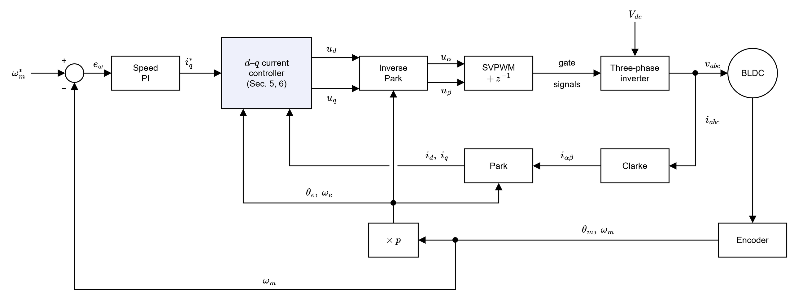
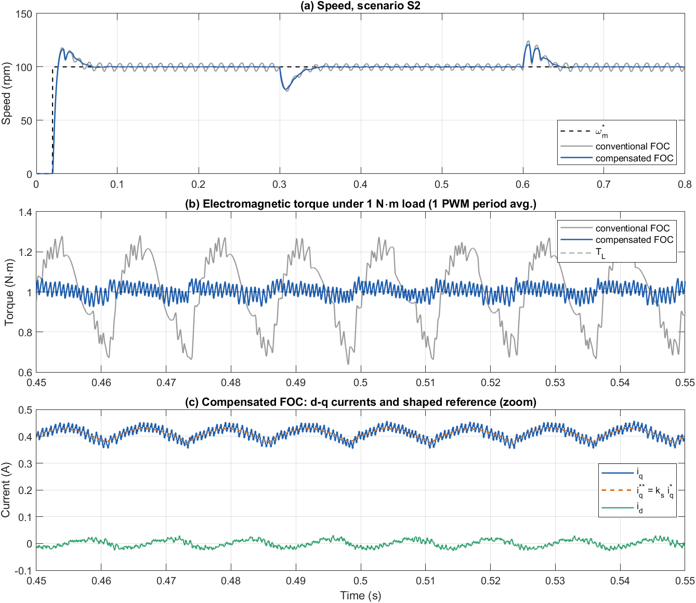

<h1 align="center">BLDC Motor Control – Research Workspace</h1>

<p align="center">
  <a href="https://www.mathworks.com/products/matlab.html"></a>
  <a href="https://www.mathworks.com/products/simscape-electrical.html"></a>
  <a href="01_Documents/Theory"></a>
  <a href="LICENSE"></a>
</p>

Modeling, design and evaluation of control strategies for **brushless DC (BLDC) motors with trapezoidal back-EMF**, developed as part of a master's thesis.

Field-oriented control (FOC) is derived for sinusoidal machines. Applied to a BLDC motor, it leaves a 6th-harmonic back-EMF component in the $d$–$q$ frame that produces torque and speed ripple. This repository models the motor, analyses the ripple mechanisms of conventional FOC, and implements a **compensated FOC** (angle-based back-EMF feedforward, digital-delay compensation and $i_q$ current shaping) in switching-level MATLAB/Simulink models.

The workspace is **not tied to a single controller**: every strategy lives in its own folder, uses the same motor, inverter and test scenarios, and can be compared directly with the others.

<p align="center">
  
  <br><em>FOC structure shared by all FOC variants – only the d–q current controller changes.</em>
</p>

---

## Contents

- [Highlights](#highlights)
- [Repository structure](#repository-structure)
- [Getting started](#getting-started)
- [Controllers](#controllers)
- [Test scenarios](#test-scenarios)
- [Documentation](#documentation)
- [Workflow and conventions](#workflow-and-conventions)
- [Adding a new controller](#adding-a-new-controller)
- [License](#license)

---

## Highlights

Steady state with 1 N·m load at 100 rpm (scenario S2), identical PI gains for both controllers:

| Metric | Conventional FOC | Compensated FOC | Change |
|---|---:|---:|---:|
| Torque ripple, peak-to-peak (N·m) | 0.642 | 0.153 | **−76 %** |
| Torque ripple, RMS (N·m) | 0.176 | 0.030 | **−83 %** |
| Speed ripple, peak-to-peak (rpm) | 6.90 | 0.87 | **−87 %** |
| Speed dip at load step (rpm) | 22.9 | 21.1 | −8 % |

<p align="center">
  
</p>

---

## Repository structure

```
master_thesis_bldc_control/
├── 01_Documents/
│   ├── Theory/
│   │   ├── Markdown/          # theory documents 01–04 (.md, render on GitHub)
│   │   ├── Latex/             # same documents as LaTeX sources (XeLaTeX)
│   │   └── PDF/               # compiled PDFs
│   └── Thesis/
│       └── figures/           # all figures (draw.io source, PNG exports, Simulink screenshots, plots)
├── 02_References/             # papers, datasheets, standards; references.bib
├── 03_Simulation/             # one folder per control strategy (see 03_Simulation/README.md)
│   ├── Common/                # shared parameters, scenarios, run helper, plant library (bldc_plant_lib.slx)
│   ├── Conventional_FOC/
│   └── Compensated_FOC/
├── 04_Results/
│   ├── Raw/                   # <scenario>_<controller>.mat (generated, not tracked)
│   ├── Figures/
│   └── Tables/
├── 05_Admin/                  # forms, decisions, deadlines
└── .vscode/settings.json      # LaTeX Workshop: XeLaTeX via latexmk, output in build/
```

---

## Getting started

### Requirements

| Purpose | Software |
|---|---|
| Simulation | MATLAB/Simulink **R2023a**, Simscape Electrical (Specialized Power Systems) |
| Documentation (optional) | XeLaTeX + `latexmk` (TeX Live or MiKTeX), Latin Modern fonts, babel-vietnamese |
| Diagrams (optional) | [draw.io](https://www.drawio.com/) desktop – source file `01_Documents/Thesis/figures/foc_block_diagram.drawio` |

### Run the simulations

```matlab
% from 03_Simulation/Conventional_FOC
run_conv_foc                        % scenarios S1–S4 -> 04_Results/Raw/S*_conv.mat

% from 03_Simulation/Compensated_FOC
run_comp_foc                        % scenarios S1–S4 -> 04_Results/Raw/S*_comp.mat
SCEN_LIST = {'S2'}; run_comp_foc    % a single scenario
DO_CALIB = true;   run_comp_foc     % re-tune the look-up-table phase (TAB_SHIFT) first
```

To run a model interactively, initialise a scenario and press **Run** in Simulink:

```matlab
SCEN = 'S3'; conv_foc_init; open_system('Conventional_FOC')
```

Each model calls its init script automatically on load (`PreLoadFcn`). One scenario takes a few seconds (fixed step 1 µs).

### Build the documentation

```bash
cd 01_Documents/Theory/Latex
./build.sh        # Linux / WSL   (build.bat on Windows)
```

PDFs are written to `01_Documents/Theory/PDF/`. See [`01_Documents/Theory/Latex/README.md`](01_Documents/Theory/Latex/README.md) for details.

---

## Controllers

| Controller | Description | Folder | Status |
|---|---|---|---|
| **Conventional FOC** | Two PI current controllers (IMC tuning), cross-coupling decoupling, constant fundamental back-EMF feedforward $\omega_e\lambda_1$ | [`03_Simulation/Conventional_FOC`](03_Simulation/Conventional_FOC) | ✅ S1–S4 |
| **Compensated FOC** | Conventional FOC + trapezoidal back-EMF feedforward from look-up tables $g_d$, $g_q$, digital-delay compensation $\theta_p$, $\theta_a$, and $i_q$ shaping $i_q^{**} = k_s\,i_q^*$ | [`03_Simulation/Compensated_FOC`](03_Simulation/Compensated_FOC) | ✅ S1–S4 |
| *Six-step, DTC, MPC, …* | Planned / open for extension | – | – |

Common setup: 8 pole-pair BLDC motor (R = 0.4578 Ω, L = 3.33 mH, λ = 0.171 Wb), 36 V IGBT inverter, SVPWM at 10 kHz, current loop 10 kHz, speed loop 1 kHz, Simscape PMSM block with 120° flat-top back-EMF.

---

## Test scenarios

| ID | Description | Duration |
|---|---|---|
| S1 | No-load start-up, 0 → 100 rpm at 0.02 s | 0.40 s |
| S2 | 100 rpm, 1 N·m load step at 0.3 s, removed at 0.6 s | 0.80 s |
| S3 | Speed reversal +100 → −100 rpm at 0.3 s | 0.70 s |
| S4 | Staircase 30 → 60 → 100 → 60 → 30 rpm, 0.5 N·m load | 1.25 s |

Results are stored as `04_Results/Raw/<scenario>_<controller>.mat` (struct `R` with `t, w_ref, TL, w, Te, i_abc, id, iq, iq_ref, iq_cmd`, sampled every 10 µs, plus parameters and run metadata).

---

## Documentation

Theory documents (Vietnamese), available as Markdown, LaTeX and PDF:

| # | Title | Chapters | Markdown | PDF |
|---|---|---|---|---|
| 01 | Mathematical model of the BLDC motor | 2 | [md](01_Documents/Theory/Markdown/01_BLDC_model.md) | [pdf](01_Documents/Theory/PDF/01_BLDC_model.pdf) |
| 02 | BLDC model in the rotating $dq$ frame | 3 | [md](01_Documents/Theory/Markdown/02_dq_model.md) | [pdf](01_Documents/Theory/PDF/02_dq_model.pdf) |
| 03 | FOC design and conventional FOC (+ Simulink model) | 4, 5 | [md](01_Documents/Theory/Markdown/03_FOC_conventional.md) | [pdf](01_Documents/Theory/PDF/03_FOC_conventional.pdf) |
| 04 | Compensated FOC for trapezoidal back-EMF (+ Simulink model) | 6 | [md](01_Documents/Theory/Markdown/04_FOC_compensated.md) | [pdf](01_Documents/Theory/PDF/04_FOC_compensated.pdf) |

Equations, figures and tables are numbered by chapter, e.g. (3.3), Fig. 5.2, Table 6.1, consistently across all three formats.

---

## Workflow and conventions

```
03_Simulation (models + init scripts) ──► 04_Results/Raw (*.mat)
        │                                        │
        └──► Thesis/figures (Simulink screenshots, plots) ◄──┘
                         │
                         ▼
        01_Documents/Theory (Markdown · LaTeX · PDF)
```

- **Single source for parameters and plant** – motor, inverter, gains and scenarios come from `03_Simulation/Common` (`bldc_params`, `bldc_scenario`); Power Stage, PWM, SVPWM and abc_to_dq are library links to `Common/bldc_plant_lib.slx`.
- **Single source for figures** – Markdown and LaTeX documents both use the PNG files in `01_Documents/Thesis/figures/`; block diagrams are edited in `foc_block_diagram.drawio` and exported with draw.io.
- **Generated data is not tracked** – `04_Results/Raw/`, LaTeX `build/` folders, Simulink caches (`slprj/`, `*.slxc`) and copyrighted PDFs in `02_References/` are git-ignored.

---

## Adding a new controller

1. Create `03_Simulation/<Strategy_Name>/` with a Simulink model built from the blocks of `Common/bldc_plant_lib.slx`.
2. Write an init script based on `bldc_params` / `bldc_scenario` and a run script based on `bldc_run_scenario`.
3. Save results as `04_Results/Raw/<scenario>_<tag>.mat` with the same struct `R`.
4. Add the controller to the tables in this README and in [`03_Simulation/README.md`](03_Simulation/README.md).

---

## License

Released under the [MIT License](LICENSE). © 2026 Le Tuan Phuc.
