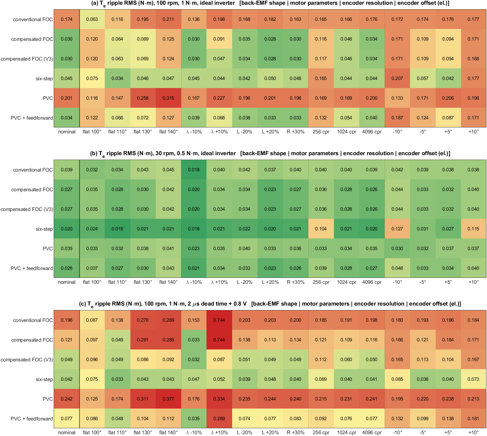

<h1 align="center">Control of BLDC Motors with Trapezoidal Back-EMF</h1>

<p align="center">
  <em>Modeling, design and simulation-based comparison of FOC, compensated FOC, six-step and pseudo vector control</em>
</p>

<p align="center">
  <a href="https://www.mathworks.com/products/matlab.html"></a>
  <a href="https://www.mathworks.com/products/simscape-electrical.html"></a>
  <a href="01_Documents/Theory"></a>
  
  
  <a href="LICENSE"></a>
</p>

This repository is the research workspace of a master's thesis on the control of **brushless DC (BLDC) motors whose back-EMF is trapezoidal rather than sinusoidal**. It contains switching-level MATLAB/Simulink models of five control strategies, shared motor, inverter and test-scenario definitions, parameter studies that run all controllers under identical conditions, and a set of theory documents (Vietnamese) in Markdown, LaTeX and PDF.

Field-oriented control (FOC) is derived for sinusoidal machines. On a trapezoidal BLDC motor it leaves a 6th-harmonic back-EMF component in the $d$–$q$ frame that causes torque and speed ripple. The work analyses this mechanism, designs a **compensated FOC** that removes it, and compares the result with classical six-step commutation and with **pseudo vector control (PVC)** after US patent 7,339,346, including inverter non-idealities, sensor errors, field weakening and robustness to motor mismatch.

<p align="center">
  
  <br><em>FOC structure shared by all FOC variants: only the d–q current controller changes.</em>
</p>

---

## Contents

- [Key findings](#key-findings)
- [Results at a glance](#results-at-a-glance)
- [Controllers](#controllers)
- [Simulation setup](#simulation-setup)
- [Repository structure](#repository-structure)
- [Getting started](#getting-started)
- [Parameter studies](#parameter-studies)
- [Non-idealities and options](#non-idealities-and-options)
- [Documentation](#documentation)
- [Reproducibility and conventions](#reproducibility-and-conventions)
- [Adding a new controller](#adding-a-new-controller)
- [Roadmap](#roadmap)
- [Citation](#citation)
- [License](#license)

---

## Key findings

1. **Compensated FOC removes the 6th-harmonic ripple of conventional FOC.** Angle-based back-EMF feedforward, digital-delay compensation and $i_q$ current shaping reduce the RMS torque ripple at 100 rpm, 1 N·m from 0.177 to 0.030 N·m (−83 %) and give the lowest copper loss of all controllers.
2. **Six-step is close in ripple and the most robust.** With rectangular 120° currents it reaches 0.043 N·m RMS ripple with the simplest hardware (Hall sensors, one current PI), at about 11 % higher copper loss. It is almost insensitive to back-EMF shape, motor parameters and inverter dead time.
3. **The claims of the PVC patent are not confirmed.** PVC as patented produces a speed-proportional reactive current (copper loss ×4.6). With back-EMF feedforward it matches compensated FOC, but its apparent advantage with a non-ideal inverter comes from the voltage limiter, not from phase-by-phase control; with three current sensors and an offset, its phase integrators wind up in the zero sequence.
4. **Voltage limiting matters near base speed.** Limiting the d–q voltage by the inverter hexagon instead of clamping $u_d$, $u_q$ separately halves the ripple with dead time and device drops and extends the speed range by 6 % without extra current. It is the default limiter since chapter 10.
5. **Compensated FOC depends on an accurate back-EMF model.** A 10° error in the back-EMF flat-top width or a 5° encoder offset increases its ripple 2–4 times; a linear model shows that the back-EMF feedforward, not the current shaping, is the main cause. This motivates the next step: back-EMF estimation or resonant control.

---

## Results at a glance

Steady state at 100 rpm with 1 N·m load (scenario S2), ideal inverter, identical speed-loop dynamics for all controllers. Full tables: [`04_Results/Tables/kpi_comparison.md`](04_Results/Tables/kpi_comparison.md).

| Metric | Conventional FOC | Compensated FOC | Six-step | PVC | PVC + feedforward |
|---|---:|---:|---:|---:|---:|
| Torque ripple, RMS (N·m) | 0.177 | **0.030** | 0.043 | 0.200 | 0.034 |
| Torque ripple, peak-to-peak (N·m) | 0.642 | **0.153** | 0.447 | 0.707 | 0.179 |
| 6th-harmonic torque (N·m) | 0.239 | **0.022** | 0.023 | 0.264 | 0.028 |
| Speed ripple, peak-to-peak (rpm) | 6.90 | **0.87** | 1.16 | 7.42 | 0.95 |
| Phase-current THD (%) | 22.0 | 5.6 | 31.6 | 9.4 | **5.2** |
| Phase current RMS (A) | 0.296 | **0.286** | 0.302 | 0.612 | **0.286** |
| Copper loss (W) | 0.121 | **0.113** | 0.125 | 0.515 | **0.113** |

<p align="center">
  
  <br><em>Steady-state indicators of the five controllers in scenario S2, relative to conventional FOC.</em>
</p>

**Which controller to use** (from the robustness study, document 08):

| Situation | Recommended | Reason |
|---|---|---|
| Back-EMF shape measured accurately, encoder ≥ 4096 counts/rev, angle calibrated within 2–3° | Compensated FOC (hexagon limiter) | Lowest ripple and copper loss |
| Back-EMF shape uncertain, Hall sensors, low cost | Six-step | Robust to back-EMF shape, parameters and inverter non-idealities |
| Near base speed with a real inverter | Six-step or compensated FOC with hexagon limiter | Never clamp $u_d$, $u_q$ separately |
| Not recommended | Conventional FOC, PVC without feedforward | Large ripple; PVC has high copper loss |

<p align="center">
  
  <br><em>Torque ripple of every controller for 17 cases of motor mismatch and encoder error (document 08).</em>
</p>

---

## Controllers

| Controller | Description | Folder | Document |
|---|---|---|---|
| **Conventional FOC** | Two PI current controllers (IMC tuning), cross-coupling decoupling, constant fundamental back-EMF feedforward $\omega_e\lambda_1$, SVPWM | [`Conventional_FOC`](03_Simulation/Conventional_FOC) | 03 |
| **Compensated FOC** | Conventional FOC + back-EMF feedforward from look-up tables $g_d$, $g_q$, digital-delay compensation ($\theta_p$, $\theta_a$), $i_q$ shaping $i_q^{**} = k_s\,i_q^*$; selectable voltage limiter (default: inverter hexagon), optional field weakening | [`Compensated_FOC`](03_Simulation/Compensated_FOC) | 04, 07 |
| **Six-step** | 120° commutation from Hall sectors, PI control of the two-phase current $I = \tfrac12\mathbf{s}^T\mathbf{i}_{abc}$, line back-EMF feedforward, H_PWM–L_ON modulation | [`Six_Step`](03_Simulation/Six_Step) | 06 |
| **PVC** | Pseudo vector control (US 7,339,346): vector-control current references (power-balance $i_q^*$, field-weakening $i_d^*$) transformed to phase currents and tracked by three phase PI controllers | [`PVC`](03_Simulation/PVC) | 07 |
| **PVC + feedforward** | PVC with phase back-EMF feedforward (not in the patent), `PVC_FF = 1` | [`PVC`](03_Simulation/PVC) | 07 |

---

## Simulation setup

All controllers run on the same switching-level plant (Simscape Electrical, Specialized Power Systems, discrete solver 1 µs).

| Quantity | Value | Quantity | Value |
|---|---|---|---|
| Pole pairs $p$ | 8 | DC-link voltage $V_{dc}$ | 36 V |
| Phase resistance $R$ | 0.4578 Ω | PWM / current-loop rate | 10 kHz |
| Inductance $L = L_s - M$ | 3.33 mH | Speed-loop rate | 1 kHz |
| Flux linkage $\lambda$ (flat top) | 0.171 V·s | Current limit $I_{max}$ | 3 A |
| Back-EMF | trapezoidal, 120° flat top | Base speed ($V_{dc}/\sqrt3$) | 119.3 rpm |
| Inertia $J$ | 1.469·10⁻³ kg·m² | Current-loop time constant $\tau_c$ | 0.318 ms |
| Viscous friction $B$ | 3.035·10⁻⁴ N·m·s | Speed loop | 20 Hz, $\zeta = 1$ |

All values are defined once in [`03_Simulation/Common/bldc_params.m`](03_Simulation/Common/bldc_params.m).

### Test scenarios

| ID | Description | Duration | Steady-state window |
|---|---|---|---|
| S1 | No-load start-up, 0 → 100 rpm at 0.02 s | 0.40 s | 0.20–0.40 s |
| S2 | 100 rpm, 1 N·m load step at 0.3 s, removed at 0.6 s | 0.80 s | 0.45–0.58 s |
| S3 | Speed reversal +100 → −100 rpm at 0.3 s | 0.70 s | 0.50–0.70 s |
| S4 | Staircase 30 → 60 → 100 → 60 → 30 rpm, 0.5 N·m load | 1.25 s | 1.10–1.25 s |
| S5 | High speed: 100 → 140 rpm at 0.3 s, 0.25 N·m (above base speed; studies only) | 0.80 s | 0.60–0.80 s |

---

## Repository structure

```
master_thesis_bldc_control/
├── 01_Documents/
│   ├── Theory/
│   │   ├── Markdown/            # theory documents 01–08 (render on GitHub)
│   │   ├── Latex/               # same documents as LaTeX sources (XeLaTeX), build scripts
│   │   └── PDF/                 # compiled PDFs
│   └── Thesis/figures/          # all figures: draw.io source, PNG exports, Simulink screenshots, plots
├── 02_References/               # references.bib (paper PDFs are kept locally, not tracked)
├── 03_Simulation/               # see 03_Simulation/README.md
│   ├── Common/                  # parameters, scenarios, run helpers, metrics, non-ideality setters, plant library
│   ├── Conventional_FOC/        # model + init and run scripts, one folder per controller
│   ├── Compensated_FOC/
│   ├── Six_Step/
│   ├── PVC/
│   ├── Studies/                 # parameter studies across controllers (parsim)
│   └── Tests/                   # controller registry and regression test
├── 04_Results/
│   ├── make_results.m               # KPI tables, figures fig7_*
│   ├── make_six_step_figures.m      # figures fig8_*
│   ├── make_pvc_figures.m           # figures fig9_1 … fig9_9
│   ├── make_sweep_figures.m         # figures fig9_10 … fig9_13
│   ├── make_pvc_study_figures.m     # figures fig9_14 … fig9_17
│   ├── make_robustness_figures.m    # figures fig10_*
│   ├── make_simulink_screenshots.m  # model diagrams fig5_sim_*, fig6_sim_*, fig8_sim_*, fig9_sim_*
│   ├── Tables/                      # KPI tables and CSV results of every study
│   └── Raw/                         # <scenario>_<controller>.mat (generated, not tracked)
├── LICENSE
└── README.md
```

---

## Getting started

### Requirements

| Purpose | Software |
|---|---|
| Simulation | MATLAB/Simulink **R2023a**, Simscape Electrical (Specialized Power Systems) |
| Parameter studies | Parallel Computing Toolbox (`parsim`, 8 workers by default; optional for single runs) |
| Documentation (optional) | XeLaTeX + `latexmk` (TeX Live or MiKTeX), Latin Modern fonts, babel-vietnamese |
| Diagrams (optional) | [draw.io](https://www.drawio.com/) desktop for `01_Documents/Thesis/figures/foc_block_diagram.drawio` |

### Quick start

```bash
git clone https://github.com/whoisLePhuc/master_thesis_bldc_control.git
```

```matlab
cd master_thesis_bldc_control/03_Simulation/Compensated_FOC
SCEN = 'S2'; comp_foc_init; open_system('Compensated_FOC')   % then press Run in Simulink
```

Every model calls its init script on load (`PreLoadFcn`), so it can be opened from any folder. One scenario takes 15–25 s.

### Run the controllers

```matlab
% from the controller folder; results -> 04_Results/Raw/<scenario>_<tag>.mat
run_conv_foc                        % Conventional_FOC, S1–S4
run_comp_foc                        % Compensated_FOC,  S1–S4
SCEN_LIST = {'S2'}; run_comp_foc    % a single scenario
DO_CALIB = true;    run_comp_foc    % re-tune the look-up-table phase TAB_SHIFT first
run_six_step                        % Six_Step, S1–S4
run_pvc                             % PVC, S1–S4, without and with feedforward
```

### Regression test

Run it after any change in a model or in `03_Simulation/Common`:

```matlab
addpath('03_Simulation/Tests')
bldc_regression                                      % S2 of every controller (~1.5 min)
bldc_regression('Scenarios', {'S1','S2','S3','S4'})  % 180 metrics (~6 min)
```

### Tables and figures

```matlab
run('04_Results/make_results.m')               % KPI tables and fig7_* (needs the S1–S4 results)
run('04_Results/make_simulink_screenshots.m')  % model diagrams (needs no results)
```

`04_Results/Raw/` is not tracked: run the controllers and studies first to regenerate it (about 30–40 min in total).

### Build the documentation

```bash
cd 01_Documents/Theory/Latex
./build.sh          # Linux / macOS / WSL  (build.bat on Windows)
```

PDFs are written to `01_Documents/Theory/PDF/`; see [`01_Documents/Theory/Latex/README.md`](01_Documents/Theory/Latex/README.md).

---

## Parameter studies

The scripts in [`03_Simulation/Studies`](03_Simulation/Studies) run the controllers in parallel with `parsim` and write CSV files to `04_Results/Tables`. Each theory document lists the exact calls in its *Reproduction* section.

| Script | Question | Runs | Document |
|---|---|---:|---|
| `run_inverter_nonideal` | Effect of dead time and device drops (S2, S4) | 40 | 07, Sec. 9.7 |
| `run_sweep_speed_load` | Steady-state ripple over 20–100 rpm × 0.25–1 N·m | 225 | 07, Sec. 9.7 |
| `check_voltage_saturation` | Activity of the voltage limiters | 4 | 07, Sec. 9.7 |
| `run_voltage_limit` | Four voltage limiters of compensated FOC vs PVC | 120 | 07, Sec. 9.8 |
| `run_sensor_error` | Current-sensor offset and gain errors, 2 or 3 sensors | 50 | 07, Sec. 9.9 |
| `check_zero_sequence` | Zero-sequence wind-up of the PVC phase integrators | 2 | 07, Sec. 9.9 |
| `run_high_speed` | Scenario S5, field weakening | 9 | 07, Sec. 9.10 |
| `run_robustness` | Motor mismatch (back-EMF shape, $R$, $L$, $\lambda$) and encoder errors | 306 | 08 |

```matlab
addpath('03_Simulation/Studies')
run_robustness()                                   % ~15 min with 8 workers
run('04_Results/make_robustness_figures.m')
```

---

## Non-idealities and options

Every non-ideality is **off by default**, so the default models reproduce the stored regression metrics. They are set on the parameter struct `P` before a run:

| Setting | Function / field | Default | Effect |
|---|---|---|---|
| Dead time, device drops | `bldc_set_inverter(P, Td, Vf)` | ideal | turn-on delay in the PWM block, IGBT/diode forward voltages |
| Current sensors | `bldc_set_sensor(P, off, gain, nsens)` | ideal, 3 sensors | offsets, gains, 2 or 3 phase sensors |
| Motor mismatch | `bldc_set_plant(P, 'R', kR, 'L', kL, 'lam', kLam, 'flat', deg)` | nominal | motor differs from the controller parameters and 120° tables |
| Encoder | `bldc_set_encoder(P, N, off_e)` | ideal | resolution (counts/rev) and mounting offset |
| Voltage limiter (compensated FOC) | `P.vlim` = 0…3, see `bldc_vlim` | 3 (hexagon) | 0 clamp $u_d$, $u_q$ · 1 vector magnitude · 2 phase clamp · 3 inverter hexagon |
| Field weakening (compensated FOC) | `P.FW.on` | 0 | voltage-feedback $i_d^*$ |

```matlab
P = bldc_params();
P = bldc_set_inverter(P, 2e-6, [0.8 0.8]);           % 2 µs dead time, 0.8 V drops
P = bldc_set_plant(P, 'flat', 140);                  % motor with a 140° flat top
P = bldc_set_encoder(P, 1024, 5*pi/180);             % 1024 counts/rev, 5° offset
```

---

## Documentation

Theory documents (Vietnamese) in three synchronized formats. Equations, figures and tables are numbered by chapter, e.g. (3.3), Fig. 5.2, Table 6.1, identically in all formats.

| # | Title | Ch. | Markdown | PDF |
|---|---|---|---|---|
| 01 | Mathematical model of the BLDC motor | 2 | [md](01_Documents/Theory/Markdown/01_BLDC_model.md) | [pdf](01_Documents/Theory/PDF/01_BLDC_model.pdf) |
| 02 | BLDC model in the rotating $dq$ frame | 3 | [md](01_Documents/Theory/Markdown/02_dq_model.md) | [pdf](01_Documents/Theory/PDF/02_dq_model.pdf) |
| 03 | FOC design and conventional FOC (+ Simulink model) | 4, 5 | [md](01_Documents/Theory/Markdown/03_FOC_conventional.md) | [pdf](01_Documents/Theory/PDF/03_FOC_conventional.pdf) |
| 04 | Compensated FOC for trapezoidal back-EMF (+ Simulink model) | 6 | [md](01_Documents/Theory/Markdown/04_FOC_compensated.md) | [pdf](01_Documents/Theory/PDF/04_FOC_compensated.pdf) |
| 05 | Simulation results and comparison of the two FOC variants | 7 | [md](01_Documents/Theory/Markdown/05_simulation_results.md) | [pdf](01_Documents/Theory/PDF/05_simulation_results.pdf) |
| 06 | Six-step control and comparison of three controllers | 8 | [md](01_Documents/Theory/Markdown/06_six_step.md) | [pdf](01_Documents/Theory/PDF/06_six_step.pdf) |
| 07 | Pseudo vector control; inverter non-idealities, voltage limiting, current-sensor errors, field weakening | 9 | [md](01_Documents/Theory/Markdown/07_pseudo_vector_control.md) | [pdf](01_Documents/Theory/PDF/07_pseudo_vector_control.pdf) |
| 08 | Robustness to motor mismatch and position-sensor errors; choice of controller | 10 | [md](01_Documents/Theory/Markdown/08_robustness.md) | [pdf](01_Documents/Theory/PDF/08_robustness.pdf) |

---

## Reproducibility and conventions

```
03_Simulation (models, init scripts, studies) ──► 04_Results/Raw (*.mat), Tables (*.csv)
        │                                                   │
        └──► Thesis/figures (screenshots, plots) ◄──────────┘
                              │
                              ▼
          01_Documents/Theory (Markdown · LaTeX · PDF)
```

- **Single source for parameters and plant.** Motor, inverter, gains and scenarios come from `03_Simulation/Common`; Power Stage, PWM, SVPWM, abc_to_dq, Current Sensor and Position Sensor are library links to `Common/bldc_plant_lib.slx`.
- **Regression test.** `bldc_regression` compares speed, torque and current metrics of every registered controller with stored references (tolerance 1 % + 10⁻³); it must pass after every change in a model or in `Common/`.
- **Versioned defaults.** Results in documents 05–07 use the original voltage limiter of compensated FOC; `VLIM = 0; run_comp_foc` and the `'Vlim', 0` option of the studies reproduce them.
- **Single source for figures.** Markdown and LaTeX use the PNG files in `01_Documents/Thesis/figures/`; block diagrams are edited in `foc_block_diagram.drawio`, plots are generated by the `04_Results/make_*.m` scripts.
- **Generated data is not tracked.** `04_Results/Raw/`, LaTeX `build/` folders, Simulink caches (written to `.cache/` by `Common/bldc_cache_setup.m`) and copyrighted PDFs in `02_References/` are git-ignored.

---

## Adding a new controller

1. Create `03_Simulation/<Strategy_Name>/` with a Simulink model built from the blocks of `Common/bldc_plant_lib.slx` and the common root interface (Inports `w_ref`, `TL`; Outports `w`, `Te`, `i_abc`, `idq`, `iq_ref`, `iq_cmd`).
2. Write `<tag>_init.m` starting from `bldc_params` / `bldc_scenario` (and calling `bldc_cache_setup`) and `run_<tag>.m` based on `bldc_run_scenario`; save results as `04_Results/Raw/<scenario>_<tag>.mat`.
3. Register the controller in `03_Simulation/Tests/bldc_controllers.m` and store its reference metrics:
   `bldc_regression('Controllers', {'<tag>'}, 'Scenarios', {'S1','S2','S3','S4'}, 'Update', true)`.
   `run_inverter_nonideal`, `run_sweep_speed_load`, `run_sensor_error` and `run_robustness` then include it automatically.
4. Add it to the tables in this README and in [`03_Simulation/README.md`](03_Simulation/README.md).

Details: [`03_Simulation/README.md`](03_Simulation/README.md).

---

## Roadmap

- [x] BLDC model, $d$–$q$ model and ripple analysis of conventional FOC (documents 01–03)
- [x] Compensated FOC and comparison (documents 04–05)
- [x] Six-step control (document 06)
- [x] Pseudo vector control; inverter non-idealities, voltage limiting, sensor errors, field weakening (document 07)
- [x] Robustness to motor mismatch and encoder errors (document 08)
- [ ] Model-independent ripple suppression: 6th/12th-harmonic resonant control, online back-EMF estimation
- [ ] Real-time implementation and experimental validation on hardware

---

## Citation

If you use this work, please cite:

```bibtex
@misc{le2026bldc,
  author       = {Le Tuan Phuc},
  title        = {Control of {BLDC} Motors with Trapezoidal Back-{EMF}: Modeling, Compensated {FOC}, Six-Step and Pseudo Vector Control},
  year         = {2026},
  howpublished = {\url{https://github.com/whoisLePhuc/master_thesis_bldc_control}},
  note         = {Master's thesis research workspace}
}
```

---

## License

Released under the [MIT License](LICENSE). © 2026 Le Tuan Phuc.
